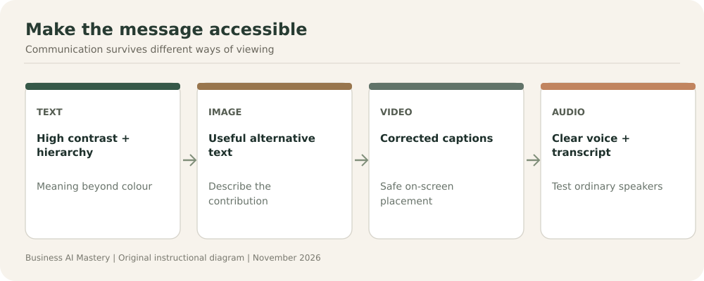
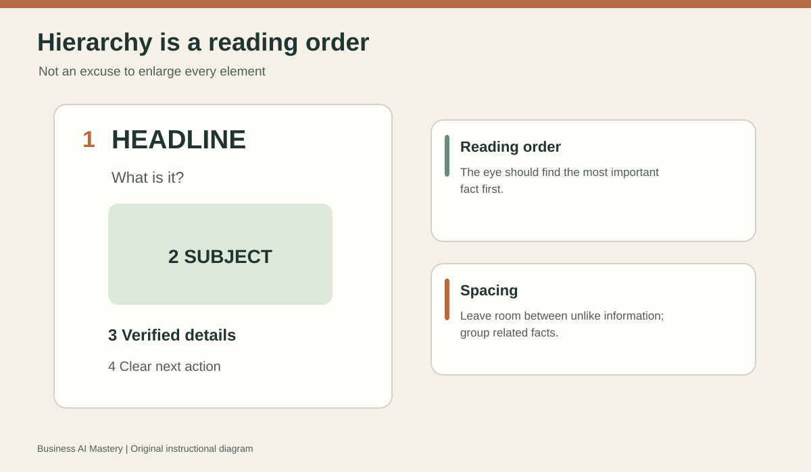

# Accessibility for posts, documents, images, audio and video

Accessibility is not a final decorative check. It influences the first design choices, the text, the media you capture and how a piece will be consumed. A person might read on a low-cost phone in sunlight, use text enlargement, watch without sound, or rely on captions. The job of the content creator is to make the essential information available without requiring one ideal device.

## Text and reading order

Use meaningful headings, ordinary words and a logical sequence. Keep each paragraph focused. In Markdown, use actual heading levels rather than simulated headings made of bold lines. Give links descriptive text, such as *Read the current returns policy*, instead of *click here*. Avoid depending on colour alone to distinguish an error or a price change.

WCAG 2.2 provides useful contrast guidance. For conventional web text, Level AA generally requires 4.5:1 contrast, or 3:1 for large text, with exceptions. A social poster is not necessarily a web page, but the underlying readability lesson applies. Test at phone size with the display brightness lower than your design monitor.

## Meaningful image alternatives

An alternative text description tells someone what the image contributes. *Photo* is not useful. *A brown ceramic mug with a wide curved handle, shown beside a ruler to demonstrate its height* may be useful when the image is specifically about dimensions. Do not stuff captions with keywords. A decorative background can have an empty alternative when it conveys no additional meaning and the platform supports that treatment.

For this repository, every substantive image should have descriptive Markdown alt text. Detailed teaching diagrams should also have a textual explanation nearby so the lesson remains usable even if the image does not render.

## Video captions and transcripts

Automatic captions are drafts. Listen to the audio while checking them, particularly names, numbers, local expressions and timing. Place captions where interface buttons will not cover them. Use readable line breaks and sufficient contrast. When meaningful events occur only visually, supply a description or appropriate audio explanation. For longer educational videos, publish a corrected transcript with speaker labels and time codes.

**Caption test:** Say aloud: *We open at nine on Saturday, the twenty-first.* If the automatic caption reads *We open at night on Saturday the 21st*, the message changes. Fix it before upload. Small errors in hours and amounts have large business consequences.

## Speech and audio

Narration should be clear without demanding specialist headphones. Balance music below dialogue and avoid a mix that destroys consonants. If a clip relies on music to communicate a warning or a result, add an equivalent text cue. Test through ordinary phone speakers. For translated narration, have a competent speaker review meaning and pronunciation.

## Accessible project assignment

Create one poster, one 20-second short video and a one-page product explanation for a fictional business. Provide heading hierarchy, legible colour, alt text, captions and a written transcript. Ask someone unfamiliar with the project to identify the item, one key detail and the next action using only the text and only the audio. Repair anything missing.

**Reference:** [WCAG 2.2](https://www.w3.org/TR/WCAG22/).

[Return to foundations](../README.md)
