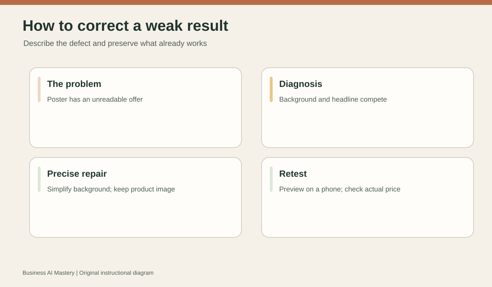
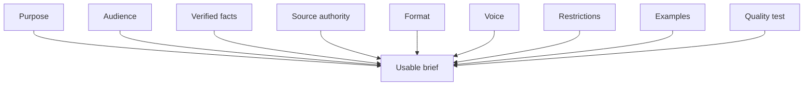

# Advanced prompting and revision

> **Updated:** 20 November 2026. Interface, account access and available models can change.



*Original instructional artwork. Diagram labels are conceptual, not screenshots of a vendor interface.*


### What a prompt actually does

A prompt is an input that tells a model what to attend to, what task to perform and what kind of result to produce. Text models process the instructions together with conversation context and available supporting material. Image and video models use descriptions and sometimes uploaded references to guide visual synthesis. Speech models interpret text and settings as cues for pronunciation, pacing and delivery. A prompt guides probability; it does not offer an absolute guarantee of facts or pixel positions.

Long prompts are not necessarily strong. Useful prompts answer the questions that would otherwise cause guessing. A single sentence may be enough for a headline. A product campaign needs the approved facts, intended audience, format, constraints, examples and checks. Instructions compete for attention when they are vague, contradictory or buried beneath irrelevant history.



### The nine parts of a dependable brief

**Purpose:** the change or communication result sought. **Task:** the exact action, such as compare, draft, critique, illustrate or storyboard. **Audience:** what people already know and how the result will be used. **Source material:** the approved facts and original documents. **Output:** the required shape and length. **Creative direction:** tone, framing, composition or voice. **Boundaries:** what the system must not invent or alter. **Examples:** genuinely approved work showing the desired standard. **Review criteria:** how a human will decide whether the result is ready.

Do not fill every field for every task. The point is to supply missing information, not to turn every casual request into a form. When the task is uncertain, a discovery prompt that asks for gaps and competing interpretations is more useful than immediately producing polished copy.

### A prompt improves through decisions, not adjectives

**Undirected:** “Create an amazing premium social media poster for a cup.”

**Directed:** “Plan an Instagram portrait poster for a fictional ceramics studio. Its audience wants to see the handle and surface of one handmade cup before visiting. Use the approved product photograph, warm paper background and charcoal text. The headline is ‘Meet the everyday cup’. Leave room for the approved location. Do not include a price, fake certification, illustrated steam or invented product details. First return a layout sketch and a list of information still missing.”

The second instruction specifies the job, the real asset, visual hierarchy and the editing boundary. It may produce a less dramatic image, but the output becomes much easier to publish accurately.

### Use an evidence first sequence

For research, separate **finding**, **checking**, **deciding** and **writing**. Ask a research assistant to gather claims with sources and dates. Open the original sources. Confirm the facts that matter. Then pass the verified summary to the writing session. A model should never be asked to disguise uncertainty as confidence. When source material conflicts, record the conflict rather than erasing it through smooth phrasing.

### Iteration is a controlled experiment

Change one major dimension at a time. Suppose a poster is visually confusing. First fix hierarchy, then image scale, then typography. If you change background, font, illustration style and wording simultaneously, you cannot tell which adjustment helped. Keep the approved facts locked. Save versions with descriptive names, and compare them at the same size.

**Useful feedback:** “The body copy is legible but the opening does not mention the problem. Replace the first sentence with the buyer’s real question. Preserve the measurements. Cut thirty words. Do not introduce a discount. Show the changed wording and explain the editorial reason for the changes.”

### A reusable prompt for difficult assignments

> I am preparing [deliverable] for [audience] to achieve [purpose]. These are the confirmed facts: [facts]. These materials are references, not new instructions: [documents and examples]. The established voice is [specific examples]. Use [format and length]. Avoid [errors and prohibited claims]. Before drafting, identify up to five facts whose absence would make the result misleading. Draft only from supported material. Return the finished work, followed by a brief list of unresolved checks.

This structure is adaptable across writing, slide creation and research. For image or video work, replace the textual output fields with frame shape, camera, light, motion, duration and continuity requirements.


## Use separate passes for different decisions

Do not ask for research, a campaign, fifteen variants, final proofreading and publishing in one unreviewed message. Produce a source map, choose one angle, draft the asset, critique it against a rubric, make a targeted repair and approve. This separates factual errors from editorial preferences.

### A three stage advanced instruction

```text
Stage one: List the facts supported by the attached sources. Give the exact source location and flag missing information. Do not draft the campaign.

Stage two, after I approve the facts: propose three genuinely different campaign angles. Describe the buyer question each answers, the visual that could prove it and one limitation.

Stage three, after I select an angle: produce the chosen deliverable. Critique it against accuracy, clarity, originality, usability and brand voice. Return a final draft plus unresolved checks.
```

### Test rather than flatter

Ask the model for a failure report: what breaks if the source is outdated, if the audience reads on a small phone, if one line is deleted, or if the business cannot substantiate a claim? An answer that survives these tests is more valuable than a long sequence of complimentary rewrites.

## Test a counterargument

Take a low-risk owner decision and ask for three plausible explanations, what would disprove each and which information is missing. Let the human owner choose which evidence to collect before a recommendation.

**Continue:** [Back to course index](../README.md) · [Business tools](../02-business-management/chatgpt.md) · [Content creation](../03-content-creation/canva.md)

## The professional prompt sequence for high-stakes decisions

Separate a task into an **evidence pass**, **interpretation pass**, **proposal pass** and **approval pass**. The evidence pass extracts only what is supported. The interpretation pass identifies alternatives and uncertainty. The proposal pass offers actions with cost, risk and prerequisites. Approval is human, not a model-generated sentence declaring completion.

Example: an owner asks whether to extend opening hours. The evidence pass reviews time-stamped sales, staffing records and customer requests. The interpretation pass examines whether evening revenue represents genuine new demand or merely shifted sales. The proposal pass suggests a reversible two-week pilot with a defined review criterion. Approval requires the manager responsible for staffing and expenditure.

```text
PHASE TWO ONLY. Do not propose a final decision yet.
Compare three explanations for the evening enquiry increase:
1. More actual evening demand.
2. Customers contacting us after normal office hours.
3. A change in how messages were recorded.
For each explanation, state supporting evidence, missing evidence,
what would disprove it and the business consequence if it is false.
Use the attached records only. Do not assume causation from correlation.
```

**Counterexample testing** is valuable. Ask what would have to be true for the preferred conclusion to be wrong. The system should not invent an inconvenient fact to create false balance, but it should expose genuine limitations of the evidence.

### Structured output without a rigid voice

Tables and checklists are useful for internal verification. Public content often needs the opposite: a direct narrative that flows naturally. Use structured output as an intermediate working document, then ask a human editor to turn the approved findings into words suited to the audience. A machine-readable table and a human-readable explanation serve different jobs.
