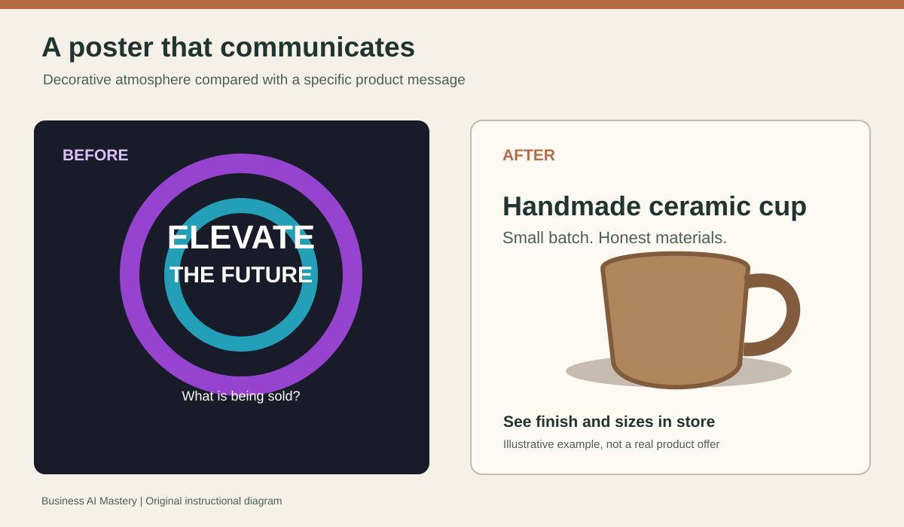

# Why generic generated content looks the same

> **Updated:** 20 November 2026. Interface, account access and available models can change.



*Original instructional artwork. Diagram labels are conceptual, not screenshots of a vendor interface.*


### The default visual is not a design strategy

When the instruction says only “make a modern professional advertisement”, there are almost no constraints on subject, audience, composition, brand or purpose. The generator often falls back on familiar examples from its learned visual and linguistic patterns. One common result features cyan and violet light, a glossy surface, floating particles, heavy gradients, excessive contrast and abstract rings. It looks energetic at first glance, yet provides little information about the actual product.

This is not because blue or violet is inherently poor design. A technology company may use either colour well. The failure occurs when the palette is chosen in place of an idea. A bakery, mechanic, school, salon and electronics shop should not all look like the same imaginary software company. Fashionable defaults become visual noise once an audience has seen them repeatedly.


### Twelve clues that deserve scrutiny

**1. Anonymous atmosphere.** Backgrounds carry mood but no evidence of location, materials, service or people. Replace invented scenery with relevant surroundings.

**2. Unmotivated light.** A subject glows along every edge, while no actual light source explains the effect. Decide where the key light is located and let shadows agree.

**3. Synthetic materials.** Skin resembles wax, fabric resembles plastic, wood has no grain variation or metal reflects impossible objects. Use close inspection at intended viewing size and compare against authentic examples.

**4. The perfect face.** Everyone has identical smooth skin, symmetrical expressions, flawless teeth and no physical detail. The issue is homogeneity, not whether a real person looks polished.

**5. Anatomical errors.** Fingers, teeth, ears, jewellery and limbs merge or change across frames. Inspect edges and contact points.

**6. Impossible product details.** A phone gains another lens, a bottle label changes, or a car emblem is invented. For commerce, use approved photographs of the real item.

**7. Decorative interface fragments.** Random graphs, fake statistics, meaningless icons and translucent panels make a design look elaborate without improving its meaning.

**8. Unreliable typography.** Letters change shape, labels are misspelled or text curves around objects unnaturally. Keep important words in editable typography rather than inside an image.

**9. Flat verbal voice.** Every caption uses the same generic enthusiasm and exaggerated benefits. Supply a real question, concrete details and the way the organisation actually speaks.

**10. Identical rhythm.** Sentences all have similar length; every short video follows the same loud hook, jump zoom and call to action. Vary pacing in response to what the viewer needs.

**11. Overdesigned finishing.** Glow, motion blur, fake film grain, sharpened edges and aggressive colour shifts appear together. Remove effects one by one until each remaining choice has a function.

**12. Untrue authenticity.** A synthetic person appears to be a satisfied buyer, a fabricated quote looks like a review, or a generated crowd resembles an actual event. This is not humanisation; it is misrepresentation.

### The four tests for a serious design

Ask whether the result belongs to this subject, whether a person can find the main information immediately, whether the depicted world obeys physical logic, and whether the content can be defended as true. If a design fails the first two, better rendering will rarely rescue it. If it fails the last two, it should not be published in its present form.

**Practical repair:** remove the background entirely and put the real product on plain paper. Identify the strongest visual fact. Add only the environment, crop or light that makes the fact easier to understand. This exercise produces distinctive work surprisingly often because it replaces an ornamental style with editorial selection.


### The actual problem behind familiar outputs

People often receive similar looking content because they ask for the same broad words: “premium”, “modern”, “cinematic”, “viral”, “professional”. Generators fill in the missing choices using familiar patterns. Creative marketplaces also encourage copying whatever currently gets clicks. The result can be a flood of blue and purple glows, black metallic surfaces, geometric rings, floating symbols, dramatic lens flare, perfectly smooth skin and shouting headlines. These are not universal signs that a particular asset was generated. They are signs that the art direction has been left to a template.


A strong brief does not say merely “no neon”. It names what belongs in the scene: the actual object's dimensions, the available light, real materials, useful cropping and a purpose for the image. If the real location has chipped paint and morning window light, those details offer more identity than another universal gradient. The real customer's question often provides a better headline than a list of superlatives.

### Text flags and why they fail

Watch for openings that say nothing about the situation: “In today's changing world”, “Unlock the future”, “Transform your journey”. Look for claims without a source, repeated claims expressed as three synonyms, paragraphs of identical length, forced transitions, generic praise and endings that say only “Take the next step”. Ask who is speaking, what they know, and what question they are answering. Make the first sentence useful.

### Image flags and why they fail

Check too perfect reflections, skin without texture, nonsensical product labels, changing hardware, impossible shadows, decorative objects that add nothing, random symmetry, identical camera distance across a campaign, and contrast so aggressive that text becomes unreadable. Correct physical truth before polishing colour. A visible product photograph often matters more than a stylish background.

### Video and sound flags

Generated movement may create hand changes, objects that melt between frames, unnatural acceleration, drifting faces, unstable text and cuts with no narrative reason. Synthetic narration can sound too smooth, push emotional stress into irrelevant words or mispronounce names. Treat those as editing defects to fix with stronger source footage, shorter shots, slower timing, clear phonetics or a real recorded voice.

### The humanisation process

Humanising a draft means bringing it closer to a particular reader's actual situation and to facts that can be supported. It does not mean hiding required disclosure, impersonating a real person, fabricating a review or pretending synthetic media documents an event. Edit in this order: truth, relevance, angle, rhythm, visual restraint, usefulness, final sign off. A specific, modest statement is often more persuasive than a dramatic promise.

> Weak: “Experience a game changing collection designed to elevate every moment.” Better: “Hold the three cups in store and compare their handles before choosing.” The revised line is useful only if the business genuinely permits in store comparison.


## Template gravity

When a prompt provides only atmosphere such as “premium, futuristic, powerful”, a generator often supplies highly familiar visual conventions. Purple and cyan gradients, perfect glass surfaces, floating rings, dramatic halos and fake interface graphics become interchangeable. The problem is not the colours. It is the absence of a visual argument.

### What to change

Replace abstract mood words with useful nouns and relationships: actual shop counter, real display surface, window direction, product size, the customer’s eye line and an intelligible headline. For copy, replace brand self praise with a verified detail or common question. For video, remove transitions that hide the demonstration. For audio, use everyday speaking rhythm rather than a sales performance.

### An honest warning

There is no reliable visual or written checklist that proves a work was generated by a model. These are quality flags, not an attribution test. Do not erase provenance metadata or required disclosures to conceal synthetic scenes.

## Identify visual sameness

Collect three illustrative poster concepts. Hide their brand names. Describe the repeated visual shortcuts, then create one purposeful alternative with authentic product evidence and legible type.

**Continue:** [Back to course index](../README.md) · [Business tools](../02-business-management/chatgpt.md) · [Content creation](../03-content-creation/canva.md)

## Why so many projects end up with the same visual treatment

The recurring combination of cyan and purple gradients, glowing outlines, spotless faces, chrome surfaces and floating particles has several causes. The initial prompt often contains vague words such as *futuristic*, *premium* and *high impact*. Popular training images and online examples reinforce familiar visual shortcuts. Design templates make it easy to repeat a layout. Creators may also judge the image at full screen instead of evaluating whether a customer can understand its message at phone size.

**Diagnostic method:** put five competing generated posters side by side and hide the brand names. Can a reader tell which organisation each belongs to? If not, the work lacks distinctive evidence. Check subject, palette, typography, composition, lighting and the one specific customer concern it addresses. A stronger design may use a genuine shop photograph, a plain background, a measured detail and one strong sentence.

### Repair the visual prompt

```text
Create a calm editorial product scene, not a technology demonstration.
Actual product photo controls shape and branding. Warm cream plaster
wall, ordinary wooden table, broad soft window light, natural shadows,
and a slightly imperfect folded cloth. Composition: single dominant
subject on the right, quiet left third for a headline. No electric
blue or purple gradients, rim glows, holograms, floating products,
chrome spheres, fake ratings, invented text or synthetic models.
```

**But a ban list is not enough.** If a product genuinely belongs in a technology setting, neon colours may be appropriate. Ask whether the treatment communicates its actual purpose. A school timetable, food offer and medical appointment notice should not all look like science-fiction film posters.

### Evaluate by reader outcome

Ask a viewer to identify the item, the important detail, the next step and whether they would trust the claim. A spectacular image that confuses those answers is weak marketing. The right improvement might be a real photograph, a smaller illustration, fewer effects or simply more readable text.
