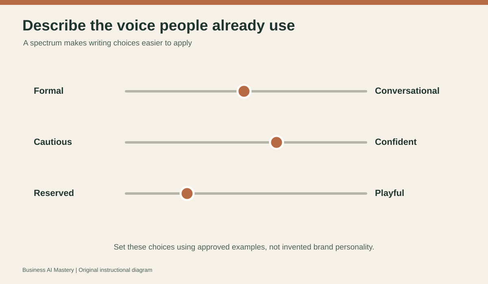

# Build a distinctive brand voice and visual system



A brand voice is not a list of abstract adjectives such as *innovative, bold and authentic*. It is a collection of repeatable editorial decisions: which customer questions matter, how claims are evidenced, how formal the company sounds, where humour belongs and which phrases the team would never actually use.

## Extract the voice from genuine material

Collect three approved pieces of copy, a staff explanation and several genuine customer questions. Do not use generated examples as proof of how the business already communicates. Mark patterns in sentence length, vocabulary, formality, directness, technical detail and how the company handles uncertainty. Distinguish stable features from one individual's writing habits.

| Dimension | Evidence to examine | Practical rule |
| --- | --- | --- |
| Opening | How staff start useful explanations | Begin with a real customer question or useful fact |
| Detail | Terms and facts customers need | Prefer verified examples to vague praise |
| Humour | Actual approved communications | Use sparingly and never for complaints or safety |
| Promise | Contracts and service standards | Do not suggest guarantees that are not confirmed |
| Rhythm | Genuine staff and brand writing | Vary length according to meaning |
| Local context | Actual customer language | Use naturally without forced dialect |

## A brand system for images

Write rules for photography based on subject, light, camera height, framing, backgrounds and acceptable editing. A warm food brand may use real daylight and close observation of textures; a legal practice may need calm portraits, careful data charts and straightforward layouts. These are creative decisions, not universal brand prescriptions.

Keep colour values and typography in a controlled reference file. Record what must remain consistent: logo safe space, headline style, margin grid, CTA treatment and photography values. Allow the composition to change with the purpose. A five-slide educational carousel should not be five copies of the same decorative header with different text.

## Example voice translation

Generic: *We strive to elevate your customer journey with seamless solutions.*

Possible grounded rewrite for a fictional repair service: *Bring the faulty charger and the device it was used with. We will check the connection before recommending a replacement.* Only use this claim when it matches actual practice.

```text
Study the five approved brand examples and the current service rules.
Describe the voice using observable evidence, with short quoted phrases
only where necessary. Write five guidelines that a new employee could
follow. Then rewrite the supplied promotional paragraph and explain
which guidelines informed the change. Do not imitate another company
or invent product promises.
```

## Consistency without creative stagnation

Build two or three layout families and vary the image, story and reading order according to the topic. Track what gets recognised in audience testing. If every post starts with the same headline, stock photograph and three icons, the identity has become a template rather than a meaningful system.

[Return to foundations](../README.md)
