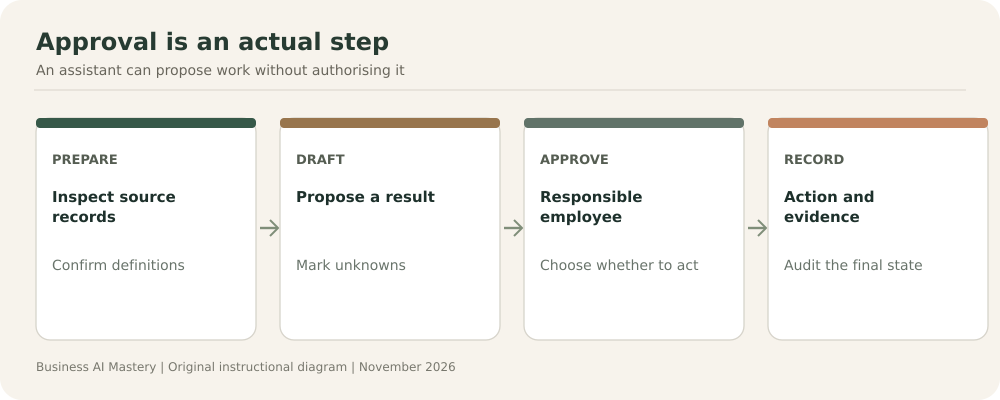

# Choosing tools by business need

> **Updated:** 20 November 2026. Interface, account access and available models can change.

*Original instructional artwork. Diagram labels are conceptual, not screenshots of a vendor interface.*

### Decide from the business job, not the model leaderboard

A business owner usually has five urgent jobs: see the financial position clearly; understand customers and sales; keep work and people organised; show products truthfully; and decide what to improve. Assign each job to the system that already holds the authoritative data. If accounts live in QuickBooks, begin there rather than asking an unrelated chatbot to guess. If customer history lives in HubSpot, clean that history before drafting personal messages. If a product needs to be shown, a phone camera is often more truthful than a perfect synthetic rendering.

### Your first technology stack

Start with one trusted reasoning assistant, the actual accounting or commerce system, one task or customer system if needed, an editable design program, a video editor, and a source archive. Introduce automation only once staff can describe the process it should perform. Measure the results before adding another subscription.

### Never confuse model access with application access

An API announcement is not a promise that a model appears in every consumer app. A feature may depend on organisation plan, region, moderation, usage credits or device. Some services silently select a model for a task. The manual uses the names verified by their official providers on the stated research date, but the selection instructions refer to the current interface rather than a guessed button.

Spend the first week making ten briefs, fact sheets and edited captions from different genuine subjects. The second week is for visual hierarchy: create three quiet posters using real or properly licensed photographs and analyse them at phone size. In the third week, shoot two twenty second videos, edit their sound and captions, and make one carefully controlled generated scene for comparison. Use the last week to build a narrated tutorial, a short educational carousel, a complete campaign package and an evidence based review.

Each day should end with a small tangible result and a note explaining one creative choice. At the end of the month, select work that demonstrates your ability to make decisions, correct errors and deliver files. A portfolio with three well documented projects is more persuasive than a gallery of fifty interchangeable effects.

## Start with the system of record

A cash problem calls for clean accounting records. A repeat support problem calls for a current knowledge base and a human escalation route. A design problem calls for a clearer brief, approved assets and composition skill. Buying several general assistants before fixing basic business records will not solve those problems.

### A simple trial scorecard

| Question | Score 0 to 2 |
| --- | --- |
| Does it solve a recurring business task? | 0 to 2 |
| Can staff verify the result from source records? | 0 to 2 |
| Is the output editable and transferable? | 0 to 2 |
| Are permissions and costs manageable? | 0 to 2 |
| Did the trial actually save review time? | 0 to 2 |

A result of ten points is not proof of value, but the questions expose hidden costs. Repeat the trial with a real but suitably protected workflow. Keep a before and after time measurement, count errors and cancel tools that complicate the work.

## Run a ten-case pilot

Choose a low-risk recurring job, record how long it currently takes and test ten representative cases with a new tool. Include human review time, errors and saved effort. Adopt the workflow only if the evidence supports doing so.

**Continue:** [Back to course index](../README.md) · [Business tools](../02-business-management/chatgpt.md) · [Content creation](../03-content-creation/canva.md)

## Choose work by value, not model popularity

Start with an inventory of recurring jobs: end-of-day reports, customer replies, monthly accounts, stock reviews, staff handovers, product photographs and marketing posts. Score each on frequency, current time, error cost, data readiness, customer impact and privacy sensitivity. Begin with a frequent, low-risk job that already has a known human review process.

**Illustrative prioritisation:** Drafting a weekly meeting agenda may take 30 minutes and carry low direct risk. Approving a refund may take two minutes but involves customer rights and cash. The first is a better early pilot even if it appears less glamorous. Productivity claims should be measured from actual before and after work, not assumed from a vendor demo.

### Pilot plan

Define the baseline before changing tools. Record the original cycle time, error rate and review cost. Run ten representative cases, including difficult ones. Track minutes saved after human correction, number of factual errors, staff satisfaction and any escalation. If review consumes all the saved time, improve the source or retire the automation.

The owner should also know the monthly spend, plan limits, export options, data retention terms and who can disable the tool. A workflow is not adopted merely because it produces one impressive response in a demonstration.
