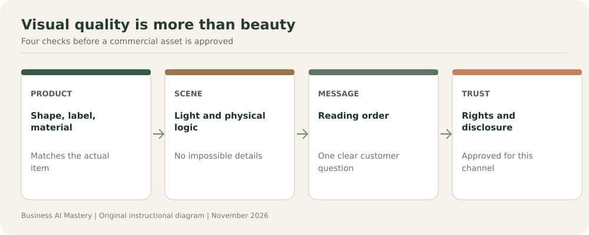

# Camera, lighting, materials and visual language




Many weak visual prompts describe an emotion but not a physical scene. Terms such as *epic*, *high end* and *cinematic* do not specify where the camera stands, where light comes from or whether the subject looks believable. Learn the essentials of visual direction, then translate them into prompts or into ordinary camera work.

## Start with the customer question

A product photograph can prove shape, scale, texture or use. Those are different jobs. A full product frame establishes appearance. A close-up shows stitching or material. A comparison frame helps a buyer understand size. A lifestyle scene suggests context but may be less precise about actual dimensions. Decide what the image should prove before choosing the framing.

## Light explains the physical world

A single window creates a recognisable shadow direction. Soft light wraps gradually around surfaces; hard light creates sharper transitions. Materials respond differently: matte ceramic diffuses reflections, glass reflects its surroundings, metal shows bright highlights and fabric reveals its weave at an angle. If an image tool applies the same glossy shine to all surfaces, the scene becomes artificial.

**Lighting exercise:** photograph a mug near a window at three angles. Compare where shadows fall and how the handle silhouette changes. Then prompt an image model to reproduce the light direction using the original photograph. If the handle or logo changes, keep the genuine image and edit only the environment.

## Camera vocabulary that improves prompts

| Term | What it changes | Appropriate use |
| --- | --- | --- |
| Eye-level view | Makes the viewer face the item naturally | Product hero or person talking |
| Overhead view | Shows arrangement and relationships | Flat-lay ingredients or craft tools |
| Close-up | Directs attention to a small feature | Material, stitching, control |
| Wide view | Includes environment and context | Shop interior or process |
| Locked camera | Keeps composition stable over time | Truthful demonstration |
| Slow lateral move | Reveals modest depth | Atmospheric video insert |

Avoid specifying technical lens numbers unless they serve a real reason. An equivalent description such as *normal perspective without exaggerated wide-angle distortion* often communicates what a beginner needs.

## Edit for credibility

First correct framing, exposure and white balance. Then remove distracting elements only when they are irrelevant and removal does not mislead. Keep natural texture. Do not add extreme skin smoothing, imaginary product components or extra camera buttons that the item lacks. Save the original photograph alongside the edited version for comparison.

### Practical prompt

```text
Plan a three-image set for the exact mug in the attached photograph.
Frame 1: eye-level full view. Frame 2: close view of rim and glaze.
Frame 3: beside a ruler for scale. All frames use the same daylight
window from camera left, cream background and believable shadows.
Do not change the actual mug's handle, mark, size or glaze. State which
views should be photographed rather than generated for accuracy.
```

[Return to foundations](../README.md)
