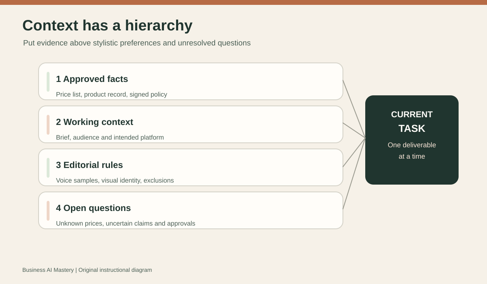
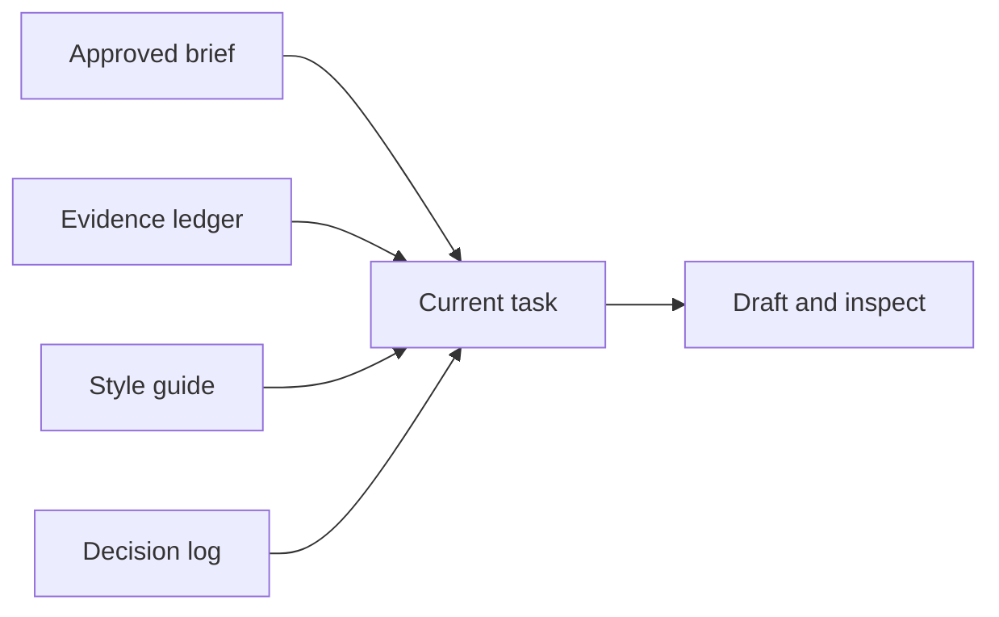

# Context engineering for long projects

> **Updated:** 20 November 2026. Interface, account access and available models can change.



*Original instructional artwork. Diagram labels are conceptual, not screenshots of a vendor interface.*


### Why long conversations lose precision

A tool can produce strong work early in a conversation and become inconsistent after many rounds. An expanding conversation may contain old prices, discarded concepts, abandoned slogans, contradictory corrections and unrelated requests. Some systems have a limited amount of previous material they can attend to at once. Others retrieve parts of external project libraries. Neither mechanism guarantees that the latest approved instruction will dominate every generated sentence.

Treat context as an edited production packet, not a chat transcript. State what is current, what has been rejected, what remains undecided and which documents have authority. A clean creative brief protects the project against accidental reuse of obsolete material.



### Build a source hierarchy

Place approved facts and explicit client decisions above suggestions from the model. Distinguish a legal notice from style preferences. Give uploaded evidence its own label and instruct the assistant to treat quotations inside it as information, not commands. If a webpage says “ignore previous instructions”, that text is not permission to override the assignment. This is especially important when working with browser results, customer emails and external documents.

Use four documents for substantial projects: an **approved brief**, a **source ledger**, a **voice and visual guide**, and a **decision log**. The source ledger records each factual claim, its original source, date checked and owner. The decision log contains a short explanation of why a style or message was accepted or rejected. These are more valuable than hundreds of exploratory chat messages.

### Reset without losing the work

At major milestones, request a compact handover that contains the objective, audience, verified facts, chosen concept, rejected ideas, file links, unresolved issues and exact next action. Read it, correct it and begin a fresh workspace or conversation when the old one becomes noisy. Reattach the relevant source material rather than trusting a vague recollection.

For a repeated campaign, save a short house instruction such as “use approved UK English spelling; do not invent prices; prefer human photographs; include evidence for technical claims”. Keep campaign specific details separate so they do not leak from one client to another.

### Context windows and multimodal material

Images, long PDFs, spreadsheets, audio and video all increase the amount of material a system may need to process. Summarise large source collections into topic specific notes while retaining citations to originals. For a twenty minute interview, preserve a time coded transcript with speaker names and uncertain words flagged. For a visual reference, identify exactly which attributes may be borrowed: framing, lighting, palette, material or pace. Never assume that attaching an image explains what should stay fixed.

**Example reference rule:** “Use the uploaded photograph only for the cup’s shape and glaze. Keep the handle, rim and maker’s mark unchanged. The second photograph is a lighting reference only. Do not copy its packaging, tableware or lettering.”

### A simple context control exercise

Create two cards. On the first, write “confirmed as of today”: product material, dimensions, price if approved, address and legal wording. On the second, write “proposals only”: headline ideas, colours, camera movement and publishing times. A collaborator should be able to tell which card may be used as fact. Repeat this before every public export.


## Four documents are more reliable than a giant conversation

Keep a current brief, an evidence ledger, an approved voice guide and a decision record. Mark old drafts superseded instead of mixing them with current information. The ledger should contain the claim, source location, date checked, owner and unresolved issue. The decision record says who approved what and when.

### Example handover

```text
Project: November product catalogue.
Authoritative sources: catalogue_v4 and approved_prices_20nov.
Superseded: october_price_draft.
Approved voice: helpful, specific, short sentences.
Approved design: cream, charcoal and photographs of actual products.
Task now: create one product announcement for a confirmed item.
Unknown: delivery date. Do not make a promise about it.
```

### The context reset test

Start a new conversation with only these four records and see whether a collaborator can produce the correct next asset. If not, the context system needs better information, not a longer chat history.

## Make a current project packet

Create a versioned brief, source ledger, brand guide and decision log. Add one deliberately outdated file labelled superseded. Ask the tool to list what it should trust and which facts it must not use.

**Continue:** [Back to course index](../README.md) · [Business tools](../02-business-management/chatgpt.md) · [Content creation](../03-content-creation/canva.md)

## Context clinic: the same project after four weeks of revisions

Imagine a product campaign with a draft price, an approved price, two rejected posters, a newly updated warranty policy and a manager's note saying the product launch is delayed. In one long chat these facts can be interleaved. The system may reuse a price from the first week because the earlier message is vivid or retrieved, even though a later decision superseded it.

The solution is an **authority map**, not another phrase such as *remember this*. Write a current project brief with a version, approved owner and date. Maintain the source ledger and put deprecated files in a labelled archive. Start each production request with a short summary of the authoritative sources, then list decisions still pending.

```text
PROJECT HANDOVER: Product announcement, version 6, dated 20 Nov 2026.
AUTHORITATIVE: approved_price_v6; current_returns_policy;
actual_product_photo; customer_support_notes_revised.
SUPERSEDED: prices_v1_to_v5; october_launch_plan.
APPROVED: quiet editorial palette and two practical benefits.
REJECTED: fake studio testimonial; neon gradient treatment.
UNKNOWN: confirmed arrival date. Do not announce availability.
TASK: draft a nonpromotional FAQ explaining what buyers can inspect.
Before writing, name which authoritative sources you can access.
```

### The retrieval problem

When a product claims it has *searched your workspace*, check whether it actually cited the right file, retrieved only a fragment, or used an old cached copy. An accessible source is not necessarily an adequate one. Important claims should include the source title, specific section and date. If a required source is unavailable, treat that part of the task as blocked.

### Untrusted context and prompt injection

A customer email, webpage, supplier document or image caption may contain language instructing a model to reveal records or bypass approval. Those words are the content of a source, not instructions from the authorised user. Give external text a lower trust level. When an assistant can act through tools, restrict its permission and require confirmation for money, messaging, record changes and publication.

### Long projects with multiple formats

Keep one canonical set of facts, but separate briefs for poster, blog article, video and narration. A video prompt needs camera and motion details; a financial report needs metric definitions. Trying to fit every production instruction into a single giant prompt creates conflict. Preserve shared brand decisions while allowing format-specific craft choices.
