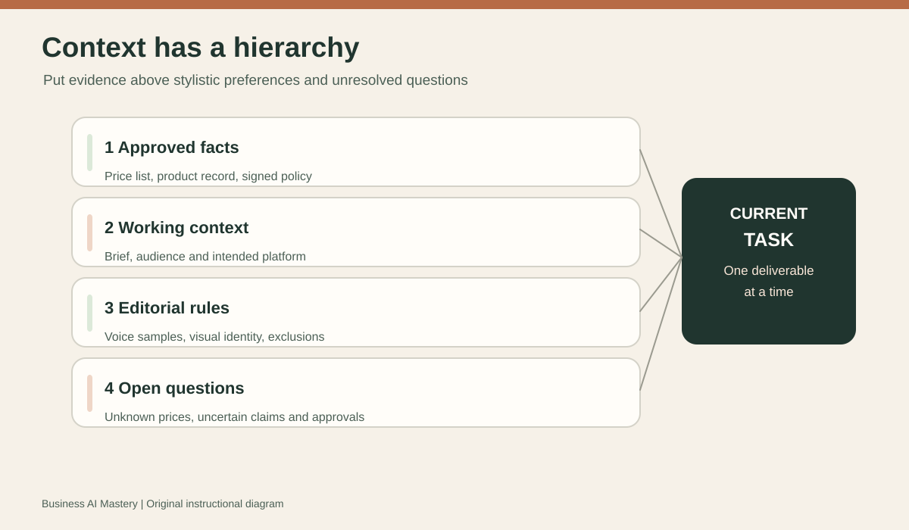

# Models, applications and subscriptions

> **Updated:** 20 November 2026. Interface, account access and available models can change.

*Original instructional artwork. Diagram labels are conceptual, not screenshots of a vendor interface.*

### Tool choice follows the deliverable

For a researched explainer, begin with sources and an assistant that shows evidence. For a short commercial poster, an editable layout tool is more important than an image model. For an actual product video, a phone and capable editor may produce better and cheaper material than synthetic footage. For long narration, consistency and pronunciation controls matter more than theatrical voice quality. For a technical presentation, inspect editable slides and underlying figures, not just the finished look.

The same application can offer different models. A fast model is appropriate for early caption variations or simple restructuring. A more deliberate reasoning mode may help with multi document synthesis, ambiguity and technical decisions. An image model should be judged by control and editability in the particular subject. A video model should be judged by motion continuity, reference handling and the ability to create a usable shot. A voice model should be judged with the actual language and names the speaker must say.

### Current model notes for November 2026

The official ChatGPT model guide describes GPT 6 with selectable thinking effort on eligible plans, alongside other supported model options. Anthropic documents the Claude Opus, Sonnet and Haiku families with current variants, including its newer 5 series. Gemini’s own help describes automatic routing and plan dependent manual selection. Runway documents Gen 4.5 for text and image guided video. Pika documents its own video tools, including keyframe based transitions. Ideogram documents Studio and reference driven image work. ElevenLabs documents voice settings and current speech models. Product names and availability can change independently of the skill taught here. [1] [2] [3] [4] [5] [6] [7]

The next section treats every application named in the original Markdown, including editing, publishing, research and cloud storage tools. It does not pretend that an ordinary video editor or file store is itself a generative model.

## A simple mental model

A model turns input into generated output. An application adds a workspace, access controls, editing tools, connections, storage and sometimes actions. An image generation model might produce a picture; an editor decides how it is cropped, labelled, licensed and delivered. A business assistant might explain a workbook; the accounting application owns the recorded transactions.

### Selection exercise

For each proposed subscription, answer: Where does its input come from? What kind of output can it create? Can the output be edited? Can someone review its sources? Which actions can it perform? What happens to private files? Check the plan before assuming that a model name seen in a technical release is visible in the interface you use.

### Worked contrast

A model may produce the sentence “Customers ordered fewer lamps last month.” A CRM or commerce system can show customer orders. A spreadsheet can calculate the change. The model should join those facts into a useful explanation only after the records are supplied. Different systems share responsibility; they do not share the same authority.

## Try a controlled model comparison

Give two tools the same fictional product facts and the same audience question. Compare supported facts, useful detail, missing information and editing effort. Do not award a winner because the wording sounds more sophisticated.

**Continue:** [Back to course index](../README.md) · [Business tools](../02-business-management/chatgpt.md) · [Content creation](../03-content-creation/canva.md)

## Why the same prompt can yield different results

Text generation predicts sequences conditioned on the prompt and other available context. Output can vary because models are probabilistic, settings differ, retrieval returns different evidence, a tool runs or fails, or the conversation contains different earlier messages. Image and video systems additionally infer plausible pixels and movements that were never explicitly supplied. They may choose different lighting, backgrounds and object details even when the words appear identical.

This explains two practical lessons. First, reproducibility requires saving the exact input, model or product version where visible, date, reference assets, settings and selected output. Second, a confident response is not proof. If an invoice number is missing, a system may complete a narrative convincingly while having no authority to supply the number.

**Decision experiment:** send a fixed product brief through two different available models. Ask for five customer questions, not a sales caption. Mark which questions have evidence, which need more research and which repeat the same idea. Compare the lists against genuine enquiries. The better model is the one that improves a real decision with your evidence, not simply the one with the most articulate prose.

An API model and an application feature are different things. A model's launch announcement does not guarantee that it is selectable in a consumer application, available in a certain region, covered by a subscription or permitted to use a particular company file. Teach the learner to verify the product workflow first.
