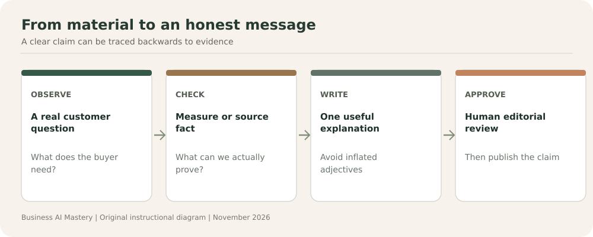
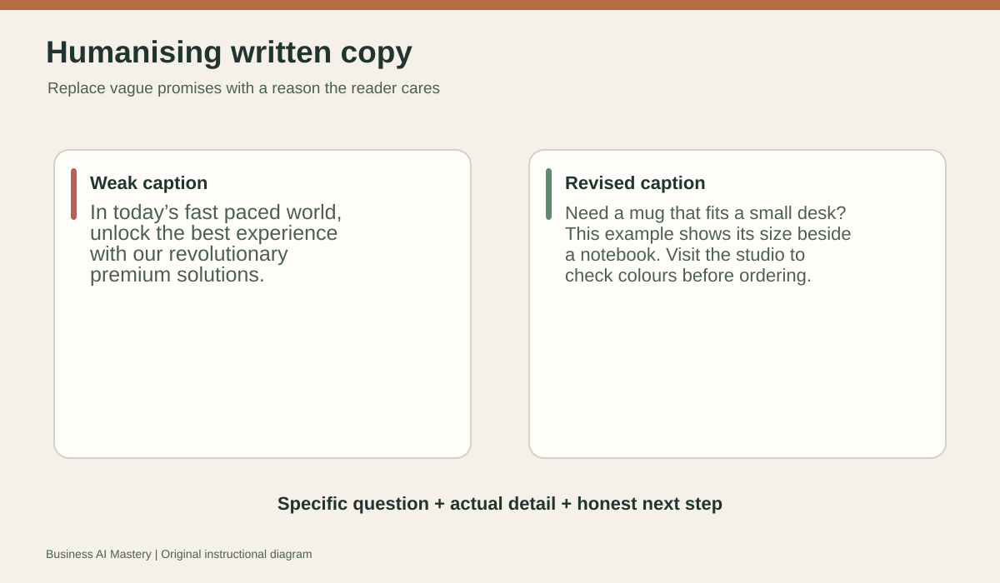

# Humanisation as editorial judgement




> **Updated:** 20 November 2026. Interface, account access and available models can change.



*Original instructional artwork. Diagram labels are conceptual, not screenshots of a vendor interface.*


### Humanisation begins before the rewrite

Natural writing is not created by sprinkling jokes, informal spelling or regional slang on a generic paragraph. It grows from genuine knowledge of the subject and a deliberate editorial position. A knowledgeable shop owner might describe how a customer can compare two products. A teacher might explain the point where pupils usually get confused. A technician might name the sound that signals a fault. Those details make communication recognisable.

Do not pretend to have personally tested a product when no one has. Do not invent a buyer who loved it. Use scenarios, clearly labelled as examples, when a real incident is unavailable. Local language can give a campaign character, but forced dialect makes it sound theatrical and may misrepresent the people addressed.

### An editorial repair clinic

The model writes: “Discover our innovative solutions designed to elevate your lifestyle and provide unmatched quality.” A human editor asks what is being sold and what the buyer can inspect. For the fictional cup studio, the revision might be: “The handle is wide enough to grip comfortably. See the glaze and size in the photographs, then visit the studio to feel the weight.” The second version still requires confirmation of any product claims. It earns its place through specificity rather than enthusiasm.


### Rhythm, texture and confidence

Read finished copy aloud. Short sentences can carry an important fact. A longer sentence can explain a choice or a condition. Repeated sentence shapes make writing predictable, especially when every paragraph begins with a promise, follows with three benefits and closes with an invitation. Vary structure because the meaning changes, not merely to appear spontaneous.

Control adjectives. “Beautiful”, “amazing”, “revolutionary” and “premium” rarely prove anything by themselves. Show a material, a measured dimension, a process, a verified result or a relevant limitation. Writers gain authority by acknowledging what they do not know.

### The five pass edit

**Accuracy pass:** names, dates, numbers, source attribution and the difference between claims and examples. **Purpose pass:** every paragraph earns its place. **Voice pass:** it sounds like the actual speaker or organisation. **Rhythm pass:** read aloud and remove repeated openings or transitions. **Delivery pass:** the text fits the screen, platform and available attention.

Use direct questions when helpful: What would I ask before spending my own money? Which detail would make me trust the account? What might I misunderstand? A good caption does not need to contain every answer. It needs to give the reader a useful next step.

### Prompt for an editorial revision

> Here is a first draft and the approved factual sheet. Improve the draft as a careful editor, not as a promoter. Keep every supported fact and remove unsupported claims. Replace vague assertions with meaningful details only when the sheet supports them. Use the supplied brand examples for vocabulary and sentence rhythm. Do not invent experience, customer reactions or urgency. Return the edited copy and a short account of the three most important changes.


## Natural does not mean informal

Humanisation means a real person has selected relevant details, written for a specific reader, removed unsupported claims and made choices about rhythm and emphasis. Slang and fake intimacy are poor substitutes for knowledge. There is no universal list of forbidden words; a phrase is weak when it adds nothing.

### Repair a draft in four passes

Read for truth first. Then read for usefulness, asking what question the reader has. Next read aloud for rhythm. Finally test the physical format: a caption on a phone, a poster at a distance or a voiceover through a small speaker.

**Weak:** “Unlock a seamless, revolutionary experience with our world class range.”

**Stronger for the fictional shop:** “Not sure which storage size you need? Tell us how you use your phone and we can show you the models currently available.”

Do not fabricate personal anecdotes or testimonials to make the second version sound lived in. If no genuine evidence exists, write directly and honestly instead.

## Edit from genuine observation

Gather one genuine customer question and an approved product fact. Write a caption without superlatives. Compare it with a generic promotional draft and explain which real detail improved it.

**Continue:** [Back to course index](../README.md) · [Business tools](../02-business-management/chatgpt.md) · [Content creation](../03-content-creation/canva.md)

## Editorial workshop: how to make writing sound observed rather than generated

A human voice begins with observation and a reason to communicate. Gather real questions from customers, a founder's rough explanation, a photograph of the actual product, and one genuine limitation or trade-off. Do not ask the assistant to fabricate a personal memory. Ask it to organise genuine material so the reader can see the useful detail.

**Three drafts from the same facts.** Fictional fact: a basket comes in two measured sizes and is available for inspection at a shop. Generic draft: *Elevate your home with our beautiful basket collection.* Informative draft: *The two basket sizes are shown side by side in the photos. You can compare their measurements before visiting.* More personal, if supported by a genuine staff observation: *People often ask whether the small basket fits a shelf. We have photographed both sizes beside a ruler so you can judge before you come.* The last claim must be confirmed by staff; otherwise prefer the informative draft.

### The sentence audit

Read every sentence and ask: **Who would know this? How could they know? Does it help the reader?** If the sentence answers none of those questions, delete it or rewrite it. Replace unsupported praise with physical evidence. Change *seamless service* into the real steps of the service. Instead of demanding a 'human tone', supply three approved paragraphs from the business and ask which features of those examples are distinctive.

```text
Edit the following draft for clarity and lived-in specificity, using
only the factual notes that follow it. Identify vague praise, repeated
ideas, invented emotional reactions and phrases no staff member would
normally say. Keep the company's natural level of formality. Do not
add a story, slang, dialect, customer quote or claim not present in
our notes. Return the edited version, then a two-column explanation
showing exactly which sentence changed and why.
```

### Humanisation beyond words

For photographs, authenticity requires credible scale, materials and light. For video, it requires purposeful action, natural pacing and truthful representation of people. For voice, it requires speech that fits the situation, pronunciation and realistic pauses. For design, it requires restraint and legible hierarchy rather than decorative sameness. Humanisation does not cancel a duty to disclose synthetic media where required.
