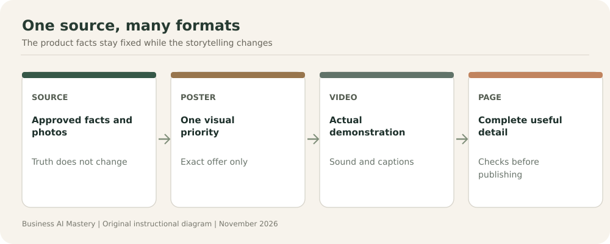
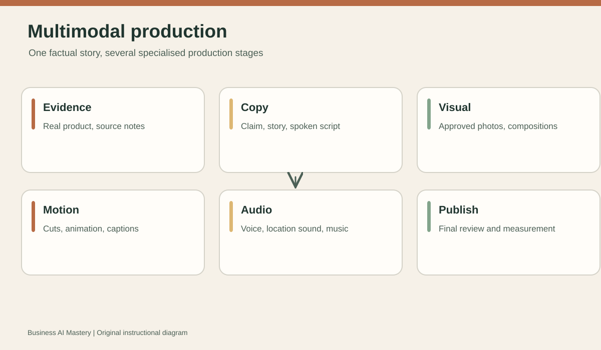
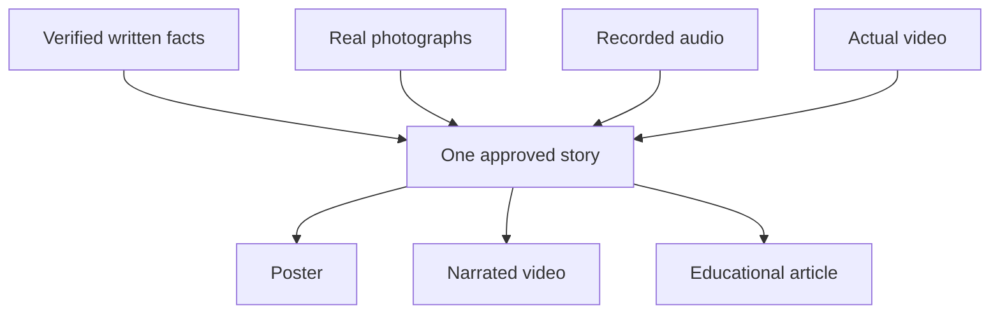

# One story across text, images, voice and video




> **Updated:** 20 November 2026. Interface, account access and available models can change.



*Original instructional artwork. Diagram labels are conceptual, not screenshots of a vendor interface.*


### Multimodal does not mean putting everything into one prompt

Text, photographs, sound, video, tables and source documents carry different kinds of information. The most reliable workflow gives each component a clear role and a deliberate handover. An image reference might define a product’s shape; a script defines the claim; an audio recording establishes the speaker’s pronunciation; a spreadsheet contains current prices. Treating these as interchangeable increases errors.



### Create an asset ledger

For each source file record the owner, date, permission, purpose, version and where it is used. Label a real photograph differently from a concept render. Mark captions that have been checked against audio. Preserve editable source files such as a project timeline or layered design. Saving only a compressed video is not an adequate archive if a contact number later changes.

### A controlled handoff

First a research workspace creates a verified fact sheet. A writing assistant turns that sheet into a short script. A director converts the script into a storyboard of four shots. A video tool produces only the illustrative shot that cannot be filmed. The human editor assembles footage in an editing application. A narration tool handles the spoken text. Captions are checked manually. A designer adapts the message into a poster and carousel without changing the facts. A publisher schedules the approved pieces, and an analyst reviews results against the initial goal.

### Continuity across a series

Maintain a shared description of recurring objects, character appearance when properly authorised, wardrobe, screen orientation, light direction and camera treatment. Use the same approved photographs where exact product identity matters. Match colour across shots in the editor rather than demanding that unrelated generators somehow produce the same grade. Keep a short glossary for brand names, units and technical terms.


### Think in evidence layers

A written source can define the actual product name and verified specifications. A real photo proves visible appearance at a moment in time. A recording can show an actual movement. An authorised voice recording provides genuine delivery. A generated scene may illustrate an idea but cannot prove a claimed real event. When working across media, state which source controls which truth.


### Building a voiced video from a product brief

Start with the product facts and the audience's question. Write a spoken answer before planning visual effects. Break the answer into natural beats. For each beat choose a real shot, a clearly labelled illustration or simple on screen text. Record the voice, or generate it with a permitted synthetic voice. Place the audio in the editor, fit shots to the words, and correct the captions from the final sound. Inspect the resulting video once without audio and once without looking at the screen.


### One business, several useful assets

A single approved subject can become a detailed article, a practical FAQ, a poster, a product photograph, a short demonstration video, a narrated explainer and a staff training note. It should *not* become seven near identical slogans. Give each format a different job. The article answers difficult questions; the poster makes one offer clear; the video shows movement and scale; the voice explains a process; the report helps the owner decide what worked.

### Distribution is part of creation

Check actual platform dimensions and disclosure policies when publishing. Use readable titles and captions, correct names and working links. Keep an editable master plus the approved final export. Measure outcomes linked to the goal, such as relevant enquiries or completed registrations, rather than assuming reach alone signals success.


## Divide responsibility by medium

Text carries detail and evidence; photographs show what exists; diagrams explain relationships; video shows change; voice carries spoken meaning; captions improve access. Using all of them is not automatically better. Choose the medium that helps a person answer a real question.

### One question, four outputs

A customer asks whether a handmade cup fits under a small coffee machine. A verified measurement card gives dimensions. A genuine photo with a ruler shows scale. A short filmed video demonstrates placement. A clear caption explains the measurement and invites the customer to verify the clearance of their own machine. All four assets use one approved specification.

### Build the asset ledger

Record asset ID, source, licence or permission, factual purpose, selected crop, approval state and final file name. This makes it possible to correct one wrong number across all formats without searching through dozens of unrelated drafts.

## Trace a single fact through formats

Choose one verified product detail and carry it into a poster, a short storyboard, a voiceover and a web description. Make a consistency checklist and ensure the feature means the same thing in every file.

**Continue:** [Back to course index](../README.md) · [Business tools](../02-business-management/chatgpt.md) · [Content creation](../03-content-creation/canva.md)

## A content pipeline with one claim and several truthful forms

A multi-format campaign should begin with a canonical content record: product identity, verified benefits, limitations, source links, approved copy, approved images, dates and responsible reviewer. From that record, create format-specific briefs instead of duplicating a finished caption. A poster carries one visual idea; a 30-second video demonstrates one action; a product page answers practical purchasing questions; narration must sound natural aloud.

**Worked scenario:** a fictional workshop sells a handmade ceramic mug. The fact sheet confirms its dimensions and glaze but not dishwasher safety. The product page may list dimensions. The poster may simply show an accurate photograph and collection time. The video may show a worker turning the actual mug to demonstrate shape. The voiceover must not say *dishwasher-safe* because no such fact has been established.

```text
Build a multi-format campaign plan from the approved mug fact sheet.
Deliverables: one photograph shot list, a 4:5 poster layout, a 25-second
video storyboard with narration, a five-frame educational carousel,
and a one-paragraph product description. For every factual statement,
name the exact supplied field. State which assets require real capture
and which may be illustrative. Use the same product identity and brand
voice, but vary the composition to suit each format.
```

### Synchronisation test

Check the same price, date, specification and contact details across every exported file. A correct PDF and an incorrect Reel still create a misleading campaign. Maintain one update record so a changed price triggers review of captions, on-screen text, voiceovers and scheduled posts.
