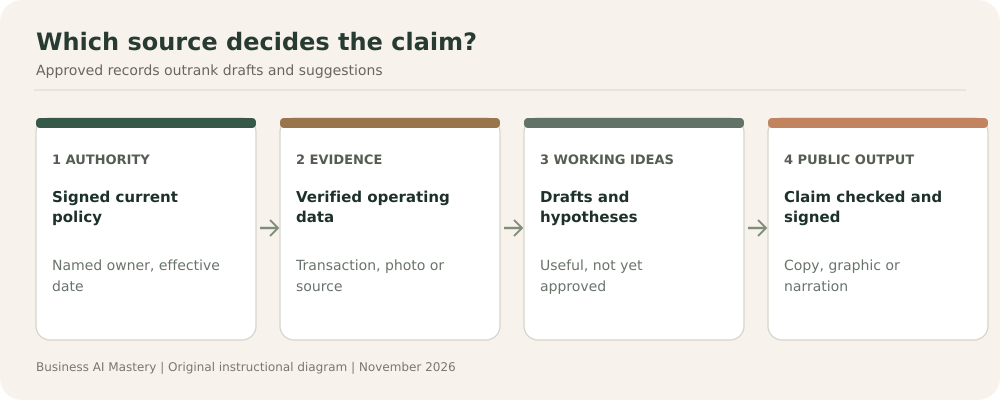
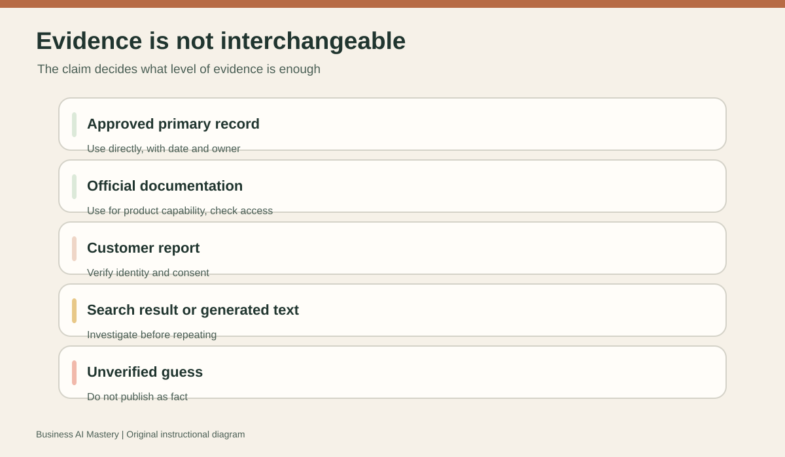

# Research that survives a real business decision






Research is not the same as collecting many web snippets. A good business answer identifies exactly what decision is being considered, the relevant geography and date, the type of evidence needed, and how a contradictory source will be handled.

## Choose sources by the claim

For a product feature, start with the manufacturer specification and the actual item. For a company's price, start with its published listing and check the date. For legal or regulatory obligations, read the relevant regulator and current law, then obtain professional advice where necessary. For customer sentiment, use properly collected feedback and treat small samples with caution. A model's own summary does not become a source simply because it includes a citation.

## Write the research question before searching

Weak: *What is the best marketing strategy?* Stronger: *For a fictional independent salon serving existing clients, what low-cost appointment reminder approaches could we test next month, and what operational risks must we check?* The second question gives a practical decision, budget constraint and evaluation path.

```text
Research three approaches to reducing missed appointments for a small
service business. Start with authoritative sources available by
20 November 2026 and label any older evidence. Summarise the actual
intervention, where it was studied, the population, measured result and
limitations. Separate general research from our company's own data.
Propose a small pilot, but do not promise a particular improvement.
Include direct source URLs for verification.
```

## Separate evidence from inference

Keep an evidence table with source, publication date, primary or secondary status, claim, limitation and link. Mark each recommendation `directly supported`, `reasonable inference`, `untested idea` or `requires specialist review`. If two credible sources disagree, explain why their definitions, periods or samples may differ. Never hide the conflict to create a tidier conclusion.

## Test the claim in the real context

A campaign method that works for an online fashion brand may not work for a rural service provider with weak internet connectivity. Consider customers' devices, local language, purchasing habits, staff capacity, costs and permission requirements. Use real business data where lawful and appropriately protected, and keep fictional educational examples explicitly labelled.

[Return to foundations](../README.md)
