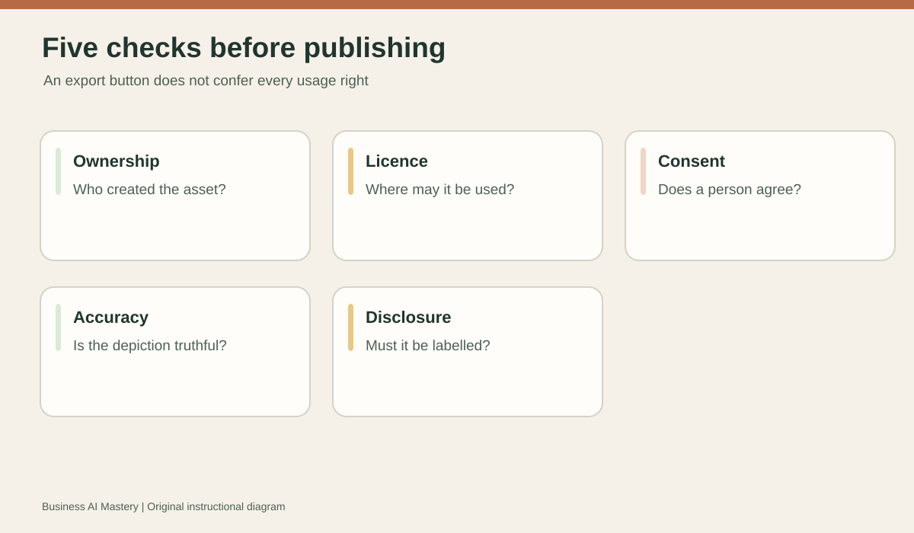

# Rights, disclosure and a believable public record

> Editorial reference date: 20 November 2026. This is a practical production guide, not jurisdiction-specific legal advice. Confirm current regulations, contractual licences and platform rules before publication.

## Three separate questions every creator must answer

**May we use it?** This concerns copyright, licences, commercial permissions, privacy and the rights of any identifiable person. **Is it truthful?** This concerns whether the image, statement or sound describes the real product, event or service. **Must we label it?** This concerns the applicable rules for synthetic or altered media. A licence does not establish truth, and truthful copy does not establish permission to use an image.

A company photographing its own shop can still inadvertently reveal a customer's private record on a screen. A generated image may not include a copyright-protected photograph but may depict a branded product or celebrity likeness in ways that create other risks. A model provider's description of commercial use should be checked against the exact output, model, service terms and applicable rules.

## Source and permissions ledger

| Asset | Who made it? | Permission or licence | What it depicts | Can it be used in advertising? | Approval |
| --- | --- | --- | --- | --- | --- |
| Actual product photo | Staff photographer | Company-approved release | Specific stocked item | Confirmed if approved | Marketing lead |
| Generated campaign illustration | Creative team using an approved service | Check service terms and inputs | Fictional scene | Conditional | Brand owner |
| Customer voice clip | Customer | Written permission needed | Testimonial | Only within consent scope | Legal or authorised staff |
| Music from a social app | Third-party rights holder | Platform-limited rights may apply | Soundtrack | Do not assume cross-platform use | Producer |
| Screen capture of an inbox | Internal employee | Contains private data | Real customer exchange | Usually inappropriate publicly | Privacy lead |

Use this table as a working register, not a legal opinion. Retain consent records in appropriate private systems, not in a public GitHub course.

## Synthetic media and honest presentation

A product visual used as a conceptual illustration should not be captioned as a photograph of stock unless it genuinely represents the stocked item. A generated person must not be presented as an actual employee, satisfied buyer or interviewee. A synthetic voice should not imply a named individual spoke the words without their permission and appropriate disclosure.

Platform rules differ. YouTube documents disclosures for realistic altered or synthetic material. TikTok requires labels for realistic generated images, audio and video under its applicable guidance. Review each destination's current wording during the publishing step. Routine grammatical assistance is different from generating a realistic scene that viewers may interpret as a real event.

## Content Credentials and provenance

Content Credentials, developed through C2PA standards, can carry signed information about the origin or history of a media asset. Provenance is useful evidence, but it does not automatically prove that the depicted event happened or that every claim is accurate. Some platforms strip metadata, and not every asset has credentials. Keep your own production record: original files, prompts, approved references, edits and publication versions.

## Practical exercise

Your fictional restaurant wants to publish a cinematic clip of a meal. You have one genuine food photograph, a generated steam effect and an instrumental track from a social video editor. Write a three-part review: which elements are true to the dish, what permissions must be confirmed, and what would need disclosure on the selected platform. Then prepare a corrected plan using genuine footage where product accuracy matters.

**References:** [YouTube disclosure](https://support.google.com/youtube/answer/14328491), [TikTok guidance](https://support.tiktok.com/en/using-tiktok/creating-videos/ai-generated-content), [C2PA standard](https://spec.c2pa.org/specifications/specifications/2.5/index.html).

[Return to foundations](../README.md)
