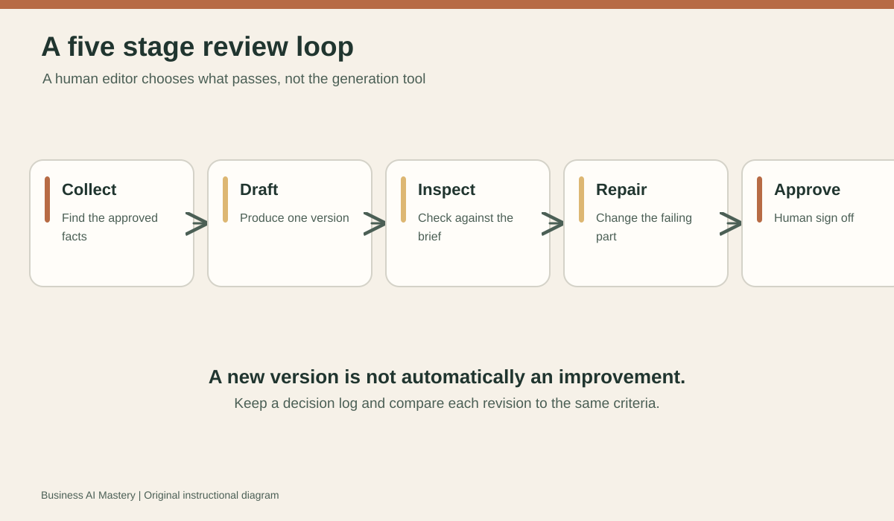

# Understanding AI in an actual business

> **Updated:** 20 November 2026. Interface, account access and available models can change.

*Original instructional artwork. Diagram labels are conceptual, not screenshots of a vendor interface.*

### Start with a human problem

A new shop does not need another attractive poster merely because its competitors publish posters. It may need customers to understand the difference between two products. A local clinic may need to explain appointment instructions. A craft maker may need credible photographs that reflect the objects actually sold. The first decision concerns the reader or viewer, not the rendering model.

Write a one sentence assignment: **For [person] who needs [information or change], make [format] that shows [specific evidence] so that [useful action] becomes possible.** This sentence forces clarity. If the information is unknown, pause the creative work and ask for it. An attractive design cannot repair a false price or an invented customer promise.

Ask what the audience knows, what confuses them, what might make them doubt the message, and what they should remember twenty minutes after viewing it. Consider internet access, language, screen size, data costs and the setting in which they will see the work. A video watched silently on a bus requires a different opening from a workshop recording watched on a laptop.

### The production chain

A reliable assignment moves through six distinct decisions. First identify a purpose, audience and measurable result. Next gather facts, reference photographs, approved language and permissions. Then choose an angle and prepare the words. Only then define the visual and sound treatment. After production, check every export and obtain approval. Finally study the response without mistaking likes for the purpose of the campaign.

A useful brief has seven fields: purpose, audience, facts, deliverables, house style, restrictions and approver. Add a deadline, asset inventory and distribution platforms when needed. Treat the brief as a living agreement, not an ornamental document. A good tool may draft it, but the person commissioning the work must confirm what is true.

### A small, grounded example

A fictional studio named Nala Clay makes cups in small batches. Its objective is to show the texture and size of a new cup. It has three original photographs, one short filmed demonstration and an approved colour palette of clay, paper and charcoal. The studio has not confirmed the selling price or delivery terms. A responsible brief therefore leaves price and delivery out of public content until they have been confirmed. The message may be simple: **See the shape, texture and handle before you choose.**

The better creative direction is neither a glittering city skyline nor a glowing circuit board. It is a useful close view of the object, an honest hand showing scale, and an explanation of its finish. This distinction is the foundation of tasteful production.

### What a model can and cannot judge

A language model can suggest outlines, identify contradictions in supplied notes and propose alternative wording. An image generator can explore arrangements, backdrops and lighting concepts. A video generator can create motion studies. None of these tools witnesses a real purchase, verifies the size of a cup, knows a customer personally or automatically secures permission to use a face or voice. Preserve a clear line between supplied facts, creative hypotheses and published claims.

## The distinction that prevents expensive mistakes

A language model predicts and constructs responses based on its input and training. An accounting system records transactions. A customer database records interactions. A design application manages editable composition. These functions overlap, but none should replace the others. Start by naming the system of record and the deliverable. If a model cannot see a record, it should not imply it has checked it.

### Worked example: the missing cost price

A shop owner supplies quantities sold and selling prices, but not wholesale costs. The assistant can calculate units and sales value. It cannot calculate true gross profit. A good output says “Cost information is missing; margin is not available.” The bad output confidently invents a cost percentage. **Practice:** write an instruction requiring the model to separate observed values, calculations, assumptions and unresolved information. Verify that it does not collapse them.

### The first decision

Choose one task that already occurs every week and is easy to check. A stock summary or staff announcement is a good place to practise. Payments, legal advice, personal data decisions and unapproved customer actions are not suitable first experiments.

## A useful first comparison

Choose a real but nonconfidential task. Describe what it would mean to draft, retrieve, reason and act in that situation. Decide which parts could be safely delegated and which need a person to approve. The goal is to distinguish a helpful assistant from an autonomous decision maker.

**Continue:** [Back to course index](../README.md) · [Business tools](../02-business-management/chatgpt.md) · [Content creation](../03-content-creation/canva.md)

## The four roles of an automated assistant in a real company

A useful distinction is **drafting, retrieving, reasoning and acting**. Drafting produces text or visual material for review. Retrieving finds evidence in approved sources. Reasoning compares options or calculates from given values. Acting writes to a system, sends a message, changes a schedule or modifies a record. Those four roles require different permissions and review processes. A model can be excellent at producing prose while still being unsuitable for autonomous refunds or accounting entries.

For a fictional repair shop, drafting could prepare a customer explanation. Retrieving could look up a current warranty policy. Reasoning could compare technician workloads from a dated schedule. Acting could create an internal task after a manager approves it. Teach staff to ask which role is happening before they click a button.

### An owner decision table

| Question | First source | Suitable model role | Human decision |
| --- | --- | --- | --- |
| How much cash came in? | Reconciled accounting records | Calculate and explain | Confirm accounting treatment |
| What are customers asking? | Approved enquiry categories | Summarise patterns | Decide whether to change the service |
| Can we advertise delivery tomorrow? | Logistics confirmation | Check evidence | Approve or decline claim |
| How should the poster look? | Brand guide and actual images | Explore compositions | Approve final art |
| Should a refund be issued? | Policy and transaction records | Prepare a review note | Authorised employee decides |

Models do not possess a business's lived experience. Provide it through real interviews, real observations and documented processes. When sources are incomplete, the appropriate answer may be *we need to check*, not a better sounding guess.
