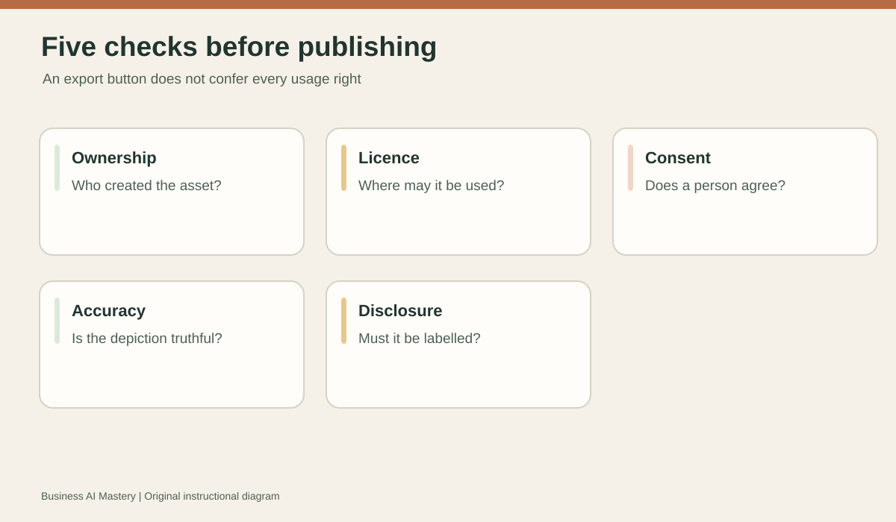

# Accuracy, privacy, rights and disclosure

> **Updated:** 20 November 2026. Interface, account access and available models can change.

*Original instructional artwork. Diagram labels are conceptual, not screenshots of a vendor interface.*

### Five separate permissions

A project may require permission for the source photograph, a person’s face, their voice, the music bed and the final distribution channel. These are separate decisions. Commercial rights for a generated background do not automatically settle trademark, likeness or music questions. The terms of a platform’s built in music library may not cover a paid advertisement published elsewhere.

Keep an approval record. For realistic synthetic or materially altered media, check the current rules of each publishing platform and disclose it where required. The relevant YouTube and TikTok guidance appears in the sources. Humanising writing does not justify hiding mandatory notices or stripping provenance information.

### Do not turn private material into prompt ingredients

Customer records, identification documents, unreleased business plans, unreconciled financial statements and personal contact details may not belong in a third party service. Confirm that the tool is approved and that the organisation’s data handling rules permit the upload. Redact unnecessary information and use synthetic examples when training or demonstration does not require actual personal data.

### The final accuracy gate

The approver should see the content as it will be published, not just the text. Check names, prices, product appearance, claims, logos, source attributions, contact details, duration, caption timing and audience suitability. Keep the final file alongside the brief and asset list. Approval is a real decision with accountability, not a tick box generated by a model.

## Review is a documented action

A final approval record should answer who checked the facts, the source, the date, the licensed assets, the depicted people, accessibility and the platform’s disclosure requirements. Be particularly careful with payment details, sensitive records, fictional testimonials, medical claims, guaranteed income and identity imitation.

### A source ledger example

| Claim | Evidence | Status |
| --- | --- | --- |
| “Two sizes are listed” | Approved catalogue, page 3 | Confirmed |
| “Delivery takes one day” | No current delivery policy | Not approved |
| “Customers love this product” | No genuine survey or authorised reviews | Remove |

If an article or post cannot defend its claims with appropriate evidence, revise it. For realistic synthetic video or images that could be mistaken for true events, check current platform disclosure rules. Humanisation is never a reason to hide required information.

## Build a claim ledger

Take five factual statements from a fictional advertisement. Give each a source, date, owner and status. Intentionally leave one unsupported and block publication until it is resolved.

**Continue:** [Back to course index](../README.md) · [Business tools](../02-business-management/chatgpt.md) · [Content creation](../03-content-creation/canva.md)

## An evidence ledger for every public claim

For a real business, every claim that might affect a purchase should be traceable. A useful ledger has columns for `claim`, `source`, `source date`, `source owner`, `verification method`, `approval status` and `where published`. This allows a single changed detail, such as a delivery date or price, to trigger correction wherever it was reused.

**Example:** An advert says an appliance has a two-year warranty. The supplier's unsigned brochure says two years, but the retail contract says twelve months. The correct response is not to choose the more attractive number. Block the claim until the authorised person confirms the actual consumer terms.

### Verification ladder

1. Open the relevant original record, not just the model's summary.
2. Check dates, units, currency and geography.
3. Confirm that a quote was actually said by the attributed person.
4. For calculations, recompute at least one sample and reconcile totals.
5. Check approvals for price, safety, performance and legal claims.
6. Mark unknowns instead of letting attractive copy conceal them.

Use a separate disclosure review when realistic generated media might be mistaken for a real person, event or product. Humanising the design must not remove a platform-required label or create false testimony.
