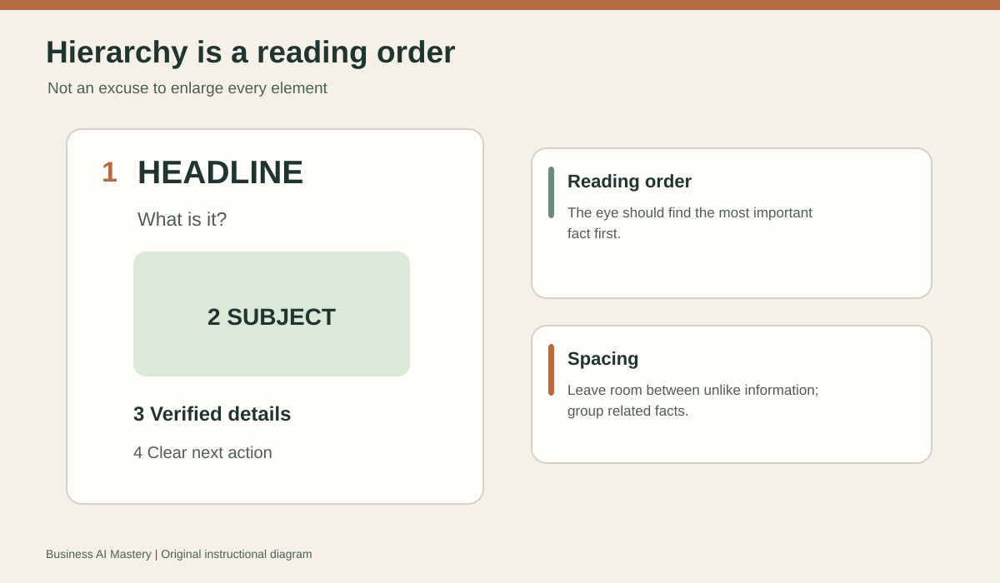

# Visual design, composition and useful restraint

> **Updated:** 20 November 2026. Interface, account access and available models can change.

*Original instructional artwork. Diagram labels are conceptual, not screenshots of a vendor interface.*

### Plan where attention should go

Every visual contains a hierarchy, even when nobody planned one. A strong layout gives the eye a deliberate route through subject, headline, evidence and action. Contrast comes from size, spacing, position, light, colour and density. If everything shouts, the viewer has no reason to look anywhere first.

Visual composition should remain legible at the final display size. A poster designed on a large monitor may become a dense grey rectangle on a phone. Print a thumbnail or preview at ordinary phone width. If the name, offer or event date disappears, change the layout before polishing details.

### Grids and spacing are quiet tools

Use a small number of aligned columns. Keep related objects close and unrelated groups apart. Give text breathing room. Begin with one family of type and two or three deliberate size levels. Use a second typeface only when it introduces a useful distinction. An actual brand system is a better starting point than randomly chosen online font pairs.

Colour should serve recognition, contrast and mood. For the fictional ceramics studio, a muted clay accent and deep charcoal can communicate texture and restraint. For a school safety notice, clarity and strong contrast may be more important than a delicate brand palette. Choose colours because they solve the communication problem.

### Real products need real evidence

A generated scene may be appropriate for a concept campaign, but it can alter geometry, texture, packaging and safety details. For an actual product, photograph it or obtain approved imagery. If a creative backdrop is needed, keep the product cutout separate and preserve labels, dimensions and distinguishing features. Do not generate warranty seals, awards or customer reactions as decoration.

### A photograph with believable light

Start with one main source. Window light gives direction and natural shadows. A reflector brightens the opposite side. Move the object until its relevant surface is clear. If the object is glossy, watch what it reflects. If it is translucent, consider backlighting. If a material is textured, side light can reveal it without needing aggressive sharpening.

Record the original image and its changes. Colour correcting a photograph for accurate presentation is different from changing the product itself. In sensitive comparisons, retain the source photograph and describe alterations truthfully.

### Choose the generation method

**Text to image** is useful when the idea is open and the scene can be invented. **Image to image** is useful when you already have a reference but want to change a permitted attribute. **Inpainting** replaces a selected area. **Outpainting** extends an image beyond its current frame. **Background removal** isolates a subject. **Compositing** places separately controlled pieces together in an editable design. The last method is often best for advertisements because text, logos and factual product details remain under direct control.

### Describe the photograph rather than the prestige

A useful image description includes subject, action, setting, view, distance, light, materials, background and frame shape. “Premium cinematic masterpiece” says little about what must appear. “A wide ceramic cup on rough linen, photographed from table height beside a north facing window, with soft shadow falling right and empty space for a title on the left” gives the generator decisions it can use.

For accurate colour and dimension, supply original reference photographs and state what may not change. For a campaign with multiple images, create a visual bible: subject description, camera height, lens feeling, palette, texture, background, recurring props and exclusions. Maintain a contact sheet of approved frames. A single good image does not guarantee a consistent family of images.

### Prompt demonstration

> Create a realistic editorial photograph of a fictional handmade ceramic cup. The cup is matte terracotta with a wide handle and sits on pale linen beside a wooden window frame. Three quarter view from table height. Soft daylight enters from the left; one coherent shadow falls right. Show the surface texture without exaggerated sharpening. Leave the upper left uncluttered for a future headline. Do not add lettering, glowing particles, logos, additional cups or invented certificates. Portrait composition. This is a concept image, not a depiction of stock for sale.

### Review at three scales

At thumbnail size, check hierarchy and emotional clarity. At normal viewing size, check composition and colour. At full resolution, inspect anatomy, product edges, labels, reflections, shadow direction and repeated textures. Then put the image back into the intended layout. A photograph can be technically impressive and still fail because the text has nowhere to sit.

### Correcting weak images

If the output has too much contrast, request softer light instead of “more realistic”. If the main subject is small, change camera distance or crop. If a hand appears wrong, regenerate or replace the faulty region with an authorised photograph. If the product shape is altered, stop generating that product and use the original asset. If all results share the same visual clichés, remove style adjectives and add physical, locational and cultural details grounded in the assignment.

## Design as a reading order

A useful poster establishes a first, second and third piece of information. Choose a focal point. Let related things sit together. Keep margin and alignment consistent. Contrast should be sufficient for ordinary viewing, and a visual effect should solve a problem rather than decorate an empty corner.

### Practical layout test

Print the headline and supporting copy as plain black text. Put the approved product photograph beneath it. Ask a reader three questions after a three second view: What is offered? Which detail matters? What can I do next? If the answers are not clear, repair the message before adding colour.

### Photograph versus synthetic image

For a real product, an actual photograph is the safest evidence of appearance. Generated atmosphere can be helpful around the product but should not change its proportions, number of controls or label. See the comparison illustration for an example of decoration overpowering the purpose.

## Test a design at viewing size

Make one poster and reduce it to the dimensions at which a customer will see it. Ask another person what they noticed first, the offer they understood and the action they would take. Repair the reading order.

**Continue:** [Back to course index](../README.md) · [Business tools](../02-business-management/chatgpt.md) · [Content creation](../03-content-creation/canva.md)

## Art director's correction method

Begin by sketching blocks, not by selecting a template. Divide the page into the main subject, headline, evidence, action and business identity. Decide what the reader should see in the first second and what they can discover when they look longer. Typography size, contrast and spacing should follow this information order.

**A specific poster exercise:** create an announcement for a one-day pottery workshop. The headline states the event; the image shows real hands working clay, not a fantasy artisan in a glowing laboratory. The date and location appear together, since they form one decision. The registration method is legible and unobstructed. All other decoration is optional.

### Contrast and accessibility

Aesthetic subtlety is not an excuse for unreadable type. As a useful web accessibility reference, WCAG 2.2 sets a minimum 4.5:1 contrast ratio for ordinary text and 3:1 for large text at Level AA, with defined exceptions. Platform poster requirements are not identical to web conformance, but these ratios provide a meaningful review target. Check designs at realistic phone size and avoid putting important words on a busy photograph.

### Design diagnostics

| Symptom | Likely cause | First correction |
| --- | --- | --- |
| Nothing stands out | Too many equally bold elements | Choose one focal message |
| Image looks fake | Impossible shadows or material | Use real capture or correct references |
| Text feels cheap | Too many type styles | Limit hierarchy to purposeful levels |
| Poster feels empty | Message lacks evidence | Add one relevant verified detail |
| Graphic feels crowded | Information has no priority | Remove secondary promises |
| Reels text is cut off | Crop ignores interface overlay | Reposition inside a tested safe area |

**Official reference:** [WCAG 2.2](https://www.w3.org/TR/WCAG22/).
