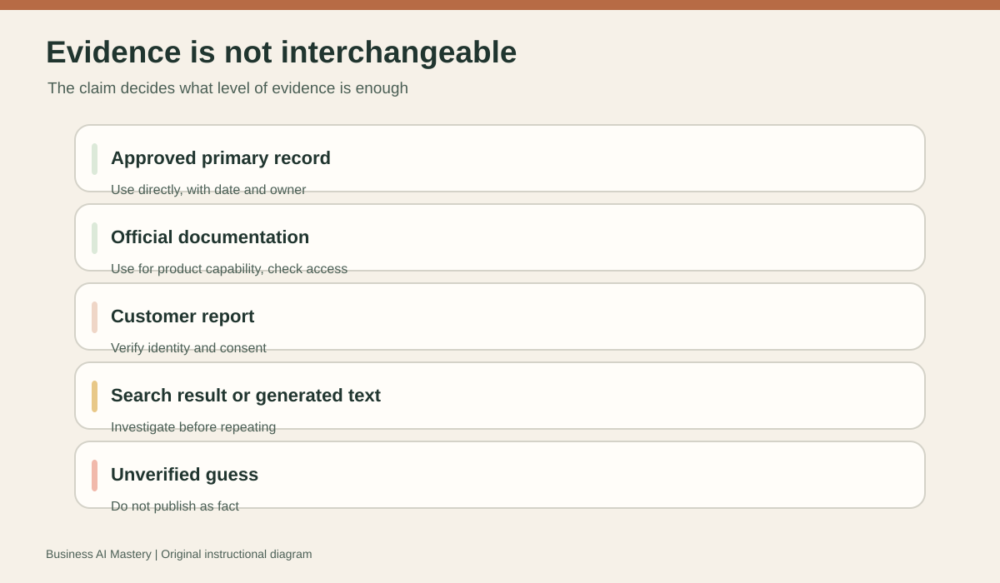

# Working with spreadsheets, documents and images

> **Updated:** 20 November 2026. Interface, account access and available models can change.



*Original instructional artwork. Diagram labels are conceptual, not screenshots of a vendor interface.*


## Give every file a job

A sales workbook may prove quantities. A signed policy document may prove approval rules. A product photo may show shape and colour. A supplier email may show a quotation but not confirmed supply. Use a source inventory with name, date, owner, status and permitted uses.

### Safe data preparation

Remove data that is not required. For customer analysis, consider grouping results instead of uploading identifying records. Preserve original spreadsheets and work on copies. Explain currencies, tax treatment, dates, refunds, duplicates and the intended interpretation of each field.

### Three useful questions

1. Which fields are missing, inconsistent or impossible to interpret?
2. Which claims can be proved by the supplied sources, and which need another source?
3. What would a reviewer need to recalculate or dispute the answer?

The same discipline applies to visuals. An image may demonstrate a proposed scene but does not prove that a real event occurred. Put that distinction in the caption.

## File preparation for business reports

AI can help create an outline, reorganise information, draft slide text
and suggest visuals. A human should still check the argument, numbers,
references and flow.

## A useful presentation structure

1.  Title and purpose.
2.  The problem or context.
3.  Key evidence.
4.  Main explanation.
5.  Options or recommendations.
6.  Implementation or next steps.
7.  Sources and acknowledgements.

## Prompt: presentation outline

``` text
Act as a presentation consultant.

Create an outline for a [duration]-minute presentation about [topic].

Audience: [audience]
Purpose: [purpose]
Available evidence: [sources or notes]

For each slide provide:
- Slide title
- One central message
- Up to three concise points
- Suggested visual or chart
- Speaker note

Do not invent statistics, quotes or sources. Identify missing evidence.
Avoid repeating the same message across multiple slides.
```

## Report quality checks

-   Does the report answer the question?
-   Are conclusions supported by evidence?
-   Are assumptions labelled?
-   Are units and dates clear?
-   Are sources traceable?
-   Are charts accurate?
-   Are limitations explained?
-   Is confidential information protected?

------------------------------------------------------------------------

## Detect a double count

Create a tiny sample with two line items for one invoice and a separate return. Ask for the difference between line count, order count and net units. Verify the result manually and document the row grain.

**Continue:** [Back to course index](../README.md) · [Business tools](../02-business-management/chatgpt.md) · [Content creation](../03-content-creation/canva.md)

## File hygiene that makes analysis reliable

Model quality cannot compensate for a spreadsheet with contradictory dates and undefined columns. Before upload, identify the file's owner, source system, time range, currency, time zone, update date and confidentiality level. For tabular data, include a dictionary describing every column. Record whether each row represents a transaction, an invoice line, a product or a customer. Those grains cannot be casually mixed.

**Example:** a sales file has 200 rows, but each invoice can appear in three rows because every line item is separate. Counting rows as sales orders would overstate the number of orders. Give the model the primary key and aggregation rule. Distinguish a missing value from zero. Explain how returns and cancelled orders are encoded.

```text
Inspect this dataset without making a recommendation. Tell me whether
each row is an order or a line item; show candidate key columns;
identify duplicates; find missing dates; list numerical columns;
explain which calculations are valid and which would double count.
Wait for my confirmation before calculating revenue or customer totals.
```

For PDFs, photograph scans or video transcripts, check the extraction quality. A confidently summarised document can hide a misread figure or misattributed speaker. Preserve links back to the original page or time code. When using customer, staff or financial data, apply access controls and minimise what is uploaded.
