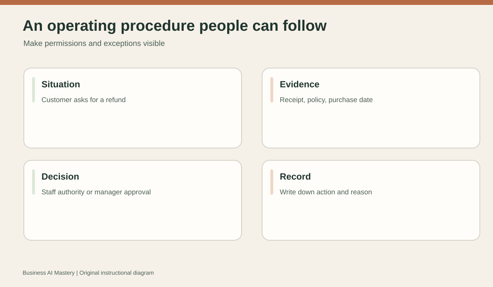

# Claude: Opus 5.5 and Sonnet 5.5

**What you will be able to do:** Turn changing staff policies into one usable procedure.

> **Updated:** 20 November 2026. Interface, account access and available models can change.



*Original instructional artwork. Diagram labels are conceptual, not screenshots of a vendor interface.*

## Core guidance from the expanded handbook

*Reasoning and long document assistant*

### Where this tool earns its place

Opus 5.5 is for difficult, sustained reasoning and complex source comparison. Sonnet 5.5 is a faster, more economical choice for defined daily work, drafting and document creation. On supported plans a Project can hold enduring source documents and working instructions. Model availability and effort controls vary.

### Before the first prompt

Create a Claude Project named Operations Handbook. Put the approved staff policies, meeting records and role definitions into project knowledge. Add a separate instruction that says which source wins when drafts conflict. Start with a source map listing each document, its date and who approved it.

### A complete business exercise

Take a messy operating procedure and ask Claude to identify the current steps, missing decision rights and contradictory instructions. Ask for a process map in plain language. Once the owner confirms the decisions, generate an operational procedure, a one page staff reference and a scenario based training quiz. Review each against the original. For a complex comparison, use Opus; for weekly updates or polished variants, Sonnet is often sufficient.

### Copy ready prompt for this tool

> Compare Policy A dated 3 June 2026 with Policy B dated 12 November 2026. Produce a change register with clause or page reference, what changed, who is affected, and the exact decision the owner must approve. Where the two documents are silent, write “not specified”. After the register, draft a short staff announcement using only changes marked approved. Keep the language respectful, direct and easy to read aloud.

### When the result is weak

When the response creates an obligation not written in the policy, ask it to quote or identify the precise supporting clause. If it repeats the same idea under several headings, ask for a consolidation while preserving exceptions and dates. Change one section at a time to avoid disturbing approved language.

### Human editorial finish

Use real examples from staff questions and naturally varied sentences. Replace “It is paramount that all team members…” with a clear instruction such as “Record the cash count before handing over the till.” Do not invent staff opinions or quotations.

### Approval boundary and common errors

The largest context window does not guarantee perfect attention. Verify clauses, calculations, and any report intended for external use.

**Official reference:** [Claude Opus 5.5 and Sonnet 5.5 product guidance](https://www.anthropic.com/claude-sonnet-5-5)

## First session: from a blank workspace to a reviewable result

1. Gather the current approved policy and previous policy, each with version, date and owner.
2. Separate existing rules from questions management has not answered.
3. Use project knowledge only for approved source material. Do not paste informal chat as if it were policy.
4. Ask for a clause by clause change register and inspect its references.
5. Approve the decisions before asking for a staff message and scenario based training notes.
6. Read the final procedure aloud with someone who will actually perform the task.

## Prompt ladder: simple, evidence based and advanced

The prompts below are teaching examples. Replace fictional context with approved records. A tool that does not support freeform prompting may require you to perform the equivalent steps through its own interface.

### First pass

```text
Inventory these policy documents. For each, list date, version, stated owner and clauses that appear to conflict. Do not rewrite anything.
```

### Evidence based

```text
Prepare a change register with old wording, new wording, source location, affected role and approval status. Say “not specified” when neither document resolves a case.
```

### Implementation

```text
For approved changes only, prepare a front desk procedure, a 90 word staff notice and four realistic practice questions with correct answers traceable to a clause.
```

## What an acceptable result looks like

**Illustrative staff line:** “Count the cash drawer before handing over the shift. Enter the amount in the log and ask a supervisor to review any difference.” This is suitable only when the approved procedure requires those steps.

## If the first version disappoints

When different dates are conflated, demand a version table. When the draft reads like a legal essay, request clear verbs and separate the exception from the normal procedure. If an approval rule appears without a source, remove it.

## Human editorial finish

Ask staff to mark the steps they would not understand during a busy shift. Keep familiar job titles and explain exceptions at the point where they occur.

## Practice assignment

Using a fictional or appropriately protected version of the case, complete **turn changing staff policies into one usable procedure**. Save an evidence inventory, the first draft, a precise correction request and the reviewed deliverable. Write a short comparison showing what the revision genuinely improved.

## Approval and success test

Could two staff members follow the process the same way? Are original policy passages archived and change approvals recorded?

## Related reading

[Prompt anatomy](../01-foundations/prompting-fundamentals.md) · [Context engineering](../01-foundations/context-engineering.md) · [Humanisation](../01-foundations/humanization.md) · [Reference index](../06-reference/sources-and-updates.md)

## Studio lesson: turn a disorderly operations manual into an approved procedure

Claude is useful when the work involves careful reading, comparison and rewriting across long documents. A sensible first assignment is a procedure, not a marketing slogan. Suppose a hospitality business has three staff handover documents, one outdated customer complaint guide and an internal message describing recent changes. The central problem is deciding which statements remain true.

**Prepare evidence in layers.** Supply the current policy, the older policy with a clear `superseded` label, examples of real staff questions and a named person who can approve changes. Ask for a conflict table. A long context window does not mean that every sentence is equally reliable; declare which sources are authoritative and which are historical.

```text
Read the attached documents as a process analyst. Do not write the new
procedure yet. Extract every instruction about handling a complaint,
then produce a comparison table with source document, exact section,
instruction, contradiction, and status: confirmed, outdated, unclear.
Treat the signed 3 November policy as authoritative where it directly
conflicts with older notes. Quote only short passages necessary to
identify the differences. List questions for the operations manager.
```

Once those questions have answers, ask for one staff procedure with trigger, responsible person, timing, sequence, escalation, evidence to record and exception handling. Then run a scenario test: a customer reports a missing item shortly before closing, and the staff member cannot contact the supervisor. The response should follow the approved procedure rather than inventing a discretionary refund.

**A strong result** has a working checklist and a decision point that a new employee can follow at a busy counter. **A weak result** repeats values such as *customer excellence* and *collaboration* without telling the employee what to say, record or do.

### Example editing exchange

First draft: *Ensure all customers have an exceptional experience, leveraging empathy and timely solutions.*

Correction request:

```text
Rewrite only the section for a customer who says an order is missing.
The staff member needs words they can actually say and a clear next
step. Use ordinary English. Include what to record, when to contact a
supervisor and what staff must not promise. Preserve the approved refund
policy verbatim where necessary. Do not invent the employee's personal
experience or a customer quotation.
```

A more useful staff script could be: *I can check the order number and the collection record. May I confirm the name on the order? I will show the supervisor what I find before confirming the next step.* This is an illustrative script, not a replacement for the company's approved rules.

### Advanced review method

Ask one pass to find missing cases, another to locate ambiguous terms and a final pass to simulate the procedure using three fictional situations. Request a trace from each step back to the approved source. A separate reviewer should approve the document and test it with an employee unfamiliar with the draft. Measure whether the person can complete the task correctly, not whether the writing sounds impressive.

**Official reference:** [Claude model information](https://www.anthropic.com/news/models).
