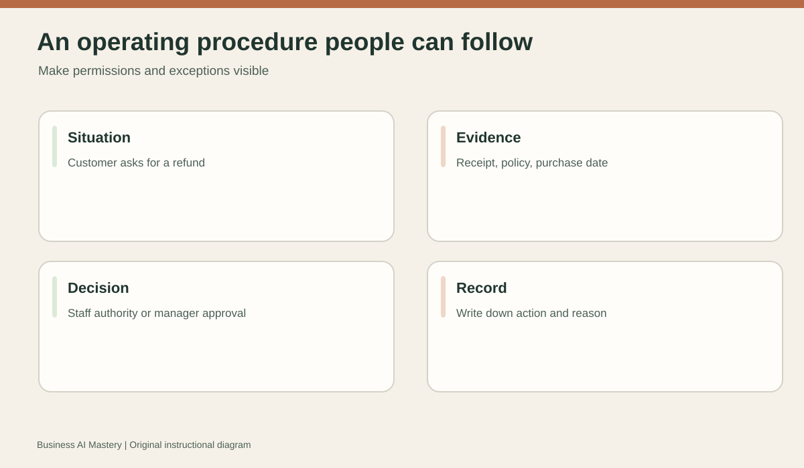

# ClickUp Brain

**What you will be able to do:** Plan a shop reopening project without losing accountability.

> **Updated:** 20 November 2026. Interface, account access and available models can change.



*Original instructional artwork. Diagram labels are conceptual, not screenshots of a vendor interface.*

## Core guidance from the expanded handbook

*Task, project and team coordination assistant*

### Where this tool earns its place

Choose it when tasks and deadlines are already managed in ClickUp. It is less useful if the team never keeps task owners, statuses and notes current. The quality of its summaries reflects the health of the workspace.

### Before the first prompt

Set up a project with owners, deadlines, statuses, dependencies and acceptance criteria. Keep the brief and approval file attached to the task. Then use Brain on a specific list or task, not an entire workspace without boundaries.

### A complete business exercise

For a campaign launch, create tasks for product facts, copy, design, filming, approvals and publication. Ask Brain to identify blocked tasks and missing owners. Request a progress note tied to real task statuses. Turn the note into a manager update. After that, ask which tasks are truly on the critical path and check the dependencies manually.

### Copy ready prompt for this tool

> Review tasks inside the November Retail Campaign list only. Produce a project update with completed work, tasks due before 27 November 2026, tasks marked blocked, and tasks that lack owners. Cite task names and current statuses. Do not infer completion from comments saying “almost done”. Draft a message assigning no new work until the manager approves.

### When the result is weak

An invented deadline can create chaos. Ask it to display the original due date and status next to each recommendation. If comments contradict the status field, flag the discrepancy instead of choosing silently.

### Human editorial finish

Write the team update in the manager’s ordinary voice. Mention actual blockers and whom to ask for help. Avoid making a routine update sound like a corporate announcement.

### Approval boundary and common errors

Keep tasks current and permissions controlled. Do not let summaries replace project ownership.

**Official reference:** [ClickUp Brain product guidance](https://help.clickup.com/hc/en-us/articles/24998833529751-Manage-tasks-with-Brain)

## First session: from a blank workspace to a reviewable result

1. Define the tangible deliverable, owner and fixed reopening date.
2. Break down tasks into milestones and dependencies before asking for dates.
3. Assign genuine team capacity and working days; do not invent employees.
4. Use Brain within the actual ClickUp space to summarise what is blocked and what has changed.
5. Check task owners and approvals on the task board.
6. Review progress in the weekly meeting and close work with proof of completion.

## Prompt ladder: simple, evidence based and advanced

The prompts below are teaching examples. Replace fictional context with approved records. A tool that does not support freeform prompting may require you to perform the equivalent steps through its own interface.

### First pass

```text
Read this ClickUp project and identify tasks without owners, deadlines or acceptance criteria. Do not invent missing fields.
```

### Evidence based

```text
Summarise overdue tasks by responsible team and blocker. Include the task link and latest recorded status.
```

### Planning

```text
Suggest a revised sequence given these stated constraints: signage must precede opening, supplier delivery is unconfirmed, and one staff member is available two days per week. Mark proposals as drafts.
```

## What an acceptable result looks like

“The new counter cannot be installed until the wiring inspection is approved” is a useful dependency, provided the task records show that rule. “Everyone should work harder” is not a plan.

## If the first version disappoints

If tasks are assigned to imagined team members, provide the actual roster. If every task has the same deadline, request dependency based scheduling and a realistic capacity check.

## Human editorial finish

Team members should recognise their own work in the summary. Replace broad project language with specific blockers and next conversations.

## Practice assignment

Using a fictional or appropriately protected version of the case, complete **plan a shop reopening project without losing accountability**. Save an evidence inventory, the first draft, a precise correction request and the reviewed deliverable. Write a short comparison showing what the revision genuinely improved.

## Approval and success test

Does each high priority task have one accountable owner, an acceptance condition and a reliable status?

## Related reading

[Prompt anatomy](../01-foundations/prompting-fundamentals.md) · [Context engineering](../01-foundations/context-engineering.md) · [Humanisation](../01-foundations/humanization.md) · [Reference index](../06-reference/sources-and-updates.md)

## Studio lesson: connect a meeting to completed work

A planning meeting produces decisions, not finished tasks. In ClickUp, define a status system that means something: `proposed`, `approved`, `in progress`, `awaiting external reply`, `completed`, and `blocked`. Add a named assignee, due date, acceptance criterion and link to the decision. ClickUp Brain can read the Workspace's tasks and documentation where your access allows, but it cannot make a vaguely worded task measurable on its own.

```text
Analyse the approved project brief and the notes from the launch
meeting. Create a *proposed* task list, not live assignments, with task
name, expected outcome, owner to confirm, due date to confirm,
dependency, acceptance test and source note. Separate new decisions from
unresolved suggestions. Flag any task whose deadline is mentioned in
only one draft document. Do not tell the team that an assignment has
been made unless it has actually been created and approved.
```

Have a manager approve the proposed work breakdown before creating it in the live workspace. Ask Brain later for tasks blocked more than three working days, but specify how a working day is defined and whether blocked time exists in the data. If a task has no due date, let the report say so.

**Evaluation exercise.** Choose five completed tasks. Can the responsible person produce evidence that each acceptance criterion was met? If not, revise the task template. A paragraph of confident analysis is less useful than a board where the team can tell what is finished.

**Humanisation.** Avoid repeating *drive alignment and accountability* in every update. Name the actual delay: *The photographer has not received the final product samples. The Friday poster cannot be approved until those images arrive.* This remains a hypothetical example, not a statement about a real employee.

**Official reference:** [What is ClickUp AI?](https://help.clickup.com/hc/en-us/articles/12578085238039-What-is-ClickUp-AI).
