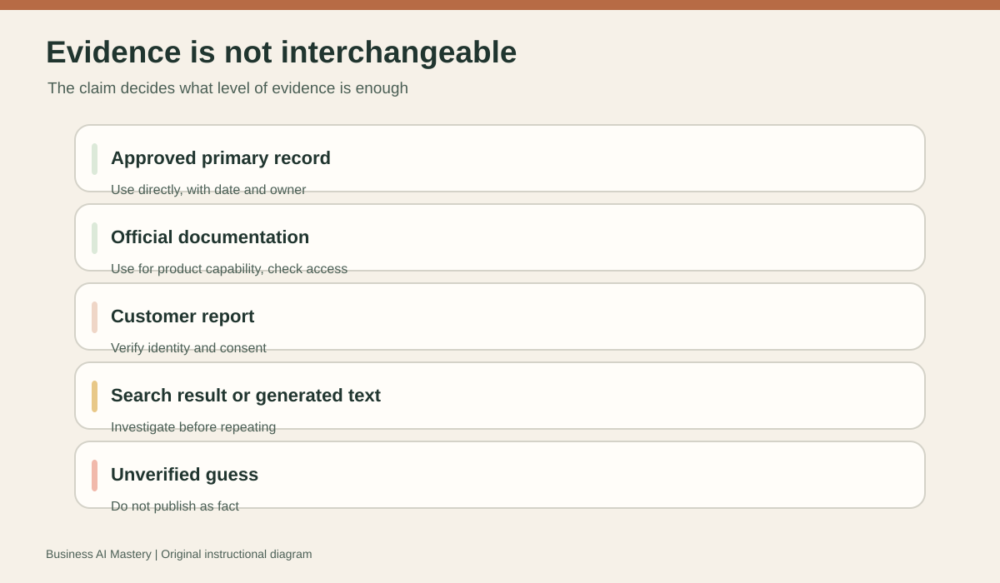

# Gemini Notebook for source-grounded business research

> Reviewed 20 November 2026. Google documentation refers to Gemini Notebook; some older tutorials and user materials may use NotebookLM. Check the current product and account interface.



## The right job for this tool

Use a source-based notebook when a business decision depends on understanding a contained collection of documents. Examples include a staff handbook, product specifications, meeting notes or several versions of a supplier proposal. The purpose is to find evidence and reconcile it, not to claim that the notebook knows more than its source collection.

## First session

1. Create a notebook for one clear question, such as comparing three supplier proposals.
2. Add sources with meaningful names and dates. Keep old documents labelled as superseded.
3. Confirm which sources are included in the active question.
4. Ask for a source inventory and contradictions before a recommendation.
5. Open the cited source passages and compare them to the originals.
6. Export or copy the approved findings into the business decision log.

### Prompt: a supplier comparison

```text
Using only these three authorised supplier proposals, compare unit
price, minimum order quantity, freight, delivery lead time, payment
terms and return conditions. Show where each figure appears in the
source. Keep different currencies separate unless an approved rate is
supplied. Label absent fields 'not specified'. List contradictions and
questions for suppliers. Do not infer that a lower unit price means
lower total purchasing cost.
```

## Better results through scoped questions

Ask *Which proposal includes a written return window?* before asking *Which supplier is best?* The first question is traceable; the second requires weighting criteria the owner may not have chosen. Create a scoring matrix only after the owner defines those criteria. If an answer lacks a usable citation, locate the source manually or treat the claim as unresolved.

### Context management

A notebook with 40 documents can still be confusing when a policy was revised five times. Maintain one explicit current-policy source, record the date, and ask for the history of changes only when needed. When Google Drive sources are synced, check the visible source status and update controls; an old snapshot may not be equivalent to the current file.

## Human editorial finish

Turn source-heavy notes into a concise decision memo. For a supplier meeting, state the main difference, the numbers that were verified and the two questions still outstanding. Do not replace a missing delivery promise with a polished invented estimate. A manager should be able to point to the clause behind any recommendation.

## Exercise and success test

Use three fictional supplier quotes with different dates. Deliberately include one missing delivery condition and one conflicting minimum order quantity. Ask the notebook for a table. The exercise passes only if it identifies both uncertainties and provides retrievable source passages.

**Official references:** [Add sources](https://support.google.com/gemininotebook/answer/16215270), [Use notebook chat](https://support.google.com/gemininotebook/answer/16179559).

[Home](../README.md) · [Research principles](../01-foundations/research-and-source-literacy.md)
