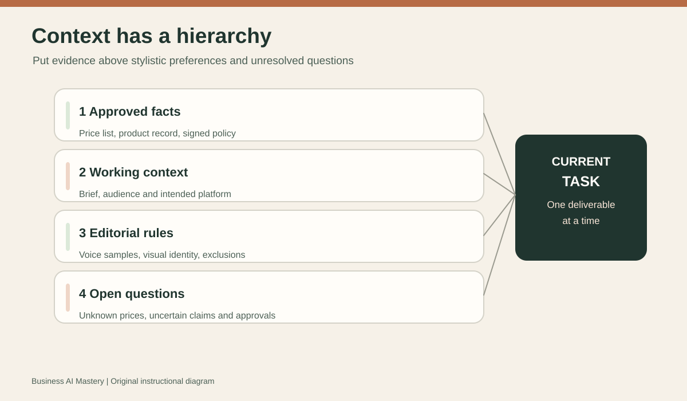

# Google Gemini for business

**What you will be able to do:** Prepare a purchasing decision from mixed files.

> **Updated:** 20 November 2026. Interface, account access and available models can change.



*Original instructional artwork. Diagram labels are conceptual, not screenshots of a vendor interface.*

## Core guidance from the expanded handbook

*Complex reasoning model and multimodal assistant*

### Where this tool earns its place

Google documented Gemini 4 Carbon availability in November 2026 for demanding reasoning and professional workflows. Gemini 4 Neon was also introduced on 18 November. For most ordinary business tasks, the quicker available default is often enough. The exact model controls in consumer and work interfaces differ.

### Before the first prompt

Open Gemini or an approved Workspace entry point. Prepare a Google Sheet with clean column headers, a written business objective and the relevant source files. If using a persistent custom assistant, check whether your account uses Gems or the newer skills experience, since Google announced a transition for some personal accounts in November 2026.

### A complete business exercise

Give Gemini a purchase ledger, a product photo and a short note explaining how procurement works. Ask it to separate what can be seen in the photo from what the ledger proves. Use it to build a decision memo about replenishment, with supplier questions and data gaps. Have it produce a second, shorter version for a purchasing manager, then verify numbers in the sheet.

### Copy ready prompt for this tool

> Review these three documents: our October stock sheet, supplier catalogue and written purchasing rules. The stock sheet decides current quantities, the purchasing rules decide approval thresholds, and the supplier catalogue is only a quotation, not proof of availability. List items that may need replenishment, state the exact supporting row, and identify prices or delivery dates that need confirmation. Do not place orders. Finish with a draft email asking the supplier only the unresolved questions.

### When the result is weak

Ask for an evidence column when numbers look too neat. A photograph is weak evidence for price or current stock. If the answer confuses a quote with an approved purchase order, correct the source hierarchy before rerunning the task.

### Human editorial finish

Keep the supplier email brief and practical. Say which items are needed, the quantities under consideration, and which dates need confirmation. Avoid technical flourish and the impression that the business has already committed.

### Approval boundary and common errors

Do not assume the latest research model is automatically selected. Review sharing rights for Drive sources, and check any source citations.

**Official reference:** [Google Gemini 4 Carbon and Gemini workspace product guidance](https://blog.google/innovation-and-ai/models-and-research/gemini-models/gemini-4-carbon-now-available/)

## First session: from a blank workspace to a reviewable result

1. Create one clean stock sheet with SKU, current count, sales rate and date counted.
2. Keep supplier catalogues and quotes separate from confirmed stock or commitments.
3. Provide one image only when it answers a visual question such as packaging or legibility.
4. State which source takes priority for quantities, policy and terms.
5. Request a ranked list of purchasing questions, not an automatic order.
6. Review calculations in Sheets and confirm current supplier availability directly.

## Prompt ladder: simple, evidence based and advanced

The prompts below are teaching examples. Replace fictional context with approved records. A tool that does not support freeform prompting may require you to perform the equivalent steps through its own interface.

### First pass

```text
List what the stock sheet, supplier offer and attached photograph actually prove. Make three separate evidence columns.
```

### Evidence based

```text
Show which SKUs may approach the reorder threshold using only the supplied rules. Quote the row values and note missing lead times or demand estimates.
```

### Decision support

```text
Draft questions to the supplier about uncertain stock, delivery and minimum order quantity. Make no purchase commitment and do not invent a quoted price.
```

## What an acceptable result looks like

A sound output separates “12 units counted on 18 November” from “the supplier might deliver next week”. The first is a recorded observation; the second needs a confirmed quotation.

## If the first version disappoints

If the response identifies product demand from a photograph, correct the evidence source. If the model estimates lead time without records, require a clearly labelled assumption rather than a firm figure.

## Human editorial finish

Edit supplier questions to match the relationship and language of the business. The person who buys stock should decide the order, not a generic recommended quantity.

## Practice assignment

Using a fictional or appropriately protected version of the case, complete **prepare a purchasing decision from mixed files**. Save an evidence inventory, the first draft, a precise correction request and the reviewed deliverable. Write a short comparison showing what the revision genuinely improved.

## Approval and success test

Can the purchaser explain every replenishment suggestion using current counts, demand evidence and supply terms?

## Related reading

[Prompt anatomy](../01-foundations/prompting-fundamentals.md) · [Context engineering](../01-foundations/context-engineering.md) · [Humanisation](../01-foundations/humanization.md) · [Reference index](../06-reference/sources-and-updates.md)

## Studio lesson: use Gemini with a business knowledge folder

The strength of a model connected to a workspace depends on the quality of the documents and its permission to retrieve them. Create a Drive folder for a specific department containing the approved pricing sheet, marketing calendar, sales definitions and previous performance reports. Do not mix stale drafts with approved files without status labels. If Gemini cannot access a file in your particular plan, upload a permitted copy rather than assuming it read the Drive folder.

Start with a source map: file, owner, date, business area, confidence and likely gaps. Then run a deliberately narrow question. A retail owner might ask which approved promotions overlap a supplier delivery and whether the available staff rota supports a weekend launch. That question spans data sources and requires reasoning, but it does not require invented market trends.

```text
Using only the three linked or attached approved documents, prepare a
launch feasibility note. Source A is the November promotion calendar;
Source B is the warehouse delivery plan; Source C is the staff rota.
Explain each dependency with the relevant date and source. If a file is
unavailable, write 'not accessible' and stop that part of the analysis.
Separate documented commitments, unresolved scheduling conflicts and
suggested changes. Do not assume stock arrived merely because an order
was placed. Provide two launch options with their operational trade-offs.
```

**Validation.** Check the calendar year, time zone and shift interpretation. Open the document cited beside each recommendation. Watch for the common failure where the system combines an old document with current data and presents the blend as today's plan. If an output includes figures, verify them against the sheet formulas.

### From report to customer communication

Only after the owner chooses a launch date should you request public wording. Give Gemini an approved factual statement and ask for a customer announcement whose first sentence answers *when* and *where*. The human editor should remove motivational framing that does not belong in a practical announcement. Keep the specific store hours, stock caveat and contact method.

### Model selection note

Google announced Gemini 4 Carbon and, on November 18, 2026, Gemini 4 Neon. Models may be exposed differently in Gemini, Google Workspace products and developer tools. Treat model selection and workspace access as separate questions. A business lesson should name the capability actually visible in the user's product and link the model announcement only as background.

**Official references:** [Gemini 4 Carbon](https://blog.google/innovation-and-ai/models-and-research/gemini-models/gemini-4-carbon-now-available/), [Gemini 4 Neon](https://blog.google/innovation-and-ai/models-and-research/gemini-models/introducing-gemini-4-neon/).

> **November 18, 2026 update:** Google also announced [Gemini 4 Neon](https://blog.google/innovation-and-ai/models-and-research/gemini-models/introducing-gemini-4-neon/). Model launch, API access and the named choices visible in Gemini apps are distinct. Check the current product before attempting to select a version.
