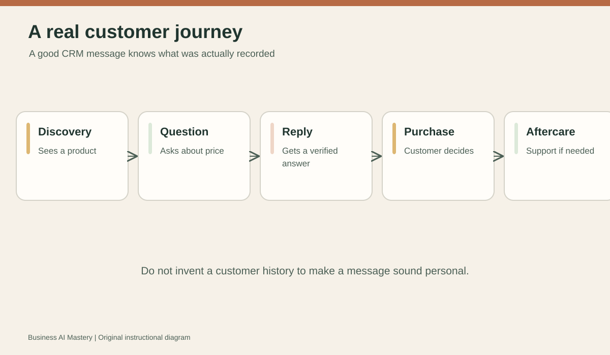

# HubSpot Breeze

**What you will be able to do:** Improve sales follow ups using actual CRM history.

> **Updated:** 20 November 2026. Interface, account access and available models can change.



*Original instructional artwork. Diagram labels are conceptual, not screenshots of a vendor interface.*

## Core guidance from the expanded handbook

*Sales, CRM and marketing assistant*

### Where this tool earns its place

Best for businesses whose lead and customer records are managed in HubSpot. Breeze Assistant can use CRM context for summarisation and content; other AI agents may involve separate usage charges.

### Before the first prompt

Clean up deal stages, contact details, next activity dates and source fields. Define what “qualified”, “proposal sent” and “closed” mean. Open Breeze Assistant inside HubSpot and specify the exact records or pipeline rather than requesting a vague list of leads.

### A complete business exercise

Review leads created in the past 30 days. Ask for accounts without a next activity, stalled proposals and incomplete contact records. Approve a follow up order. Draft messages using only the history actually logged. Test the message against an existing approved example, then send through the team’s normal process.

### Copy ready prompt for this tool

> In our Retail Partnerships pipeline, find open deals with no recorded activity in the past 14 days. Show deal name, owner, stage, latest logged interaction date and next action, if recorded. Do not invent meeting outcomes or customer intent. For the five deals I select, draft short follow up emails that reference only verified CRM notes and ask one relevant next question.

### When the result is weak

If the assistant sounds as though it knows what the prospect wants, check that the claim appears in the record. Remove invented urgency and any promise of pricing or delivery not approved by sales.

### Human editorial finish

A useful follow up is personal because it refers to the actual conversation, not because it begins with fake familiarity. Write briefly and make the next step easy to answer.

### Approval boundary and common errors

CRM data quality matters more than fancy messaging. Review customer permissions and whether a requested action would update records or contact customers.

**Official reference:** [HubSpot Breeze product guidance](https://knowledge.hubspot.com/ai/use-breeze-assistant)

## First session: from a blank workspace to a reviewable result

1. Define sales stages and require consistent data entry before using predictions.
2. Create a safe test set of fictional or appropriately protected contacts.
3. Open the relevant records and identify dates, enquiries and consent status.
4. Ask Breeze for a summary grounded in the CRM fields, not guessed intentions.
5. Draft a reply that answers the latest question and avoids fabricated familiarity.
6. Review contact permissions and have a seller send only an approved message.

## Prompt ladder: simple, evidence based and advanced

The prompts below are teaching examples. Replace fictional context with approved records. A tool that does not support freeform prompting may require you to perform the equivalent steps through its own interface.

### First pass

```text
Summarise this lead’s recorded interactions in date order. Distinguish notes written by staff from messages sent by the customer.
```

### Evidence based

```text
Find open leads with no recorded follow up in 14 days. Show record IDs and exclude contacts that have opted out.
```

### Communication

```text
Draft a 75 word reply answering the contact’s last recorded question. Use verified stock and delivery information only. Do not claim that they are ready to purchase.
```

## What an acceptable result looks like

**Illustrative reply:** “You asked whether the desk comes in a smaller size. The approved catalogue lists two widths. I can send the measurements if you would like.” This works because it answers an actual question.

## If the first version disappoints

If the draft says “I know you will love it”, remove that unsupported intimacy. If a lead stage changes without evidence, fix the CRM record and repeat the analysis.

## Human editorial finish

Keep the salesperson’s normal vocabulary and offer a helpful next step without pressure. A real relationship does not require invented personal detail.

## Practice assignment

Using a fictional or appropriately protected version of the case, complete **improve sales follow ups using actual crm history**. Save an evidence inventory, the first draft, a precise correction request and the reviewed deliverable. Write a short comparison showing what the revision genuinely improved.

## Approval and success test

Do the interaction records and permissions justify the message, and can a recipient opt out?

## Related reading

[Prompt anatomy](../01-foundations/prompting-fundamentals.md) · [Context engineering](../01-foundations/context-engineering.md) · [Humanisation](../01-foundations/humanization.md) · [Reference index](../06-reference/sources-and-updates.md)

## Studio lesson: improve a sales pipeline without sending spam

A CRM has evidence of conversations and sales stages, but it may also contain incomplete notes, duplicated contacts and old information. Start with a single segment rather than asking an assistant to *contact every lead*. In HubSpot, check which AI data permissions are enabled and what records Breeze Assistant actually used. The current knowledge base describes attaching context and referring to CRM records with `@` where supported.

```text
Review the 20 open fictional deals in this pipeline. For each deal,
identify its current stage, date of last logged customer interaction,
next documented step and any missing information. Propose a priority
order with a reason based only on existing CRM data. Do not invent
purchase intent or a conversation that was never recorded. Draft a
follow-up only for the five deals I approve. Mark each draft unsent.
```

**Audit the proposed follow-up.** A good message refers to the customer's actual question and makes one appropriate offer to help. A poor one pretends urgency or friendship and uses the same formula for every person. Compare a sample of drafts with the underlying customer history. If the customer did not consent to marketing, respect that status regardless of how promising the model considers the lead.

**Advanced workflow.** Build a lifecycle report that distinguishes leads created, qualified deals, meetings held and closed revenue. These are separate metrics with different denominators. Verify that archived, merged and duplicate records are handled consistently. If a HubSpot AI agent is involved, check credit consumption and approval points before enabling actions.

**Humanisation.** *I saw you asked about delivery to Entebbe. We can confirm the available options once you tell us the preferred day* is more relevant than *Unlock an incredible solution now*, provided the inquiry and options are real.

**Official reference:** [Use Breeze Assistant](https://knowledge.hubspot.com/ai/use-breeze-assistant).
