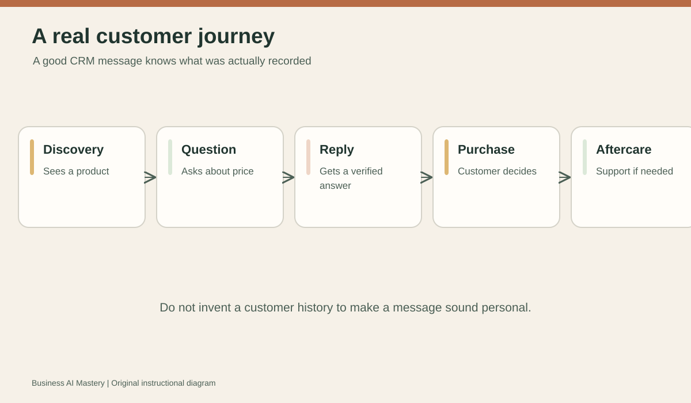

# Intercom Fin

**What you will be able to do:** Improve customer support answers using an approved knowledge base.

> **Updated:** 20 November 2026. Interface, account access and available models can change.



*Original instructional artwork. Diagram labels are conceptual, not screenshots of a vendor interface.*

## Core guidance from the expanded handbook

*Customer service assistant based on approved knowledge*

### Where this tool earns its place

Fin is an application for supporting customer conversations. It answers from curated help content and permitted data sources and can be given guidance about tone, processes and escalation.

### Before the first prompt

Build a small, accurate help library. Separate public answers from internal notes. Define escalation routes, opening hours, refund approval rules and sensitive subjects. Review audience permissions so customers cannot receive staff only content.

### A complete business exercise

Test 30 historical enquiry types using anonymised examples. Group failed cases into missing knowledge, unclear questions, wrong routing and tone. Improve the source article first when the policy is missing. Add a narrow piece of guidance where the response pattern needs correction. Repeat the test before expanding the audience.

### Copy ready prompt for this tool

> When a customer asks about delivery, use only the current Delivery Policy and the order status available to this conversation. State the verified delivery window if it applies. If their district, order status or delivery method is unknown, ask for the single missing detail or hand over to staff. Do not promise same day delivery, refunds or compensation not found in the approved sources.

### When the result is weak

A wrong answer is often a source maintenance problem. Correct the help article, verify indexing or sync, and test the same question again. If the question falls outside policy, use escalation rather than elaborate confident language.

### Human editorial finish

Service writing should sound attentive but not fake. Answer the question first, acknowledge inconvenience where relevant, and give an honest timeline. Never imitate a staff member or claim a human reviewed a reply when they did not.

### Approval boundary and common errors

Observe consent, security and escalation requirements. Review resolution rates alongside complaints and incorrect answers.

**Official reference:** [Intercom Fin product guidance](https://fin.ai/help/en/articles/13975995-fin-ai-agent-explained)

## First session: from a blank workspace to a reviewable result

1. List recurring customer questions and the actual policy owners.
2. Prepare current help articles with clear headings, dates and exceptions.
3. Configure Fin’s knowledge sources and permitted support actions where available.
4. Test with normal, ambiguous and deliberately misleading customer messages.
5. Inspect whether each answer is supported by a current policy and whether escalation happens at the right time.
6. Review unresolved conversations weekly and repair the knowledge base, not just the wording of one reply.

## Prompt ladder: simple, evidence based and advanced

The prompts below are teaching examples. Replace fictional context with approved records. A tool that does not support freeform prompting may require you to perform the equivalent steps through its own interface.

### First pass

```text
List the knowledge articles relevant to this shipping question and identify contradictions or outdated dates.
```

### Evidence based

```text
Draft a reply using only the approved shipping and returns articles. If a specific date cannot be promised, say so plainly.
```

### Escalation

```text
For a complaint with damaged goods and missing order information, ask for the minimum details needed and route to a person if the policy cannot resolve it.
```

## What an acceptable result looks like

“We can check the delivery status if you provide your order reference” is appropriate when that is the support process. A fabricated shipment estimate is not.

## If the first version disappoints

When support answers contradict a human agent, inspect which article was retrieved and the article’s date. Change the source or escalation rule before attempting a cosmetic rewrite.

## Human editorial finish

Avoid automatic cheerfulness in upsetting situations. Address the customer’s issue in plain terms and give a meaningful, achievable next step.

## Practice assignment

Using a fictional or appropriately protected version of the case, complete **improve customer support answers using an approved knowledge base**. Save an evidence inventory, the first draft, a precise correction request and the reviewed deliverable. Write a short comparison showing what the revision genuinely improved.

## Approval and success test

Are knowledge sources controlled and is a human route available when the tool lacks authority or confidence?

## Related reading

[Prompt anatomy](../01-foundations/prompting-fundamentals.md) · [Context engineering](../01-foundations/context-engineering.md) · [Humanisation](../01-foundations/humanization.md) · [Reference index](../06-reference/sources-and-updates.md)

## Studio lesson: prepare a support answer base before enabling an agent

An automated support agent cannot solve a policy conflict that staff have not resolved. Before using Fin, inventory the official help articles that answer delivery, returns, account access and billing questions. For each article record its owner, effective date, markets covered and escalation contact. Identify which questions should always go to a person, such as suspected fraud, sensitive personal information, and disputed payments.

**Draft test question:** *A customer says a parcel arrived broken, wants the cost refunded, and cannot provide the order number.* Can the help centre answer that without inventing a policy? If not, improve the source article and escalation process rather than trying to force the model to sound more confident.

```text
Using our approved support articles only, draft an answer for a customer
who received a damaged item. First locate the policy that covers this
product and market. Ask only for information necessary to identify the
order safely. If the policy requires human inspection, explain that
step and route the case to the correct team. Do not promise a refund,
replacement or timeframe not stated in the policy. Keep the response
short, respectful and concrete.
```

**Quality test set:** 15 representative questions, five deliberately ambiguous questions and five adversarial messages. Evaluate factual correctness, source coverage, escalation, customer comprehension and whether a proposed answer would harm someone if wrong. Use fictional customer identifiers in public tutorials.

**Humanisation.** A good service answer reflects the customer's situation without pretending to be a person or making up sympathy. *I can help you report the damage. Please use the secure order form so the team can find the purchase* is useful if that process actually exists. Emotional decoration without a credible next step makes service feel less human, not more.

**Official reference:** [Fin](https://www.intercom.com/fin).
