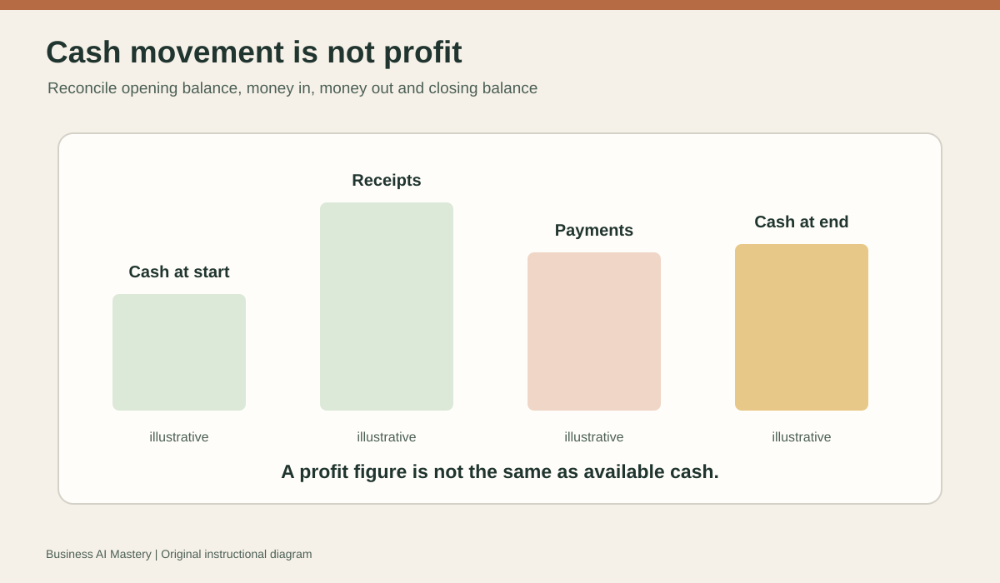

# Microsoft 365 Copilot

**What you will be able to do:** Prepare an overdue invoice review in Microsoft 365.

> **Updated:** 20 November 2026. Interface, account access and available models can change.



*Original instructional artwork. Diagram labels are conceptual, not screenshots of a vendor interface.*

## Core guidance from the expanded handbook

*Workplace assistant inside Microsoft applications*

### Where this tool earns its place

Choose this when business records already live in Excel, Word, Outlook and Teams. It is an application experience that can use work data you are authorised to access, not a single standalone business language model.

### Before the first prompt

Start in the relevant Microsoft application rather than a blank chat. In Excel make the data a clear table, confirm data types, and name the columns. In Outlook select the thread and the desired reply. In Teams locate the meeting record. Verify that the correct work account and data permissions are active.

### A complete business exercise

For an overdue receivables review, open the relevant Excel workbook. Ask Copilot to find invoices overdue by more than 30 days, grouped by customer, and identify records with missing due dates. Check the actual rows and create a follow up plan. In Outlook use the approved list to draft customer specific reminders, leaving balances and payment details unchanged. Never send without review.

### Copy ready prompt for this tool

> In the table named Invoices, use InvoiceDate, DueDate, Customer, Currency, Balance and Status. Calculate days overdue as of 20 November 2026. Do not include paid or void invoices. Show a grouped summary by customer plus all records where a date or status is missing. Identify the formula or data range used. Draft a tactful reminder for only the invoices I confirm.

### When the result is weak

If Copilot looks at the wrong table, name the table and columns explicitly. If it creates a chart without declaring which measure it plotted, ask for the aggregation, date range and excluded rows. Confirm formulas in Excel itself.

### Human editorial finish

Use natural customer messages that acknowledge the particular invoice and invite correction if the payment has already been made. Do not sound threatening or imply late fees that have not been agreed.

### Approval boundary and common errors

Some capabilities depend on Microsoft 365 subscription, licensing and tenant setup. Confirm access rather than assuming every feature is available.

**Official reference:** [Microsoft 365 Copilot product guidance](https://support.microsoft.com/en-us/microsoft-365-copilot/get-started-writing-prompts-in-microsoft-365-copilot)

## First session: from a blank workspace to a reviewable result

1. Open the approved Excel table or the file shared in Microsoft 365 using the correct account.
2. Check that due dates are dates, balances are numeric and cancelled invoices are clearly marked.
3. Ask Copilot to describe the fields before requesting any grouping.
4. Reconcile overdue totals with the workbook rather than trusting a summary alone.
5. Draft a customer reminder in Outlook from the actual invoice record; do not include extra private details.
6. Require staff review before any message is sent.

## Prompt ladder: simple, evidence based and advanced

The prompts below are teaching examples. Replace fictional context with approved records. A tool that does not support freeform prompting may require you to perform the equivalent steps through its own interface.

### First pass

```text
In the Invoices table, identify empty DueDate, invalid Balance and missing Status cells. Return affected row identifiers.
```

### Evidence based

```text
As of 20 November 2026, group unpaid, nonvoid invoices by days overdue. Show the underlying filters and arithmetic. Keep each currency separate.
```

### Communication

```text
Draft an individual, polite reminder for this verified invoice. Include the exact approved amount and due date. Do not invent a payment link or imply previous promises.
```

## What an acceptable result looks like

**Illustrative reminder:** “Our records show invoice 1048 remains open. The listed due date is 3 November. Could you confirm whether payment is already on its way?” The number and date must come from the actual record.

## If the first version disappoints

When generated totals do not reconcile, compare the formula range, text dates, duplicate records and credit notes. If the message sounds threatening, reset the tone to a professional request for clarification.

## Human editorial finish

The accounts colleague should check the relationship and whether a payment was recently received before sending. A helpful reminder is precise, not artificially warm.

## Practice assignment

Using a fictional or appropriately protected version of the case, complete **prepare an overdue invoice review in microsoft 365**. Save an evidence inventory, the first draft, a precise correction request and the reviewed deliverable. Write a short comparison showing what the revision genuinely improved.

## Approval and success test

Do the Excel records support the figures, and did a person authorise the external message?

## Related reading

[Prompt anatomy](../01-foundations/prompting-fundamentals.md) · [Context engineering](../01-foundations/context-engineering.md) · [Humanisation](../01-foundations/humanization.md) · [Reference index](../06-reference/sources-and-updates.md)

## Studio lesson: a board update grounded in Microsoft 365

Microsoft 365 Copilot is most helpful when the owner already lives in Outlook, Teams, Excel, Word and PowerPoint. The difficult part is not typing a command. It is giving Copilot access to the correct documents, then ensuring that the final account is faithful to those materials. Features vary between personal and organisational accounts, and some work-data capabilities need separate licensing.

**Set up the source material.** Maintain a controlled OneDrive or SharePoint location containing approved monthly accounts, meeting decisions and the current operating plan. Check who can see it; Copilot's respect for existing permissions does not substitute for good file permission hygiene. When your Copilot interface supports grounding controls, confirm whether work sources are enabled. Microsoft documents a Work IQ control for relevant accounts.

```text
Write a two-page owner update for November using only the attached
finance review and the named October and November management meeting
notes. Summarise actual decisions, their owners and their due dates.
Beside each decision, state the document and meeting date supporting it.
Do not describe a suggestion as an approved decision. If the finance
review lacks cost figures, do not report profit margin. List unresolved
items at the end. Use restrained, plain language suitable for directors.
```

Next, ask for an Excel table with one row per action, rather than asking for a polished presentation first. Inspect whether the output carried over dates correctly and whether names refer to the right owners. Only then turn the approved table into slides. A presentation can be beautiful while still being wrong; the figures and dependencies determine whether it is usable.

### Troubleshooting permissions and grounding

If Copilot says a document is unavailable, verify that you have access, that the file type and location are supported, and that you are in the correct account. Do not instruct it to 'ignore permissions'. If a response seems too broad, explicitly reference a source file using the product's supported source picker or file reference syntax, then limit the task to that file.

### Human editorial finish

Microsoft-style corporate summaries can become a parade of abstract nouns. Replace *strategic alignment on resource utilisation* with *the service team will move two shifts to Saturday because weekend requests increased*. The revised sentence still needs a source. Read the final memo aloud, then have the meeting owner confirm each decision and the intended recipients.

**Official references:** [Where Copilot gets information](https://support.microsoft.com/en-us/microsoft-365-copilot/what-information-does-copilot-use-to-answer-my-prompt) and [prompt guidance](https://support.microsoft.com/en-us/microsoft-365-copilot/get-started-writing-prompts-in-microsoft-365-copilot).
