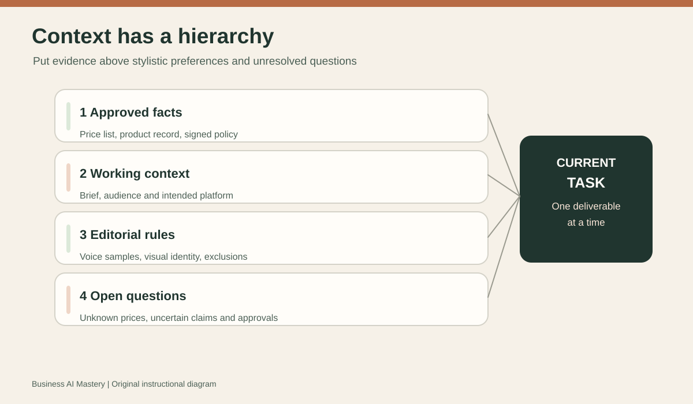

# Notion AI and Notion Agent

**What you will be able to do:** Build a company knowledge base that answers staff questions.

> **Updated:** 20 November 2026. Interface, account access and available models can change.



*Original instructional artwork. Diagram labels are conceptual, not screenshots of a vendor interface.*

## Core guidance from the expanded handbook

*Knowledge, procedures, project records and connected search*

### Where this tool earns its place

Useful for an organisation that needs a reliable place to store decisions, procedures, project notes and approved reference pages. The Agent and search features can act on workspace material within permissions and available plans.

### Before the first prompt

Create a top level business workspace, then pages for Operating Procedures, Decisions, Meetings, Marketing Library and Roles. Make page status visible: draft, approved, retired. Do not start by importing every old note. Curate the information first.

### A complete business exercise

After a properly consented team meeting, store the notes and extract decisions, named owners and due dates. Ask the agent to compare them against open tasks, propose updates, and identify decisions that still lack approval. Have a human confirm each action. Publish a concise summary to the team page and archive the previous approved version.

### Copy ready prompt for this tool

> Read the meeting note dated 18 November 2026 and our Current Priorities database. Extract only decisions explicitly recorded in the meeting, with owner and deadline if actually stated. Match each to an existing task where possible. Put uncertain assignments in a “Needs confirmation” section. Draft the manager’s update in plain language and do not change the task database until I approve the list.

### When the result is weak

If an owner is guessed from context, replace it with “unassigned”. If an outdated page is used, identify the revised policy and retire the old one. When search results from connected apps conflict, label both dates.

### Human editorial finish

Meeting summaries should reflect how the team actually speaks about work, not replace every discussion with vague efficiency language. Capture small but important problems, and keep promises tied to named people.

### Approval boundary and common errors

Meeting transcription requires appropriate consent; workspace permissions and connector access need review.

**Official reference:** [Notion AI and Notion Agent product guidance](https://www.notion.com/help/notion-agent)

## First session: from a blank workspace to a reviewable result

1. Identify the recurring questions staff ask about ordering, returns and opening routines.
2. Gather only current, approved procedures and name a document owner for each.
3. Create pages with one clear purpose and a last reviewed date.
4. Use Notion AI or Agent where available to draft a table of unanswered questions from the approved pages.
5. Test the answers with staff scenarios that have one verifiable resolution.
6. Keep permissions narrow and route missing policies to the responsible person.

## Prompt ladder: simple, evidence based and advanced

The prompts below are teaching examples. Replace fictional context with approved records. A tool that does not support freeform prompting may require you to perform the equivalent steps through its own interface.

### First pass

```text
From these approved operating pages, identify their titles, owners, dates and unresolved conflicts.
```

### Evidence based

```text
Draft a staff FAQ. Every answer must link to its source page or say that the procedure is not documented.
```

### Implementation

```text
Convert approved steps into a checklist for opening the shop. Add a place to record exceptions and the person responsible for reviewing them.
```

## What an acceptable result looks like

An effective knowledge answer says “The return window is stated in the Returns Policy, section 2” with a link, rather than “Our policy is flexible and customer friendly.”

## If the first version disappoints

If answers cite obsolete pages, improve page status and the source hierarchy. If procedures contain vague verbs such as “handle promptly”, request the actual action and responsible role.

## Human editorial finish

Use the exact terms staff use for tools, roles and counters. Let the team challenge unclear steps before declaring a page complete.

## Practice assignment

Using a fictional or appropriately protected version of the case, complete **build a company knowledge base that answers staff questions**. Save an evidence inventory, the first draft, a precise correction request and the reviewed deliverable. Write a short comparison showing what the revision genuinely improved.

## Approval and success test

Can a new employee trace every instruction to the current source and identify whom to ask when the source is silent?

## Related reading

[Prompt anatomy](../01-foundations/prompting-fundamentals.md) · [Context engineering](../01-foundations/context-engineering.md) · [Humanisation](../01-foundations/humanization.md) · [Reference index](../06-reference/sources-and-updates.md)

## Studio lesson: build a handbook staff can actually use

Begin with information architecture, not chat. A service business might have pages for `Opening the shop`, `Taking a booking`, `Handling a complaint` and `Closing the shift`. Each page needs an owner, last-reviewed date, approval state and links to the documents it depends on. When Notion AI is used to answer employee questions, obsolete procedures in the workspace can still mislead the result unless the source material is maintained.

Use a small database with fields such as `Procedure`, `Owner`, `Status`, `Effective from`, `Review due` and `Related form`. Write one plain-language instruction per meaningful action. Keep screenshots of menus only when necessary and label them with capture date so they can be replaced when the interface changes.

```text
Using the approved pages in the Operations workspace, draft a
step-by-step opening checklist for a new employee. Start at arrival and
end when the shop is ready for customers. For every step identify the
responsible role and the evidence of completion. If two pages disagree,
list the conflict rather than choosing a new rule. Do not invent key
holders, opening hours, cash limits or access codes.
```

**Test against an employee question.** Ask *What should I do if the card terminal is offline?* The answer should link to the correct, current page and flag any approval needed. If the answer drifts into generic customer-service advice, improve the underlying document instead of adding more adjectives to the prompt.

**Human editorial finish.** Staff documents should feel like help from an experienced colleague. Prefer *Put the day's cash summary in the locked office folder* over *ensure financial operational compliance*. Use the former only if it is the actual approved procedure. Do not put personal customer data or passwords in a public teaching workspace.

**Official reference:** [Notion Help](https://www.notion.com/help).
