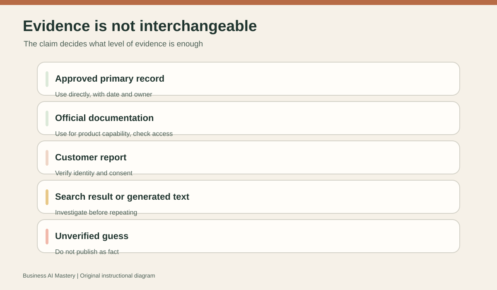

# Perplexity

**What you will be able to do:** Research competitors without inventing facts.

> **Updated:** 20 November 2026. Interface, account access and available models can change.



*Original instructional artwork. Diagram labels are conceptual, not screenshots of a vendor interface.*

## Core guidance from the expanded handbook

*Research application with source links*

### Where this tool earns its place

Use for finding current public information, not for treating a generated summary as evidence. It is valuable for competitors, laws, specifications, suppliers and trends, especially when you open the original cited pages.

### Before the first prompt

Write one research question at a time, with geography, date and source priority. Decide whether you need official sources, primary data, product manuals or community feedback. Use the more thorough search mode if available for consequential questions.

### A complete business exercise

Suppose a business wants to compare card payment solutions in Uganda. Ask for a map of providers and official fee documents. Open each fee page and record what was actually published, along with conditions, payment method, settlement and date. Ask the assistant to flag unknowns and produce questions to ask each provider. Only after verification should a recommendation be written.

### Copy ready prompt for this tool

> As of 20 November 2026, identify payment service providers serving registered businesses in Uganda. Prioritise current provider documentation and official regulatory sources. For each provider, give a link to its own business product page and disclose whether pricing is publicly verified or must be requested. Separate factual service features from marketing statements. No unsupported ranking of “best” providers.

### When the result is weak

A search result that cites another roundup is not good enough for a decisive fee comparison. Ask for provider or regulator sources. When claims are time sensitive, request publication or update dates and note gaps.

### Human editorial finish

Write findings as a purchasing brief rather than a breathless trend article. Emphasise the questions the owner should ask on a sales call, not which provider sounds impressive.

### Approval boundary and common errors

A visible citation is not a guarantee of a valid quote. Open the source and check context, date and conditions.

**Official reference:** [Perplexity product guidance](https://www.perplexity.ai/help-center/en/articles/10352903-what-is-pro-search)

## First session: from a blank workspace to a reviewable result

1. Define the question narrowly, for example published delivery policies of three competitors.
2. Ask for primary official pages, not a broad unverified ranking of “best providers”.
3. Open each cited page and record its publication date, location and relevant clause.
4. Create a comparison table with a separate source column for every claim.
5. Mark facts that cannot be verified as unknown, not estimated.
6. Use findings to choose a test in your own business rather than copy the competitor’s language.

## Prompt ladder: simple, evidence based and advanced

The prompts below are teaching examples. Replace fictional context with approved records. A tool that does not support freeform prompting may require you to perform the equivalent steps through its own interface.

### First pass

```text
Find the official current return policy pages for these three named retailers. Give working links, country and date checked.
```

### Evidence based

```text
Compare delivery charges, exclusions and return windows exactly as the official pages state. If a term is not published, write “not found”.
```

### Decision support

```text
Based on verified differences only, propose two customer questions we should investigate before changing our own policy. Keep speculation clearly labelled.
```

## What an acceptable result looks like

**Illustrative finding:** “Retailer A publishes a 14 day return window for unopened items, according to its policy page accessed on the research date.” Never write this about an actual retailer unless that page supports it.

## If the first version disappoints

If the citations land on a homepage, follow the link to the real policy. If a result cites old cached terms, note the mismatch and seek the newer page. Remove invented market share percentages.

## Human editorial finish

Summarise the research in the owner’s practical language: what changed, what matters, what remains unknown. A source list is only valuable if someone can inspect it.

## Practice assignment

Using a fictional or appropriately protected version of the case, complete **research competitors without inventing facts**. Save an evidence inventory, the first draft, a precise correction request and the reviewed deliverable. Write a short comparison showing what the revision genuinely improved.

## Approval and success test

Are links working and dated? Are comparisons for the same country, product category and time period?

## Related reading

[Prompt anatomy](../01-foundations/prompting-fundamentals.md) · [Context engineering](../01-foundations/context-engineering.md) · [Humanisation](../01-foundations/humanization.md) · [Reference index](../06-reference/sources-and-updates.md)

## Studio lesson: competitor research without accidental misinformation

A search answer may look well sourced and still compare unlike products, confuse countries or rely on an out-of-date page. Use Perplexity to assemble a research trail and open each important source yourself. Begin by defining a narrow question: *Which three competitors publicly list 30 ml skincare products in our target market, and how are the sizes and claims described?* This is more reliable than asking who is winning the skincare market.

```text
Research publicly available product listings for a fictional skincare
shop considering a 30 ml moisturiser. Market: [specific country/city].
Time frame: sources available as of 20 November 2026. Make a table with
retailer, product, size, observed listed price, currency, page URL, date
checked and any qualifications. Prefer official seller pages. Mark a
missing price 'not published'. Do not infer market share or customer
satisfaction from the number of search results. List claims that need
independent checking.
```

Then run a **verification pass**: open the first-party listing, check whether it is still published, compare pack sizes and currencies, and note whether tax or shipping is included. Screen captures or citation links should be stored according to your rights and privacy policy. For legal, medical or financial claims, go to primary laws, standards or regulator guidance instead of relying on a generated summary.

**Advanced comparison.** Ask the tool to identify disagreements between sources and classify each as a date difference, metric-definition difference, country difference or unresolved conflict. Do not choose a winner because one source sounds more confident. A concise research memo should explain *what we know, what we do not, and what this means for a test*.

**Humanisation.** The final customer-facing copy should not say *market-leading industry solution*. If genuine research establishes that customers struggle to compare two pack sizes, a better editorial angle is a simple, visible cost-per-quantity comparison with a real example. The source supports the comparison; it does not authorise an invented testimonial.

**Official reference:** [Perplexity Help Center](https://www.perplexity.ai/help-center).
