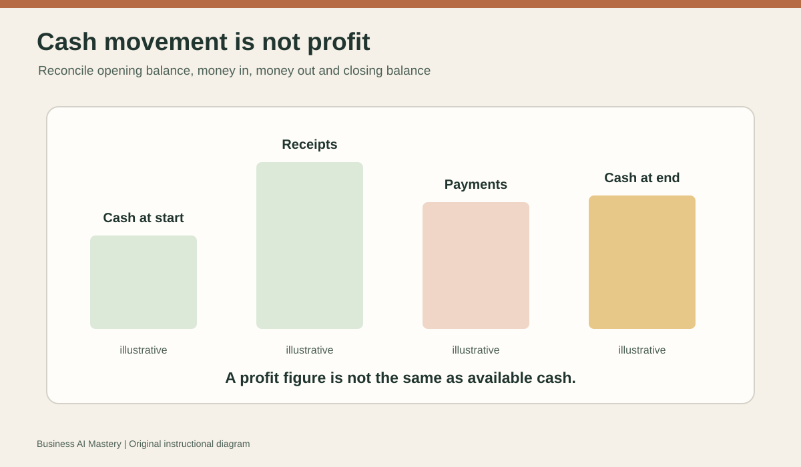

# QuickBooks with Intuit AI

**What you will be able to do:** Understand cash flow without confusing it with profit.

> **Updated:** 20 November 2026. Interface, account access and available models can change.



*Original instructional artwork. Diagram labels are conceptual, not screenshots of a vendor interface.*

## Core guidance from the expanded handbook

*Accounting and payment management software*

### Where this tool earns its place

Use it for accurate bookkeeping workflows, receipt and transaction handling, invoices and receivables. Intuit AI includes specialist accounting and payments assistants, but supported features depend on region and plan. Do not assume a US payment method is available in Uganda.

### Before the first prompt

Connect approved business accounts or import reliable transaction records. Confirm chart of accounts, tax treatment, opening balances and invoice templates with the accountant. Review permissions before using automation. Reconcile a known past month before asking for predictions.

### A complete business exercise

Review an accounts receivable report. Identify late balances, disputed invoices and missing contact information. Ask for a suggested follow up sequence, then approve each reminder. For cash flow, distinguish bank balance from future invoices and commitments. Have an accountant review reconciliations and classifications.

### Copy ready prompt for this tool

> Using only the current Accounts Receivable report, group unpaid invoices by 0 to 30, 31 to 60, 61 to 90 and over 90 days past due. Exclude void and paid transactions. Identify clients with disputed invoices and do not recommend an automated reminder for those records. Show the source invoice ID for every total. Prepare a courteous draft follow up for approval; do not send it.

### When the result is weak

If an expense category is incorrect, fix the underlying transaction classification instead of polishing a narrative around bad numbers. Trace every total to the ledger and reconcile tax and payment details.

### Human editorial finish

Money messages should be clear and considerate. Refer to the actual invoice, provide the correct contact route, and acknowledge that payments sometimes cross with reminders.

### Approval boundary and common errors

Accountant review is essential for tax filings and unusual entries. Check geographic product availability and data privacy.

**Official reference:** [QuickBooks with Intuit AI product guidance](https://quickbooks.intuit.com/learn-support/en-us/help-article/accounting-bookkeeping/overview-agents-quickbooks-online/L9irCAtK4_US_en_US)

## First session: from a blank workspace to a reviewable result

1. Make sure bank transactions and invoices are reconciled in the accounting system.
2. Check the report period, basis of accounting and currency.
3. Ask Intuit Intelligence a descriptive question about cash movement.
4. Inspect the underlying transactions for large or unusual movements.
5. Separate cash balance, revenue, expenses, taxes and outstanding receivables.
6. Review any recommendation with the bookkeeper or qualified accountant before changing policy.

## Prompt ladder: simple, evidence based and advanced

The prompts below are teaching examples. Replace fictional context with approved records. A tool that does not support freeform prompting may require you to perform the equivalent steps through its own interface.

### First pass

```text
For October 2026, show opening cash, recorded inflows, outflows and closing cash using the reconciled records. State the accounting basis.
```

### Evidence based

```text
Break down the largest payments and receipts by category. Identify unreconciled or uncategorised items separately and do not guess their purpose.
```

### Decision support

```text
List three questions for the accountant about the cash changes. Include the report and transaction references for each question, without recommending an unsupported tax treatment.
```

## What an acceptable result looks like

An owner might see improved monthly revenue and lower cash at month end because of stock purchases or overdue receivables. This is a hypothesis until the underlying movements confirm it.

## If the first version disappoints

If the balance fails to match the bank, investigate missing transactions before any forecast. If the tool calls a transfer “income”, inspect the category and correct the source record.

## Human editorial finish

Rewrite the monthly note in financial language staff can use: how much cash is available, which bills are due, and what remains uncertain.

## Practice assignment

Using a fictional or appropriately protected version of the case, complete **understand cash flow without confusing it with profit**. Save an evidence inventory, the first draft, a precise correction request and the reviewed deliverable. Write a short comparison showing what the revision genuinely improved.

## Approval and success test

Does the report reconcile? Has any tax, payroll or regulatory conclusion been reviewed by a qualified person?

## Related reading

[Prompt anatomy](../01-foundations/prompting-fundamentals.md) · [Context engineering](../01-foundations/context-engineering.md) · [Humanisation](../01-foundations/humanization.md) · [Reference index](../06-reference/sources-and-updates.md)

## Studio lesson: understand cash without mistaking it for profit

A business can report strong sales and still have too little cash to pay suppliers. QuickBooks records are valuable because they document invoices, expenses, payments and account balances, but the analysis depends on proper categorisation and reconciliation. Intuit Intelligence helps surface information and complete some tasks, yet the owner must review transactions and obtain professional advice when tax treatment is uncertain.

**A disciplined monthly sequence:** reconcile the bank, review outstanding invoices, inspect bills due, check uncategorised entries and confirm the accounting basis. Only then ask what changed. Keep separate terms for revenue, gross profit, net profit, operating cash and bank balance. They are not synonyms.

```text
Using only the reconciled records for October 2026, prepare a cash
review. Show opening and closing cash, customer payments received,
supplier payments, payroll and other material movements. Identify the
ten largest unpaid customer invoices by due date, but do not disclose
private customer details in a public example. List uncategorised or
unreconciled transactions separately. Do not forecast tax liabilities or
classify a transaction without my approval.
```

**Follow-up prompt:** *For each late invoice, prepare a proposed reminder using the actual agreed payment terms. Do not send it. Flag disputes and promises to pay for human review.* A polite reminder should say the invoice number, amount and due date only if verified. It should not imply legal action without policy approval.

**Exercise with illustrative numbers.** A fictional shop made UGX 12,000,000 in invoiced sales but collected only UGX 7,000,000 during the month. It also paid UGX 8,500,000 in cash expenses. That is not enough information to calculate its profit. It does show why receipts and payments must be examined separately. Label the example illustrative, and do not transfer these figures into a real client report.

**Human editorial finish.** Change *optimise collections* to *call the three customers whose invoices are past the agreed due date and whose accounts show no dispute*, when the records justify it. A finance report should tell the owner what to verify and decide, not disguise uncertainty in polished prose.

**Official reference:** [Introducing Intuit Intelligence](https://quickbooks.intuit.com/learn-support/en-us/help-article/intuit-assist/introducing-intuit-intelligence/L189976Da_US_en_US).
