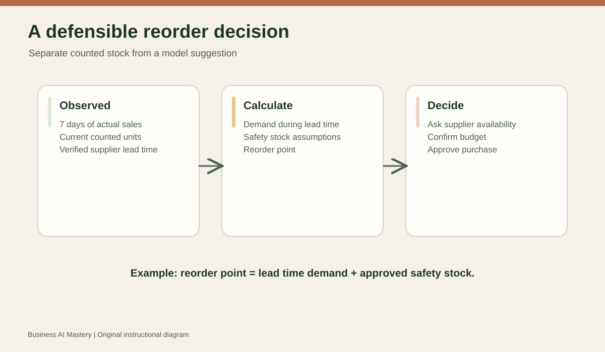

# Shopify Sidekick

**What you will be able to do:** Research a product availability question inside a Shopify shop.

> **Updated:** 20 November 2026. Interface, account access and available models can change.



*Original instructional artwork. Diagram labels are conceptual, not screenshots of a vendor interface.*

## Core guidance from the expanded handbook

*Commerce operations assistant in Shopify*

### Where this tool earns its place

Use it if the business actually runs on Shopify. Sidekick can work inside the store admin to help analyse shop information, draft content and carry out supported store tasks. It is not a substitute for verifying stock and storefront publication.

### Before the first prompt

Open Sidekick from the Shopify admin. Check the correct store, dates, store currency and permissions. Start with a read only question such as sales by collection, low inventory or abandoned checkout patterns. Keep store changes behind explicit confirmation.

### A complete business exercise

Ask for products whose inventory is nearing a reorder threshold. Compare sales rate and supplier lead time with the existing catalogue. Review whether any items are already committed to orders. Have Sidekick draft revised product page descriptions using verified specifications only. Preview edits before publishing.

### Copy ready prompt for this tool

> For the last 30 completed days, show the 15 products with the highest units sold and their current available inventory. Exclude cancelled orders and returns from the sales measure. Flag products where stock may not cover the next two weeks at the same sales rate, clearly saying that this is a simple estimate. Do not alter inventory, discounts, prices or published descriptions.

### When the result is weak

When results look wrong, inspect whether the data counts returns and which sales channel it includes. Ask for the time window and definitions. Do not generate a discount recommendation without knowing margins.

### Human editorial finish

Rewrite descriptions so they help someone choose. Include real dimensions, compatibility, material or delivery restrictions instead of “must have” claims. Use the actual product photograph.

### Approval boundary and common errors

Any action that changes a store can affect buyers immediately. Preview and approve changes in the admin.

**Official reference:** [Shopify Sidekick product guidance](https://help.shopify.com/en/manual/ai-powered-tools/sidekick)

## First session: from a blank workspace to a reviewable result

1. Enter the actual store admin using an authorised staff role.
2. Start with the product’s existing name, variants, stock locations and published price.
3. Ask Sidekick to explain the relevant store data; inspect suggested actions before applying them.
4. Verify that inventory counts reflect recent returns or transfers.
5. Draft product copy from the verified record and inspect product photographs manually.
6. Review the storefront on a phone after any approved change.

## Prompt ladder: simple, evidence based and advanced

The prompts below are teaching examples. Replace fictional context with approved records. A tool that does not support freeform prompting may require you to perform the equivalent steps through its own interface.

### First pass

```text
For this SKU, summarise published variants, listed price, inventory by location and which fields are missing. Do not modify the product.
```

### Evidence based

```text
Which variants might need attention based on the provided actual recent sales and inventory? Cite the store records and distinguish a suggestion from a stock commitment.
```

### Storefront

```text
Draft a product description using only the official fields. Exclude unverified material, compatibility, warranty and delivery claims. Leave changes pending review.
```

## What an acceptable result looks like

A useful product page says “Dimensions: 30 cm by 20 cm” when confirmed by the catalog. “Perfect for every home” gives no evidence and may not help the buyer.

## If the first version disappoints

If the assistant mixes inventory between variants, ask it to display the exact variant IDs. If a proposed change affects live pricing or stock, inspect it in the admin before approval.

## Human editorial finish

Have someone familiar with customer questions test the description. Include the practical dimensions and care information buyers regularly request.

## Practice assignment

Using a fictional or appropriately protected version of the case, complete **research a product availability question inside a shopify shop**. Save an evidence inventory, the first draft, a precise correction request and the reviewed deliverable. Write a short comparison showing what the revision genuinely improved.

## Approval and success test

Does the live product page match approved stock, imagery, pricing and policies?

## Related reading

[Prompt anatomy](../01-foundations/prompting-fundamentals.md) · [Context engineering](../01-foundations/context-engineering.md) · [Humanisation](../01-foundations/humanization.md) · [Reference index](../06-reference/sources-and-updates.md)

## Studio lesson: a useful product page that matches the actual item

A store owner can draft better descriptions and inspect product performance with Sidekick, but it is easy to publish inaccurate claims about materials, size, origin or stock. Shopify explains that Sidekick works with store data and can present actions for review. Use this review stage deliberately, especially before edits that affect live pages.

**Prepare a product fact sheet.** Record the product's exact title, barcode or SKU, size, variants, materials, verified usage instructions, care notes, price, shipping conditions and the approved original photographs. Separate what the supplier says from what your own team has confirmed. If a field is missing, leave it blank rather than copying a plausible phrase from another product.

```text
Using only product SKU CANDLE-012 and its approved attributes, draft a
product page for customers purchasing a home candle. Provide a title,
a two-sentence explanation, exact specifications, care instructions
only if present, and three customer questions worth answering. Mark
missing burn time, wax composition and origin as 'not confirmed'.
Do not infer a scent profile from a photograph. Present proposed
changes for review; do not publish or edit the live listing.
```

**Beyond copywriting:** ask for a collection audit to locate missing images, mismatched variant labels and duplicate titles. Review a sample of ten items by opening their live pages. Customer experience improves when shipping conditions and actual stock are easy to find, not when every paragraph declares the product *premium*.

**Advanced scenario:** compare visitor sessions, add-to-cart actions and paid orders by collection using the platform's metric definitions and reporting period. Do not assume a change in conversion rate was caused by a new image without a controlled test. Record when prices or shipping offers changed.

**Official reference:** [Shopify Sidekick](https://help.shopify.com/en/manual/ai-powered-tools/sidekick).
