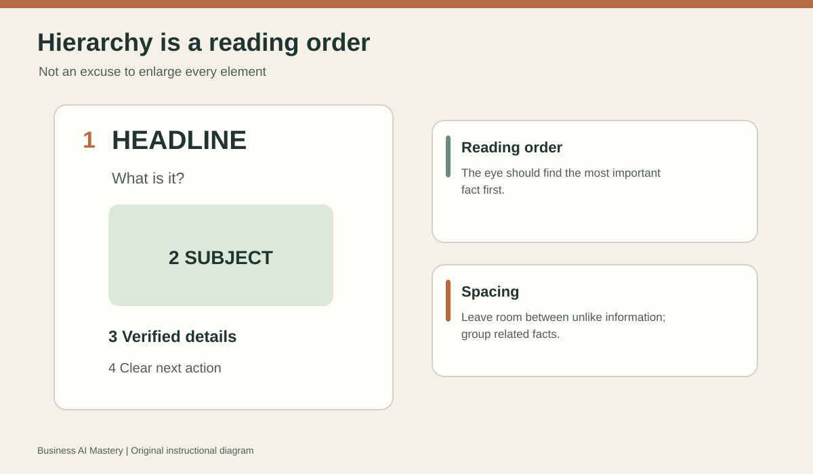

# Adobe Express for editable content and fast brand adaptation

> Reviewed 20 November 2026. Feature location and plan availability may change.



## Where it fits

Adobe Express is useful for editable social graphics, straightforward video and design adaptations. Some generative features can help draft templates or rewrite copy, but the finished brand identity should be built with real text layers and approved images. Treat generated templates as starting points rather than as a source of truth.

## First project: a three-size announcement

A fictional community bookstore is holding a Saturday event. The approved content includes the exact title, start time, venue and entry requirements. Begin with a portrait poster for a social feed. Create one dominant title, leave enough space for location and time, and use an authorised photo. Duplicate into story and square formats, then recompose for each crop.

```text
Make an editable layout concept for the event "Books and Coffee".
Use the supplied exact date, venue and entry terms, with a calm
cream-and-ink design system. Give the event title priority, then time,
then location and next step. Use no fake sponsor logos, invented ticket
price, unrelated stock photo, embossed chrome or futuristic glow.
Describe the layout before applying it.
```

## Humanisation and revision

The danger is a busy template full of stickers that hides the practical information. Remove decoration that does not help the reader. If text rewriting turns the event into a *transformative literary experience*, bring it back to what someone will actually do. Confirm every occurrence of the date after resizing and before export.

## Print and phone checks

Read the headline at thumbnail size, test colour contrast and ensure the story's bottom caption is not hidden by platform controls. Use real text where possible, not text embedded in an unreliable generated image. Export a flattened image for posting and preserve an editable source copy for later corrections.

**Official references:** [Generative templates](https://helpx.adobe.com/express/web/create-with-templates/text-to-template.html), [Rewrite](https://helpx.adobe.com/express/web/create-and-customize-text/create-text-variations-using-generative-ai.html).

[Home](../README.md) · [Canva comparison](canva.md)
