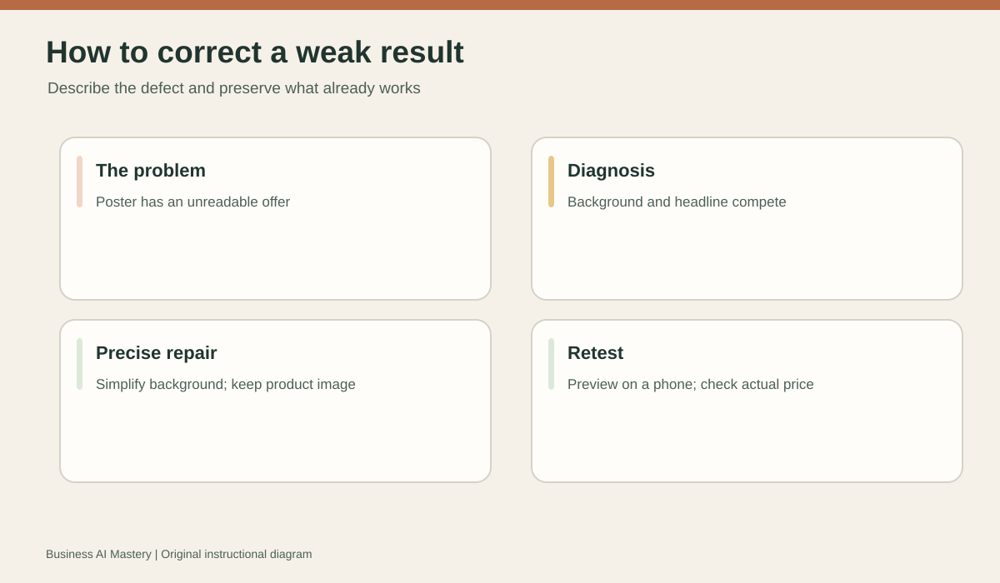

# Adobe Firefly

**What you will be able to do:** Edit a campaign image without losing product identity.

> **Updated:** 20 November 2026. Interface, account access and available models can change.



*Original instructional artwork. Diagram labels are conceptual, not screenshots of a vendor interface.*

## Core guidance from the expanded handbook

*Image and video generation in an editing workflow*

### Where this tool earns its place

Firefly combines generation with editing tools such as prompt to edit and generative fill. It is valuable when the designer needs to refine an existing image rather than replace everything after each prompt.

### Before the first prompt

Choose Image or Video from the available Firefly interface. Import an authorised reference image if appropriate. Mark which region is the edit target; keep the rest fixed. Decide the output aspect ratio before generating. Maintain the original image as a separate file.

### A complete business exercise

To improve a restaurant photo, use generative removal to remove an unwanted cable from the background. Keep the actual plated meal untouched. Inspect whether the edge, reflection or table grain became unnatural. For a concept scene, request a quiet, physical setting, export the result and add business identity in an editable design application.

### Copy ready prompt for this tool

> Edit only the marked background region of this authorised restaurant photo. Remove the black cable on the far left of the table and reconstruct the wooden surface with the same grain direction and afternoon light. Do not change the plate, food, cutlery, people, branding, shadows around the food or crop. Return a natural photographic repair.

### When the result is weak

A wide edit request may alter more than intended. Shrink the mask and state the preservation list. Check edges at 100 percent and undo if the repaired grain repeats visibly.

### Human editorial finish

Retouch distractions without turning an ordinary meal into an impossible glossy sculpture. If a diner would receive something different from the image, use the original photograph.

### Approval boundary and common errors

Check which model actually produced the asset, associated usage rights and applicable platform disclosure obligations.

**Official reference:** [Adobe Firefly product guidance](https://helpx.adobe.com/firefly/web/unified-generation-and-editing-experience/generate-and-edit-content.html)

## First session: from a blank workspace to a reviewable result

1. Obtain the source photo and check image rights and release requirements.
2. Choose the intended output: generate a concept, remove a distraction or build a commercial layout.
3. Identify the specific area to change and the details that must remain untouched.
4. Use the appropriate Firefly generation or editing experience offered in the current product.
5. Compare the edited file with the original at full resolution.
6. Finish lettering, logo and price in an editable design or layout program.

## Prompt ladder: simple, evidence based and advanced

The prompts below are teaching examples. Replace fictional context with approved records. A tool that does not support freeform prompting may require you to perform the equivalent steps through its own interface.

### First pass

```text
Analyse this authorised product photo as an art director. Identify lighting and composition strengths and distractions. Make no visual changes.
```

### Edit

```text
Remove the small background cable while keeping the ceramic product, its handle, glaze variation, size and cast shadow unchanged. Preserve the original lighting.
```

### Quality check

```text
Compare original and edited image. Flag any changes to the product silhouette, label, colour or shadow. State whether the result is acceptable for an accurate product advertisement.
```

## What an acceptable result looks like

Removing a stray cable can be a legitimate retouch. Changing the product’s handle shape, finish or size would be a false representation of what a buyer receives.

## If the first version disappoints

If the mask affects the subject, reduce the edit region and provide stronger preservation language. If new texture looks inconsistent, revert to source and retouch manually.

## Human editorial finish

Preserve the familiar wear and honest surface of the product where relevant. Commercial polish should improve clarity without erasing the object’s truth.

## Practice assignment

Using a fictional or appropriately protected version of the case, complete **edit a campaign image without losing product identity**. Save an evidence inventory, the first draft, a precise correction request and the reviewed deliverable. Write a short comparison showing what the revision genuinely improved.

## Approval and success test

Could a customer compare the finished image with the real product and find no misleading differences?

## Related reading

[Prompt anatomy](../01-foundations/prompting-fundamentals.md) · [Context engineering](../01-foundations/context-engineering.md) · [Humanisation](../01-foundations/humanization.md) · [Reference index](../06-reference/sources-and-updates.md)

## Image and motion lab: build an editable commercial scene

Firefly belongs in a broader Adobe workflow. An art director can generate exploratory artwork, create variations, refine with reference material and bring accepted assets into design or editing tools. That does not remove the need to check the rights of imported images or the truth of product claims. Adobe's 'commercially safe' positioning is not a guarantee that every recognisable third-party mark or person's likeness is cleared for your specific use.

**Start with one decision.** Is the scene a background, an illustration, a product mockup or a moving insert? For a business poster, generate the decorative environment without text and bring authentic logo, product photograph and prices into the final editable composition. For video, specify a single camera movement, shot size and original or approved motion reference when the option exists.

```text
Six-second video insert for an artisan soap maker. A real wooden shelf
at eye level with neutral, unbranded soap packages. Morning light moves
softly across the paper. The camera makes a very slow lateral move from
left to right; packages keep the same size and shape. No human faces,
labels, floating objects, particle bursts, surreal colour shifts or
invented product claims. The final frame should leave space on the
right for an editor to add the actual brand mark.
```

**Quality review:** watch the video three times: once for storyline, once for product geometry, once with sound off for motion continuity. If text appears inside the image and is not verifiably correct, cover or replace it in the design editor. Preserve source files and note which frames are generated.

**Advanced design practice.** Make a style sheet from three authorised examples describing type, layout, lighting and materials. Ask for visual rules rather than for imitation of one artist. When a campaign needs consistency, keep the same approved reference set and edit one variable at a time. A changed wall colour should not change the product's form.

**Official reference:** [Firefly video generation](https://helpx.adobe.com/firefly/web/work-with-audio-and-video/work-with-video/generate-videos-using-text-prompts.html).
