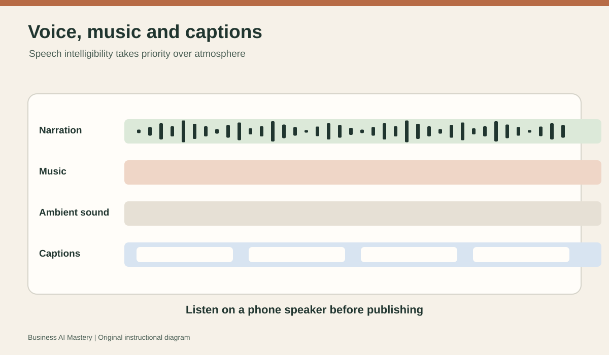

# Adobe Podcast for cleaner recorded speech

> Reviewed 20 November 2026. Recording and enhancement options depend on the current product and subscription.



## Use it for the correct problem

Recording clear speech is usually preferable to repairing unusable sound later. Adobe Podcast's Enhance Speech and Studio workflows can help improve captured dialogue and support recordings. Voice enhancement is not a magic restoration of missing words. Severe clipping, overlapped voices and wrong pronunciation may require re-recording.

## First lesson: a 30-second founder announcement

Record on a phone in a quiet room, close enough for clear speech, with a few seconds of room sound. Write the script in everyday language and read it aloud before recording. Upload a permitted copy into an enhancement tool where available. Compare the original and processed versions at matching volume; louder is not necessarily better.

```text
Review this 30-second spoken announcement transcript. Keep all facts
and the speaker's natural manner. Find phrases difficult to speak,
places needing a breath and numbers that should be read unambiguously.
Do not invent a personal story or testimonial. Return a revised script
and a pronunciation checklist before we record again.
```

## Sound review

Listen for pumping, watery consonants, disappearing background words or a voice that sounds unnaturally isolated. Enhancement can make a recording less recognisable if applied aggressively. Check the product's commercial terms and do not upload sensitive client audio without permission. For interviews, obtain participant consent before processing or publishing their voice.

## Edit into a real video

Take the approved speech into CapCut, Premiere or Resolve. Use real footage that demonstrates what is said. Keep captions synchronised and add only licensed music. Compare the final audio on headphones and a small speaker, because problems in speech intelligibility often appear on phones.

**Official references:** [Enhance Speech](https://podcast.adobe.com/en/enhancespeech), [Adobe Podcast features](https://podcast.adobe.com/en/features).

[Home](../README.md) · [Video and voice workflow](../04-practical-workflows/video-and-voice.md)
