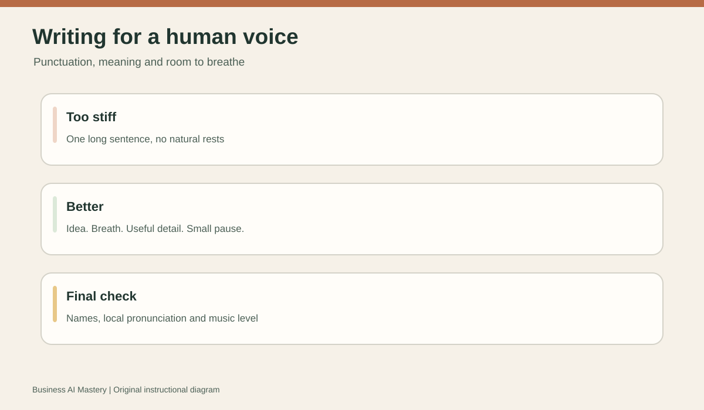

# Audacity for recorded narration and careful audio repair

> Reviewed 20 November 2026. Menu labels vary with application version. Always keep an untouched copy of the recording.



## Why an ordinary audio editor still matters

Many business videos do not need synthetic speech. A real employee may be the most credible narrator, provided the recording is clear and permission is in place. Audacity is useful for trimming mistakes, reducing steady noise, normalising loudness and checking the waveform. Its output must be listened to rather than judged solely by how even the waveform looks.

## Controlled editing sequence

1. Import a copy of the original audio and save the project.
2. Listen once without touching controls. Mark pops, clipping, long pauses and distracting noise.
3. Trim clear mistakes while preserving natural sentence rhythm.
4. Apply noise reduction gently if there is a stable background noise profile.
5. Make volume consistent using appropriate normalisation or gain controls.
6. Export an ordinary compatible audio format and listen to the export again.

## A common failure

Heavy noise reduction removes parts of consonants and leaves a metallic voice. The resulting sound may seem technically quiet but becomes harder to understand. A better remedy can be moving the microphone closer or recording again in a quieter room.

### Script improvement prompt

```text
Prepare the attached text for narration by a real shop owner. Keep the
verified product facts. Split long sentences, mark pauses that help
meaning and explain how to say abbreviations. Do not insert fake
excitement, pretend personal experiences or make the announcement sound
like a radio advertisement. The result should be comfortable to say
out loud at a normal pace.
```

## Quality test

Play the final file through a phone speaker at an ordinary volume. Ask whether every important word, price and place name can be understood. If the main message requires music or on-screen text to repair incomprehensible speech, improve the recording first.

**Official references:** [Audacity effects guide](https://manual.audacityteam.org/man/effect_menu_built_in.html), [Loudness normalisation](https://manual.audacityteam.org/man/loudness_normalization.html).

[Home](../README.md) · [Narrated video](../04-practical-workflows/video-and-voice.md)
