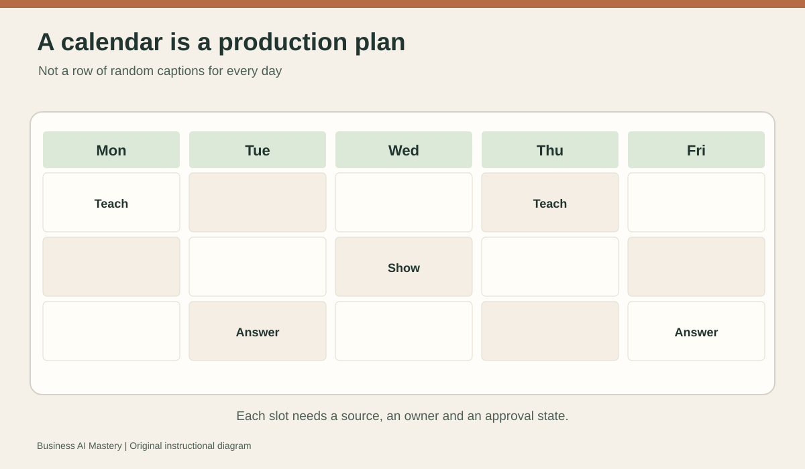

# Buffer scheduling and editing

**What you will be able to do:** Turn an approved campaign into a manageable publishing plan.

> **Updated:** 20 November 2026. Interface, account access and available models can change.



*Original instructional artwork. Diagram labels are conceptual, not screenshots of a vendor interface.*

## Core guidance from the expanded handbook

*Social publishing, drafting and channel adaptation*

### Where this tool earns its place

Buffer is a publishing and planning application. The AI Assistant helps brainstorm or rewrite captions, while scheduling workflows determine what appears on each social platform. Do not use automation to publish an unapproved offer.

### Before the first prompt

Connect the business channels with the appropriate account permissions. Build a weekly queue from already approved content ideas. Separate the creative brief from final text and store the publication date, required assets and owner.

### A complete business exercise

Take one useful product explanation and make native versions for Instagram, LinkedIn and Facebook. Change the opening and length for each audience; do not merely repeat the same caption. Add approved visuals, preview each channel, schedule during an agreed window and monitor questions after publication.

### Copy ready prompt for this tool

> Adapt this approved product explanation into three distinct captions. Instagram: 60 to 80 words, opening on the visible product detail. Facebook: 90 to 120 words, answer the practical buying question. LinkedIn: a short lesson about how we document product information accurately. Preserve the exact verified facts and the call to action. No invented testimonials, inflated claims, generic hook or emoji strings.

### When the result is weak

If every caption begins with a sweeping claim, replace each with the audience’s actual question. If two versions are effectively the same, rewrite the angle rather than swapping synonyms. Preview links and crops before queueing.

### Human editorial finish

Write as the business’s staff would genuinely speak to the customer in that channel. When a customer asks a real question after publication, answer it directly rather than replying with a canned marketing paragraph.

### Approval boundary and common errors

Confirm publishing permissions, scheduling limits, platform changes and any generated media disclosures.

**Official reference:** [Buffer and its AI Assistant product guidance](https://support.buffer.com/en-us/articles/using-buffers-ai-assistant-qbBulfw9sn)

## First session: from a blank workspace to a reviewable result

1. Set an objective for each content item, such as enquiries or product education.
2. Collect approved posts and visual assets in named folders.
3. Use Buffer or its writing assistance for initial variations if available, but keep the facts fixed.
4. Adapt copy for each destination instead of publishing the same text everywhere.
5. Review captions, links and timing in the scheduled queue.
6. Check results by post objective and update the next plan.

## Prompt ladder: simple, evidence based and advanced

The prompts below are teaching examples. Replace fictional context with approved records. A tool that does not support freeform prompting may require you to perform the equivalent steps through its own interface.

### First pass

```text
From these five approved ideas, build a seven day draft calendar. Assign each a purpose, channel, asset owner and approval state.
```

### Channel adaptation

```text
Rewrite this approved product note for Facebook and LinkedIn separately, retaining all factual details and not adding hashtags automatically.
```

### Performance review

```text
Compare these posts by enquiries per reached account where data exists. Separate observation from explanations and propose one small test.
```

## What an acceptable result looks like

An educational post might aim for saves, while an availability announcement aims for enquiries. Their success should not be judged using one universal metric.

## If the first version disappoints

If scheduling produces repetitive captions, vary the actual subject and audience question before changing adjectives. If a link or number is wrong, fix the approved source.

## Human editorial finish

The calendar should reflect events the team can genuinely document. Nobody needs a daily forced “inspirational” post to maintain quality.

## Practice assignment

Using a fictional or appropriately protected version of the case, complete **turn an approved campaign into a manageable publishing plan**. Save an evidence inventory, the first draft, a precise correction request and the reviewed deliverable. Write a short comparison showing what the revision genuinely improved.

## Approval and success test

Does every scheduled item have a verified source, approved copy, owner and relevant measure?

## Related reading

[Prompt anatomy](../01-foundations/prompting-fundamentals.md) · [Context engineering](../01-foundations/context-engineering.md) · [Humanisation](../01-foundations/humanization.md) · [Reference index](../06-reference/sources-and-updates.md)

## Publishing lab: plan conversation, not a conveyor belt of captions

Publishing software is useful because it keeps a content schedule and results in one place. It does not know whether every post is worth making. Start with a weekly editorial meeting: customer questions, genuinely available products, important dates and useful educational ideas. Build a calendar around those inputs rather than demanding seven promotional posts from one vague concept.

```text
Create a seven-day draft publishing schedule for a small fictional
bookshop. Available material: two real product photographs, a verified
Saturday event, one staff recommendation approved for publication, and
a frequently asked question about special orders. Produce an idea,
format, opening line, evidence needed and approval owner for each day.
Leave two days empty if the existing material does not justify posts.
Do not invent customer reviews, discounts, attendance or a daily trend.
```

**Before scheduling:** check every title, price, CTA, link, image crop and the correct destination account. Respect different audiences across LinkedIn, Instagram, Facebook and other channels. A caption that performs as a thoughtful LinkedIn post may feel stiff beside a short product video.

**After publishing:** review results against the objective, not just likes. Did customers ask relevant questions? Did the event post produce useful enquiries? Were comments answered accurately? Keep learnings in a simple change log so next week's plan responds to actual behaviour.

**Human editorial finish.** Use a real observation from the shop, a genuine question or an actual detail about an object. Avoid formulaic posts that begin with motivational statements unrelated to the business.

**Official reference:** [Buffer](https://buffer.com/).
