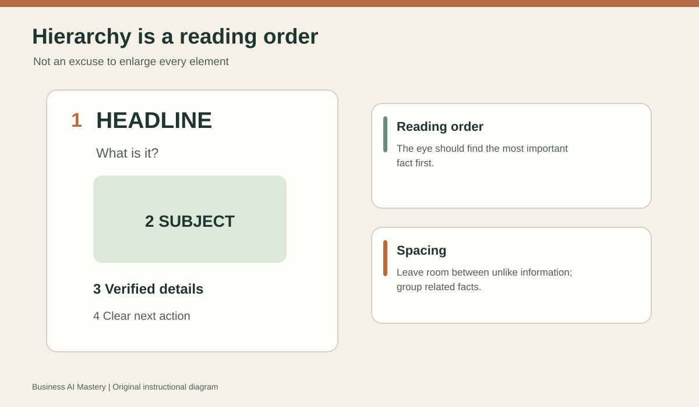

# Canva Magic Studio

**What you will be able to do:** Build a product poster from a verified brief.

> **Updated:** 20 November 2026. Interface, account access and available models can change.



*Original instructional artwork. Diagram labels are conceptual, not screenshots of a vendor interface.*

## Core guidance from the expanded handbook

*Editable layouts, marketing material and presentations*

### Where this tool earns its place

Canva is the practical starting point for most small business graphics because words, logos and individual objects can stay editable. Magic Design can produce starting layouts; Brand Kit helps preserve approved fonts, colours and assets. Do not treat a generated poster as production ready.

### Before the first prompt

Open Canva, select the actual output size and upload the approved logo and real product photo. Set up Brand Kit before creating many designs. Write the exact headline, product name, price and contact line separately. Turn on guides and arrange a reading order: subject, promise or fact, action.

### A complete business exercise

Create a portrait sales poster from one source photo. Request three distinct grid options but restrict the colour palette and limit the number of text styles. Choose the version that reads best when reduced to phone size. Adjust the crop, line length and spacing manually, and check the real contact number. Make a Story version by resizing and reflowing, not blindly stretching.

### Copy ready prompt for this tool

> Make a portrait promotion for a local household goods shop. Use the approved logo and attached real product photograph, not a generated substitute. Text: “See the new ceramic cups in store”; supporting line: “Three finishes available”; action: “Ask us for today’s prices”. Use our cream and forest green palette. Give the cup most of the visual space. No floating icons, neon glow, fake awards, stock people or invented prices. Produce an editable layout.

### When the result is weak

When the design looks generic, change the hierarchy rather than adding texture. If the headline is tiny, shorten it and give it more width. Check mobile crop boundaries and remove decoration that does not carry information.

### Human editorial finish

Introduce a recognisable part of the actual business, such as a real workbench, shop shelf or customer question. The finished layout should feel designed for this company, not for every company.

### Approval boundary and common errors

Keep exact text and logos as editable elements. Confirm commercial rights for inserted assets and that brand settings are correctly applied.

**Official reference:** [Canva Magic Studio and Brand Kit product guidance](https://www.canva.com/help/use-magic-design/)

## First session: from a blank workspace to a reviewable result

1. Start with an approved logo, a real product photo and one message the viewer should remember.
2. Choose a design size for the actual channel before browsing templates.
3. Use Magic Studio for directions or draft layout ideas; treat all generated claims as editable suggestions.
4. Create a hierarchy with headline, product, one useful proof point and contact action.
5. Apply the brand kit, then inspect padding, alignment, contrast and copy on a phone.
6. Export a test, confirm crop and links, and retain the editable design.

## Prompt ladder: simple, evidence based and advanced

The prompts below are teaching examples. Replace fictional context with approved records. A tool that does not support freeform prompting may require you to perform the equivalent steps through its own interface.

### First pass

```text
Suggest three poster compositions for a small pottery studio. The product is a real cup shown in the attached approved photo. No headline text yet; describe reading order and spacing.
```

### Design direction

```text
Create a layout plan for a 1080 by 1350 social poster. The headline is “Find your everyday cup”. Leave a large product area and space for the verified store address. Warm off white and dark green are approved colours.
```

### Review

```text
Critique this poster at phone size. Identify only issues with type hierarchy, contrast, alignment, text accuracy and unnecessary decoration. Give exact changes, not a new unrelated concept.
```

## What an acceptable result looks like

**Illustrative layout:** a short headline at the upper left, an authentic cup photograph in the centre, a two line size note and one contact instruction. It communicates more than a luminous background with an undefined promise.

## If the first version disappoints

If the design becomes crowded, remove decorative shapes and shorten the secondary copy. If image text is misspelled, replace it with editable type instead of repeatedly regenerating it.

## Human editorial finish

Keep signs of the actual shop or craft process if they help buyers trust the product. Do not add a fabricated customer quote or “best seller” badge.

## Practice assignment

Using a fictional or appropriately protected version of the case, complete **build a product poster from a verified brief**. Save an evidence inventory, the first draft, a precise correction request and the reviewed deliverable. Write a short comparison showing what the revision genuinely improved.

## Approval and success test

Can a person identify what is offered in three seconds and read the next step at the actual display size?

## Related reading

[Prompt anatomy](../01-foundations/prompting-fundamentals.md) · [Context engineering](../01-foundations/context-engineering.md) · [Humanisation](../01-foundations/humanization.md) · [Reference index](../06-reference/sources-and-updates.md)

## Design lab: build one campaign without becoming another template

Canva is a design workspace, not a substitute for knowing what a poster needs to communicate. The professional process begins outside the canvas: write the exact offer, identify the single audience and choose the main visual proof. For a fictional bakery, the message may be *Fresh banana bread available on Saturday from 9 a.m.* The photograph should show the actual item, not an invented pastry with the wrong size or ingredients.

**Build a visual brief.** Set the output size, safe margins, approval owner, brand palette, headline, product photograph, verified price, location and contact method. Create a clean starting composition with one dominant picture, one headline and a small practical information block. Give the headline an obvious reading order, keep line lengths short and check the design at phone size before adding decoration.

```text
Plan a square social poster for a real bakery. Audience: nearby repeat
customers. Goal: announce Saturday banana bread availability.
Approved words: "Banana bread on Saturday", "From 9 a.m.",
"Ask the counter for today's availability". Use the supplied genuine
product photo. Visual direction: warm daylight, cream background,
charcoal type and one terracotta accent. Make the bread photograph the
hero. Describe a precise layout with relative positioning, type sizes,
spacing and safe areas. Do not add discounts, awards, menu items,
synthetic customer quotes or decorative neon lighting.
```

**Production sequence.** Create the base design, lock the brand colours, insert an approved photograph, arrange the text, test the reading order, then duplicate into story format. Recompose for the second aspect ratio instead of merely stretching the page. Review the story with interface controls overlaid so the message is not obscured. Ask a person unfamiliar with the project what the poster sells and when it is available.

**Before and after exercise:** a poor poster has six font sizes, four glowing stickers and a large stock image. The improved version has a clear product photograph, readable headline and real business details. Compare at 25% size. If the message disappears, it still needs revision.

### Extend it into a brand system

Make reusable layouts for product announcement, staff story, educational tip and event notice. Shared elements should be logo position, typography, spacing and tone, while the composition must respond to each piece's purpose. A consistent brand is not twenty copies of the same gradient.

**Official reference:** [Canva Magic Studio](https://www.canva.com/newsroom/news/magic-studio/).
