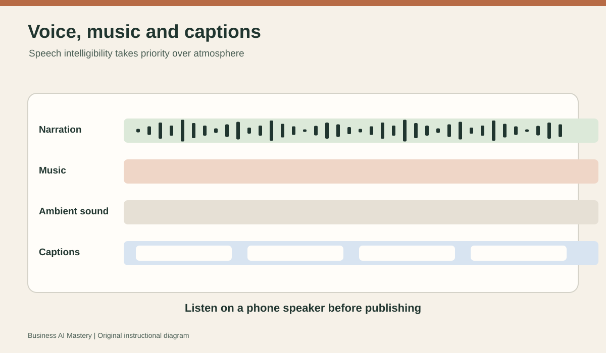

# CapCut video editing

**What you will be able to do:** Edit a 30 second product demonstration for social media.

> **Updated:** 20 November 2026. Interface, account access and available models can change.



*Original instructional artwork. Diagram labels are conceptual, not screenshots of a vendor interface.*

## Core guidance from the expanded handbook

*Short form editing, captions and social video assembly*

### Where this tool earns its place

CapCut is the assembly tool for many business Reels and short tutorials. It is a video editor with assisted features, not a single generative model. Use it to combine real clips, narration, captions and approved brand text.

### Before the first prompt

Create a new project in the destination aspect ratio, import original footage and rename clips by purpose. Put the strongest real visual first. Assemble a rough cut before adding effects, transitions, templates or animated captions.

### A complete business exercise

Edit a 30 second shelf demonstration. Cut from a clear opening question to a medium shot, then show the relevant detail, add a short response to a common customer concern, and end with a verified next step. Transcribe captions, correct them manually and keep them away from the interface controls. Export and rewatch on a phone.

### Copy ready prompt for this tool

> Use this shot list and approved script to plan a 30 second vertical video. Start with the question “How large is this cup?” then show the cup next to a ruler, rotate it in a real hand, and close with “Visit the shop to compare the finishes”. Suggest cut points, exact caption chunks, moments where no music is needed, and any footage missing. No invented dimensions or fabricated customer reactions.

### When the result is weak

If captions cover the product, move them into the safe region and reduce wording. If the video feels frantic, remove unnecessary transitions and let the demonstration breathe. If the automated text is wrong, edit the transcript rather than relying on effect presets.

### Human editorial finish

Keep real room sound when it helps communicate material and setting. Let a hand demonstrate scale. Natural pacing is more credible than constant zooming.

### Approval boundary and common errors

Check watermark and export restrictions by plan, music rights and legibility on a phone.

**Official reference:** [CapCut product guidance](https://www.capcut.com/help)

## First session: from a blank workspace to a reviewable result

1. Write the exact viewer question and record the real product in use.
2. Import clips into the editing timeline and arrange for meaning before adding visual effects.
3. Remove dead space while keeping enough time to see the action.
4. Add captions from the actual spoken material and correct every product name.
5. Place music under the voice, then test on headphones and a phone speaker.
6. Export a vertical version and inspect captions against platform interface areas.

## Prompt ladder: simple, evidence based and advanced

The prompts below are teaching examples. Replace fictional context with approved records. A tool that does not support freeform prompting may require you to perform the equivalent steps through its own interface.

### First pass

```text
From this rough transcript, make a 30 second shot order with a practical opening, one demonstration, one clarification and a next step. Use only recorded actions.
```

### Editing notes

```text
Suggest cut points for these timestamps. Preserve the continuous demonstration of how the lid closes. Do not suggest transitions that imply a result not actually filmed.
```

### Quality check

```text
Check the subtitle text against the transcript and list uncertain words. Identify any frame where a button or caption would obscure the product.
```

## What an acceptable result looks like

A better opening can show the action immediately, then add one clear sentence. The viewer does not need a fast zoom every two seconds.

## If the first version disappoints

If automatic captions mistake a local name, correct it manually. If music masks speech, lower it or remove it entirely. If a transition hides a physical step, use a plain cut.

## Human editorial finish

Keep the real hands and environment where they support credibility. Spoken language should sound like the person at the shop, not a corporate advertisement.

## Practice assignment

Using a fictional or appropriately protected version of the case, complete **edit a 30 second product demonstration for social media**. Save an evidence inventory, the first draft, a precise correction request and the reviewed deliverable. Write a short comparison showing what the revision genuinely improved.

## Approval and success test

Can the viewer follow the demonstration silently, and does the soundtrack remain easy to hear?

## Related reading

[Prompt anatomy](../01-foundations/prompting-fundamentals.md) · [Context engineering](../01-foundations/context-engineering.md) · [Humanisation](../01-foundations/humanization.md) · [Reference index](../06-reference/sources-and-updates.md)

## Editing lab: turn raw phone footage into an understandable short video

The most practical short-form video for a business may need no generated footage. Film what staff actually do: unpack an item, clean a table, arrange products or answer a customer question with permission. A basic editing application such as CapCut can assemble the sequence, remove dead time, create captions and export in the intended format. Check the exact controls on your device because features differ across plans and platforms.

**Storyboard for a 25-second product demonstration:** 0 to 3 seconds shows the customer problem; 3 to 8 seconds identifies the product; 8 to 18 seconds demonstrates one genuine feature; 18 to 22 seconds answers an obvious question; 22 to 25 seconds gives the approved next step. Use a genuine close-up instead of replacing the feature demonstration with a glowing animation.

```text
Create an editing plan for 25 seconds of phone footage. Available clips:
A: customer opening the outer box; B: product in hand; C: close-up of
one documented feature; D: staff member explaining availability.
Provide an exact clip order, recommended trim points, one caption
sentence per shot, audio transitions and the text safe area. Use only
spoken words present in the recording. Do not invent testimonials or
features and do not suggest transitions that obscure a real defect.
```

**Caption repair:** automatic transcription often misses names, amounts, local language and dates. Compare every caption to the audio. Use a maximum of a few readable words per line, clear contrast and placement away from on-screen buttons. Export a draft and review it on an ordinary phone at normal brightness.

**Human editorial finish.** Keep short pauses when the worker is genuinely thinking or showing something. Cutting every silence creates synthetic urgency. Natural actions and room sound can give a small business credibility that studio effects do not.

**Official reference:** [CapCut product](https://www.capcut.com/).
