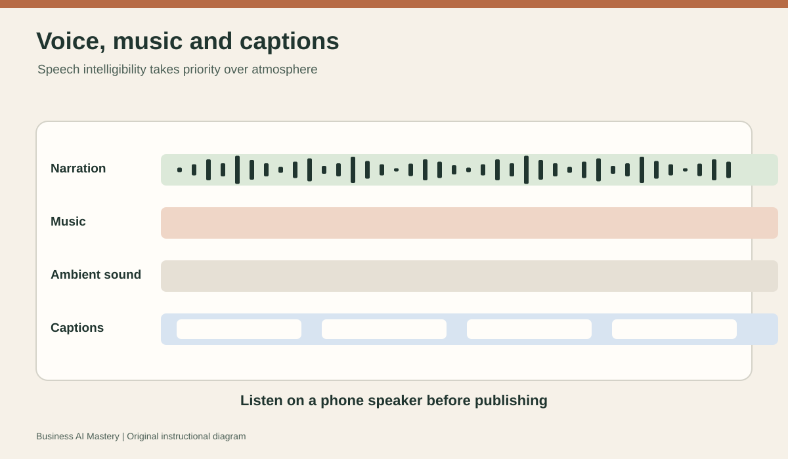

# DaVinci Resolve

**What you will be able to do:** Finish a commercial explainer with controlled colour and sound.

> **Updated:** 20 November 2026. Interface, account access and available models can change.



*Original instructional artwork. Diagram labels are conceptual, not screenshots of a vendor interface.*

## Core guidance from the expanded handbook

*Professional editing, colour, Fairlight sound and finishing*

### Where this tool earns its place

DaVinci Resolve is appropriate when a business needs stronger colour matching, timeline control, sound repair and polished exports. It provides distinct editing, colour, Fairlight and Fusion workspaces.

### Before the first prompt

Make a project with a defined frame rate and output dimensions. Copy source media to a stable folder. Import, organise bins, synchronise clean voice and build a picture rough cut. Do not begin with colour grading before the story works.

### A complete business exercise

For a three camera interview, sync audio, choose the clearest main angle, remove pauses that harm meaning while preserving the speaker’s intent, and insert close views only when relevant. Balance voices in Fairlight, match exposure and skin tones, and export a review cut. Apply graphics only after content approval.

### Copy ready prompt for this tool

> Build an editor’s paper cut from this approved interview transcript. Keep the exact meaning. Mark five quotes with the original timestamps, identify which claims require an on screen citation, and recommend genuine B roll from the shot log. Do not invent spoken words or rearrange a sentence so it appears to say something different.

### When the result is weak

If colour looks unnatural, match neutral surfaces and skin before creative treatment. If speech is muffled, repair the source modestly instead of overprocessing. Review audio on both headphones and a phone speaker.

### Human editorial finish

Good editing preserves character, hesitations when meaningful and visual evidence. The best cut is usually the one that respects what the speaker actually meant.

### Approval boundary and common errors

Use original recordings and licensed assets; check captions, audio peaks and the exported file, not just the preview.

**Official reference:** [DaVinci Resolve product guidance](https://www.blackmagicdesign.com/products/davinciresolve/training)

## First session: from a blank workspace to a reviewable result

1. Organise footage by scene, source, date and permission.
2. Create a timeline that tells the story using picture and natural sound first.
3. Use Resolve editing tools for cut timing, then correct exposure and colour consistently.
4. Repair dialogue conservatively so it still sounds like the original speaker.
5. Build captions and title graphics as editable elements.
6. Export the requested master and delivery versions; review them at normal playback speed.

## Prompt ladder: simple, evidence based and advanced

The prompts below are teaching examples. Replace fictional context with approved records. A tool that does not support freeform prompting may require you to perform the equivalent steps through its own interface.

### First pass

```text
Make a factual scene outline from this transcript and shot list. Every scene must correspond to recorded footage.
```

### Finishing notes

```text
Prepare a colour and audio review checklist for indoor daylight footage mixed with phone video. Do not prescribe a universal preset; focus on matching exposure and natural skin tones.
```

### Delivery

```text
List export checks for a 1080 by 1920 social version and a 1920 by 1080 archive master. Include caption legibility, aspect ratio, audio and missing media review.
```

## What an acceptable result looks like

The technically correct finish is not necessarily a heavily graded image. It is footage with believable whites, consistent faces, legible titles and clear dialogue.

## If the first version disappoints

If a face changes colour between shots, compare exposure and white balance rather than applying a single fashionable look. If speech is robotic after repair, reduce processing.

## Human editorial finish

Leave room for natural pauses and location sounds that carry information. A purposeful imperfect shot may be more useful than a perfect irrelevant one.

## Practice assignment

Using a fictional or appropriately protected version of the case, complete **finish a commercial explainer with controlled colour and sound**. Save an evidence inventory, the first draft, a precise correction request and the reviewed deliverable. Write a short comparison showing what the revision genuinely improved.

## Approval and success test

Does the delivered file match its source, aspect ratio and caption requirements without misleading edits?

## Related reading

[Prompt anatomy](../01-foundations/prompting-fundamentals.md) · [Context engineering](../01-foundations/context-engineering.md) · [Humanisation](../01-foundations/humanization.md) · [Reference index](../06-reference/sources-and-updates.md)

## Finishing lab: picture, dialogue and sound need separate reviews

DaVinci Resolve brings editing, colour, effects, audio and delivery into one environment. Business owners do not need every professional feature to benefit. They need a reliable path from messy footage to a legible and truthful final film. Name and organise the original clips, make a simple cut, balance sound, correct colour and export only after reviewing the actual delivered file.

**Practical edit:** a two-minute staff demonstration filmed with mixed window and fluorescent light. Use the cut page or edit page to remove repetition and organise the explanation. Correct white balance so the product colour is closer to the real item. Avoid dramatic teal and orange grading if it makes a product materially misleading. Use the Fairlight page or available audio controls to reduce distracting noise without destroying intelligibility.

```text
Review this proposed two-minute product demonstration. Build an edit
paper plan with time codes, what the audience learns, which shot proves
the claim and which caption is required. Give a dialogue cleanup pass,
a colour continuity pass and a final accessibility pass. Do not propose
removing statements merely because they disclose real limitations of
the item. Suggest only music that is licensed for commercial use.
```

**Delivery inspection:** check aspect ratio, frame rate, audio clipping, subtitle positioning, cropped heads, spelling and any unexpected freeze frame. Compare the export to the timeline, because a successful render does not guarantee correct presentation. Keep an archived project and original footage separate from the public upload.

**Humanisation.** Professional editing protects the meaning of the original action. A modest demonstration with truthful colour and clean sound often communicates more than a visually spectacular but confusing montage.

**Official reference:** [DaVinci Resolve](https://www.blackmagicdesign.com/products/davinciresolve).
