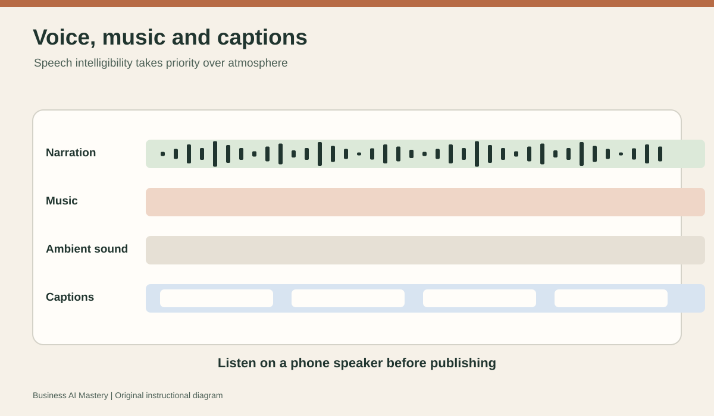

# ElevenLabs voice

**What you will be able to do:** Produce a clear, human sounding narration.

> **Updated:** 20 November 2026. Interface, account access and available models can change.



*Original instructional artwork. Diagram labels are conceptual, not screenshots of a vendor interface.*

## Core guidance from the expanded handbook

*Expressive text to speech and audio production*

### Where this tool earns its place

Eleven v4 launched in September 2026 and supports natural direction and audio tags. It is useful for narration, multilingual versions and dialogue when the business needs a consistent voice, provided it has rights to that voice.

### Before the first prompt

Write a speech script before choosing a synthetic voice. Mark words a listener may mishear, especially personal names, local place names and product terms. Choose a properly licensed voice. Set the delivery in plain language: warm, measured, unhurried, without sales pressure.

### A complete business exercise

For a 25 second demonstration, break the script into four naturally spoken phrases. Generate a test of the opening. Listen without watching the video. Correct pronunciation and emphasis; then produce the final takes. Place each phrase on the editor timeline, leaving room for the picture to show what the words describe. Mix music beneath speech.

### Copy ready prompt for this tool

> Read as a calm shop assistant explaining a practical choice, not as a radio announcer. Medium pace, gentle emphasis on “size” and “finish”, small natural pause after the question. Script: “Not sure which cup fits your table? You can see the three finishes in the shop. Compare the size and the handle before choosing. Ask us which colours are in stock today.” Do not add excitement, laughter, a new claim or a false personal story.

### When the result is weak

If the line sounds strained, rewrite the text for speech instead of stacking more mood labels. Break long sentences, spell a proper name phonetically if the editor supports it and listen to the endings of sentences. Do not hide pronunciation failures behind loud music.

### Human editorial finish

Natural narration has purpose and breath. Use ordinary spoken phrasing, not a brochure. For sensitive or personal stories, a consenting human speaker may be more suitable than a synthetic voice.

### Approval boundary and common errors

Never clone a real voice without clear permission. Check required labelling and licences before commercial release.

**Official reference:** [ElevenLabs Eleven v4 product guidance](https://elevenlabs.io/blog/eleven-v4)

## First session: from a blank workspace to a reviewable result

1. Write an ordinary spoken script with one thought per breath.
2. Decide whether to record a real person or use a licensed synthetic voice with appropriate consent.
3. Select a suitable voice and language based on audience, not novelty.
4. Test difficult names, place names, currencies and abbreviations on a short clip.
5. Adjust punctuation and emphasis where the interface supports these controls.
6. Mix narration with music and replay on phone speakers with captions on.

## Prompt ladder: simple, evidence based and advanced

The prompts below are teaching examples. Replace fictional context with approved records. A tool that does not support freeform prompting may require you to perform the equivalent steps through its own interface.

### First pass

```text
Edit this 100 word shop announcement for speech. Identify sentences too long to say comfortably. Do not change any price or address.
```

### Voice direction

```text
Read calmly and clearly for a practical product demonstration. Moderate pace. Slight pause after the product name; natural emphasis on the useful feature; no sales shout or imitation of a particular person.
```

### Audit

```text
Compare the final audio with the approved script word for word. Flag mispronounced names, unnatural stress, missing words and pauses that obscure meaning.
```

## What an acceptable result looks like

“You can see the sizes in store. Ask us to bring both out so you can compare.” is often easier to speak than a long sentence about a “seamless, revolutionary shopping journey”.

## If the first version disappoints

If a voice sounds rushed, shorten the script rather than forcing it into the target duration. If proper names fail, test phonetic guidance or use a human recording.

## Human editorial finish

Natural speech has choices, hesitations and emphasis guided by meaning. Avoid both a stiff documentary tone and simulated personal intimacy.

## Practice assignment

Using a fictional or appropriately protected version of the case, complete **produce a clear, human sounding narration**. Save an evidence inventory, the first draft, a precise correction request and the reviewed deliverable. Write a short comparison showing what the revision genuinely improved.

## Approval and success test

Can a listener understand the words without captions? Is the voice authorised and the disclosure policy satisfied?

## Related reading

[Prompt anatomy](../01-foundations/prompting-fundamentals.md) · [Context engineering](../01-foundations/context-engineering.md) · [Humanisation](../01-foundations/humanization.md) · [Reference index](../06-reference/sources-and-updates.md)

## Voice lab: script direction, pronunciation and audible trust

A synthetic voice is not humanised by adding exaggerated emotion tags everywhere. It sounds better when the underlying writing can be spoken naturally, the voice suits the subject and the pauses correspond to meaning. Eleven v4 documentation describes expressive audio tags and language support; the available controls can vary by interface and model.

**Script first.** Write about 50 to 70 spoken words for an introductory 30-second video, then read it aloud. Mark the product name, local place name and any number that could be mispronounced. Test two short passages before creating the full narration. Listen on a phone speaker as well as headphones.

```text
Prepare this 28-second announcement for an everyday, calm voice.
Audience: customers asking when a small shop reopens.
Approved facts: "We reopen on Monday, 23 November, at 9 a.m." and
"The entrance is on the market side." Do not add a personal anecdote,
claim the narrator works at the store, promise a discount or invent a
customer response. Use short spoken sentences and punctuation for
natural pauses. Show a pronunciation note for any unusual local word.
```

**Example line for an appropriately licensed voice:** *We reopen Monday at nine. The entrance is on the market side. If you need directions, send the shop a message.* Confirm the date and directions before recording. Audio tags such as `[softly]` are optional; check supported syntax and do not let a tag change the actual words.

**Quality inspection:** listen for clipped syllables, breathlessness, unusual emphasis, incorrect numerals, repeated cadence and local words said incorrectly. Edit the script itself before trying more exotic voice settings. Mix music lower than narration and test that speech remains clear on small speakers. Always obtain consent for cloning a real person's voice; do not represent a synthetic actor as an actual customer testimonial.

**Official references:** [Eleven v4 audio tags](https://elevenlabs.io/docs/help-center/product/core-capabilities/text-to-speech/how-do-audio-tags-work-with-eleven-v3-and-v4) and [speech best practices](https://elevenlabs.io/docs/overview/capabilities/text-to-speech/best-practices).
