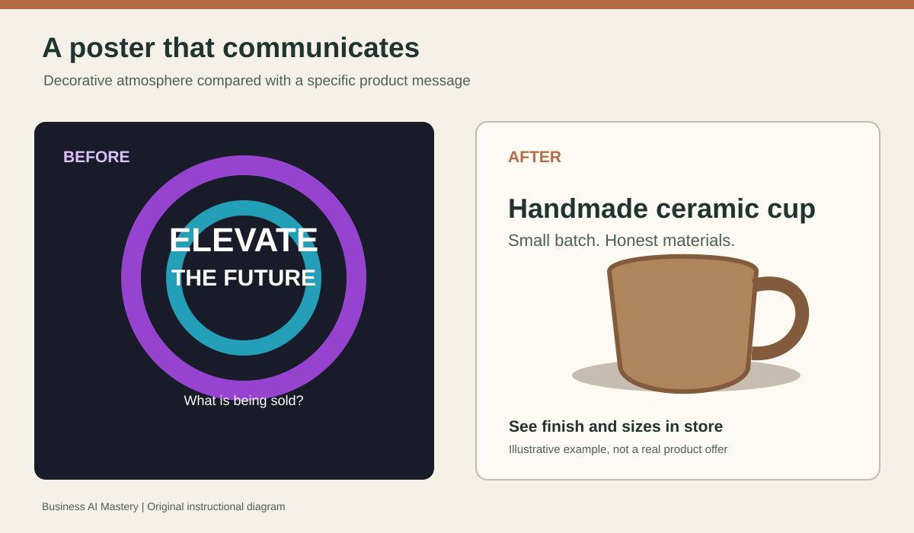

# Ideogram 4.6

**What you will be able to do:** Develop a text led campaign concept.

> **Updated:** 20 November 2026. Interface, account access and available models can change.



*Original instructional artwork. Diagram labels are conceptual, not screenshots of a vendor interface.*

## Core guidance from the expanded handbook

*Image design, textual concepts and precise local edits*

### Where this tool earns its place

Ideogram 4.6 was released on 19 November 2026 and focuses on image generation plus local editing, with high resolution output and reference support documented for its API. It is particularly relevant when a creative concept involves visible graphic composition or typographic experimentation.

### Before the first prompt

Start with an exact text inventory. Put each phrase in quotes and spell it carefully. Select the model version available in your interface; the API naming and website experience may differ. Use a text first prototype, then treat final prices, phone numbers and legal wording as editable overlay text when possible.

### A complete business exercise

Make a fictional coffee poster with a short headline, one main cup and balanced empty space. Generate variations, compare actual spelling and line breaks, then select the strongest composition. For a local correction, use a mask or precise edit to adjust only the surface or object. Add the shop’s real name in Canva or Illustrator.

### Copy ready prompt for this tool

> Design a refined poster concept for an imaginary coffee house. The exact headline is “A QUIET CUP”. Small supporting copy: “Every morning”. One handmade ceramic cup on a pale stone counter, soft sidelight, generous border space, editorial serif lettering and calm composition. Warm ivory, tobacco brown and charcoal. No decorative circuitry, metallic gradients, extra brand names, false awards or made up prices.

### When the result is weak

If lettering is misspelled, edit the text in an external layout program rather than repeatedly regenerating an otherwise good scene. If it looks like a stock template, reduce the number of effects and introduce a distinctive object crop.

### Human editorial finish

The strongest business poster often comes from a true story about the product, such as its material, provenance or preparation. No need to simulate a customer quotation to make it feel authentic.

### Approval boundary and common errors

Verify exact visible words, product details, resolution and edit controls available to your account.

**Official reference:** [Ideogram 4.6 product guidance](https://ideogram.ai/models/4.6/)

## First session: from a blank workspace to a reviewable result

1. Write the exact headline and every line that must appear. Do not ask the image model to invent legal or commercial text.
2. Choose a composition before choosing stylistic effects.
3. Use reference imagery only when you have permission and give each reference a defined purpose.
4. Test legibility and exact spelling. Check individual letter shapes and punctuation.
5. Export the chosen concept and rebuild critical copy and brand marks as editable elements.
6. Check a mobile size export and verify all product claims.

## Prompt ladder: simple, evidence based and advanced

The prompts below are teaching examples. Replace fictional context with approved records. A tool that does not support freeform prompting may require you to perform the equivalent steps through its own interface.

### First pass

```text
Give three art directions for a fictional craft fair poster. Each must have a different typographic focal point and enough room for actual dates added later.
```

### Generation

```text
Produce a print inspired editorial poster concept with the exact short text “MADE BY HAND”. Use dark ink on warm paper, a handmade vessel sketch and clear visual hierarchy. Leave the date and venue areas empty.
```

### Correction

```text
Keep the letterforms and central vessel position, but reduce decorative frames and increase spacing around the headline. Do not add any new event details.
```

## What an acceptable result looks like

A short phrase may render well, but ticket price, venue address, date and organiser logo should be verified and controlled in a layout program.

## If the first version disappoints

If a letter is distorted, try shorter isolated text, revise the layout or set the words manually. Do not publish nonsense lettering because the rest of the art looks attractive.

## Human editorial finish

Compare the concept with examples of actual local cultural print design instead of relying on a generic global “futuristic event” look.

## Practice assignment

Using a fictional or appropriately protected version of the case, complete **develop a text led campaign concept**. Save an evidence inventory, the first draft, a precise correction request and the reviewed deliverable. Write a short comparison showing what the revision genuinely improved.

## Approval and success test

Can someone read every word correctly, and were all event details supplied by an approved source?

## Related reading

[Prompt anatomy](../01-foundations/prompting-fundamentals.md) · [Context engineering](../01-foundations/context-engineering.md) · [Humanisation](../01-foundations/humanization.md) · [Reference index](../06-reference/sources-and-updates.md)

## Typography lab: when lettering is the design, not decoration

Image tools may be impressive at rendering a headline, yet commercial text still needs checking letter by letter. Ideogram 4.6 documentation includes generating and editing with source images and high-resolution options in the API. Use it to explore typographic compositions and integrate imagery, but do not assume every generated line is accurate or editable like native design text.

**Practical brief:** a fictional bookstore is holding a Saturday reading event. The verified event name is `Books and Coffee`, with the exact date and time provided separately. Make the title the primary graphic element, with an illustrated cup as secondary support. Test a composition with all critical copy as normal editable text in the final layout.

```text
Poster concept, portrait 4:5. Render the exact words "Books and Coffee"
in large, confident serif lettering on a warm ivory background. A small
single-colour illustrated cup sits below the second word. Use dark ink,
subtle paper texture and generous margins. Keep the typographic shape
readable at a phone's viewing size. No fake logos, decorative English
sentences, placeholder addresses, futuristic glows or random badges.
Leave a clean lower area for an editor to place the verified date and
venue as real text.
```

**Text proofing.** Check spelling, punctuation, word breaks and confusing lookalike letters. Re-enter exact lines in a text layer when possible. Export a version without event facts as a reusable conceptual background. Never publish a generated invented ticket price because the image looked finished.

**Editing test.** Request a variation that changes only the paper texture and keeps headline content, position and scale. If the lettering changes too much, return to a native text layout with your preferred licensed font.

**Official reference:** [Ideogram 4.6](https://ideogram.ai/models/4.6/).
