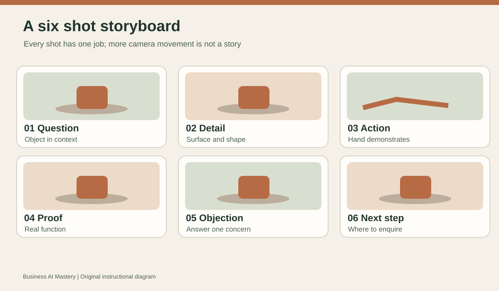

# Kling video generation

**What you will be able to do:** Test movement for a catalogue product concept.

> **Updated:** 20 November 2026. Interface, account access and available models can change.



*Original instructional artwork. Diagram labels are conceptual, not screenshots of a vendor interface.*

## Core guidance from the expanded handbook

*Generated moving images and controlled subject action*

### Where this tool earns its place

Kuaishou confirmed Kling 4.0 launched on 15 October 2026. Use it for stylised or realistic moving visual concepts, with particular attention to subject continuity, camera direction and the amount of action requested in each clip.

### Before the first prompt

Decide whether the starting point is text or an image reference. Write the one movement to be shown and describe the camera as fixed, following, pushing in or tracking. Keep a stable setting and the correct output frame. Avoid combining many actions into a short generation.

### A complete business exercise

Plan a three shot fictional product reveal: wide view of a desk, a hand turning a generic object, and a final quiet detail. Generate each shot separately, inspect its first and last frames, and choose only visually consistent clips. Add real brand assets and accurate product text during editing, not in the moving scene.

### Copy ready prompt for this tool

> Five second image to video shot using the supplied unbranded table scene. Camera moves slowly forward by a small amount while a hand rotates a plain ceramic cup once to reveal its handle. The cup stays the same size and shape, the hand has natural finger movement, shadows remain consistent, and the background does not move independently. No quick zoom, sparkles, object transformation or text.

### When the result is weak

When the video creates extra fingers or changes the object, reduce the motion and use a stronger reference frame. When it looks like a generic advertisement, remove dramatic lighting and prioritise believable touch, weight and pacing.

### Human editorial finish

A simple act that shows a useful feature beats motion added merely because the model can do it. Keep a human editor responsible for timing and context.

### Approval boundary and common errors

Do not imply a synthetic demonstration of a real item proves its durability or properties. Check access and export controls.

**Official reference:** [Kling 4.0 product guidance](https://ir.kuaishou.com/news-releases/news-release-details/kling-ai-officially-launches-next-generation-kling-40-raising/)

## First session: from a blank workspace to a reviewable result

1. Use an approved start image with clear subject edges and enough empty space for motion.
2. Describe a short motion: direction, speed, contact with surfaces and camera setting.
3. Set only the duration and controls your current account actually supports.
4. Generate one simple shot and inspect subject persistence.
5. Reject physically impossible movement, frame drift and label changes.
6. Combine approved clips with actual product footage and editable captions.

## Prompt ladder: simple, evidence based and advanced

The prompts below are teaching examples. Replace fictional context with approved records. A tool that does not support freeform prompting may require you to perform the equivalent steps through its own interface.

### First pass

```text
Write three short movement options for a still product photo: a slow camera push, slight change of light, or a person rotating the object. State what should remain constant.
```

### Video instruction

```text
A fixed camera shows a plain box on a wooden counter. A hand slides it gently 15 centimetres to the right over four seconds. Correct sliding contact, unchanged printed surface, ordinary room light and no text overlays.
```

### Correction

```text
Keep the start and end positions, but remove the unexpected camera pan. Maintain the box edges and the table grain throughout.
```

## What an acceptable result looks like

The hand’s movement, object contact and final rest position should be visible. If the printed label mutates in motion, the shot is unsuitable for factual product advertising.

## If the first version disappoints

When a model struggles with a complex gesture, reduce it to a simple slide or turn. When print changes, use a clean original reference or replace with a filmed motion.

## Human editorial finish

A product movement must answer a question about size, opening or use. Random spinning rarely increases customer trust.

## Practice assignment

Using a fictional or appropriately protected version of the case, complete **test movement for a catalogue product concept**. Save an evidence inventory, the first draft, a precise correction request and the reviewed deliverable. Write a short comparison showing what the revision genuinely improved.

## Approval and success test

Do geometry, hands and text remain consistent across the entire clip?

## Related reading

[Prompt anatomy](../01-foundations/prompting-fundamentals.md) · [Context engineering](../01-foundations/context-engineering.md) · [Humanisation](../01-foundations/humanization.md) · [Reference index](../06-reference/sources-and-updates.md)

## Motion lab: design action that is physically easy to judge

Kling is useful for motion concepts and generated visual inserts, but commercial output still requires scrutiny. Choose a clip with one primary action and a stable camera. The more objects that touch, spin, split or swap positions, the more likely small consistency errors are to become obvious. Assess each shot on its own terms rather than trusting a model release claim to guarantee a usable result.

**Product teaser exercise.** Create a short concept showing a folded linen napkin beside a plain drinking glass. A hand gently straightens one corner. Nothing else moves. Keep the visual language grounded in the brand's ordinary setting rather than giving every object a floating rotation.

```text
Five-second realistic tabletop shot. Fixed camera at a slight angle
above a clean wooden table. A human hand enters from frame right,
straightens one corner of a folded linen cloth and leaves. A plain
glass stays stationary beside it. Soft natural light from the left,
consistent glass reflections, gentle realistic hand speed. No camera
orbit, no liquid appearing, no additional fingers, no product labels,
no morphing furniture and no added writing.
```

**Review:** count fingers where visible, watch cloth fold continuity, check reflections and compare the first and final frame. If it fails, shorten the action, simplify contact between objects or film the gesture on a phone. Do not promote a visual generated for a fictional brand as real behind-the-scenes evidence.

**Human finish.** Combine restrained generated inserts with genuine product demonstrations. Avoid a montage of impossible hero shots that never shows what the customer receives.

**Official reference:** [Kling AI company releases](https://ir.kuaishou.com/news-releases).
