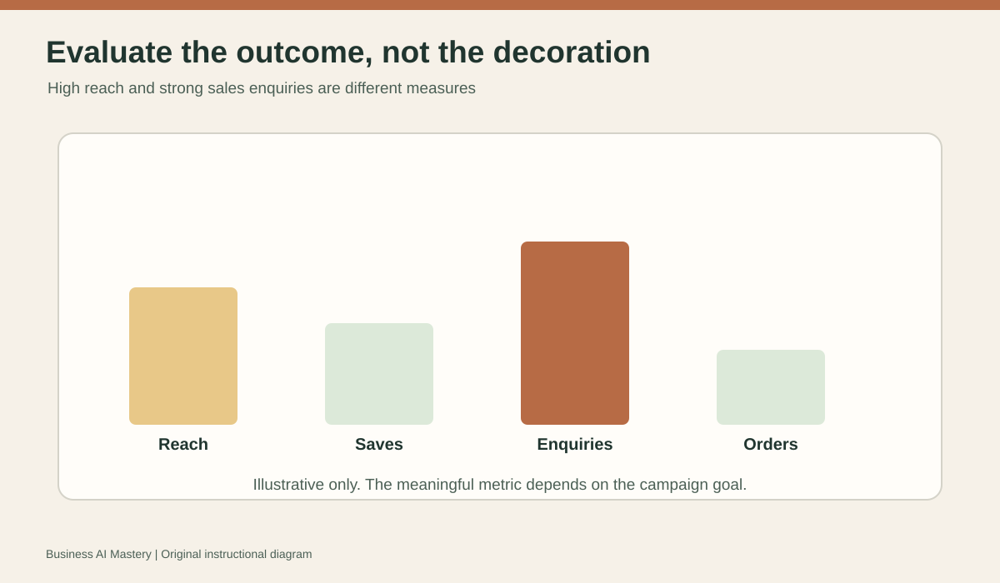

# Meta Business Suite

**What you will be able to do:** Publish and evaluate a small Facebook and Instagram campaign.

> **Updated:** 20 November 2026. Interface, account access and available models can change.



*Original instructional artwork. Diagram labels are conceptual, not screenshots of a vendor interface.*

## Core guidance from the expanded handbook

*Facebook and Instagram publication and performance*

### Where this tool earns its place

Business Suite is primarily a channel operations application. It can help plan, schedule, respond to messages and review insights for Meta accounts, rather than serving as a standalone creative model.

### Before the first prompt

Connect the right Facebook Page and Instagram account. Confirm roles and access before scheduling. Use Planner to see gaps and publishing collisions. Keep a campaign record outside the application with approved claims and asset versions.

### A complete business exercise

Schedule the approved poster, product Reel and customer FAQ across one week. Use a distinct caption for each asset. After publication, record reach, watch behaviour, profile visits and relevant enquiries using the platform definitions. Identify which customer questions deserve a follow up piece.

### Copy ready prompt for this tool

> Prepare a publication checklist for these three approved assets: a square product photograph for Tuesday, a 30 second demonstration Reel for Thursday, and an FAQ post for Saturday. For each give the target account, final caption, verified product claims, file name, approval status, proposed schedule and post publication metric to record. Do not create or schedule anything that is not marked approved.

### When the result is weak

If a post has good views but no enquiries, do not infer failure or success from views alone. Compare the objective, audience and next action. If a video loses viewers early, inspect whether it starts with a relevant demonstration.

### Human editorial finish

Make publishing a conversation. Use actual customer questions to guide the next week’s topics. Do not rely on templated engagement bait.

### Approval boundary and common errors

Verify the content visible in the final preview, not just the scheduler fields. Follow Meta disclosure and account rules.

**Official reference:** [Meta Business Suite product guidance](https://www.facebook.com/business/tools/meta-business-suite)

## First session: from a blank workspace to a reviewable result

1. Use the correct business account and check the connected Page and Instagram account.
2. Set one campaign goal and prepare approved copy, real visuals and landing destination.
3. Build draft posts or reels with appropriate formatting for each channel.
4. Check labels and disclosures required for materially synthetic scenes.
5. Preview on an ordinary phone before publication.
6. Review reach, engagement, actual enquiries and follow through actions after the reporting period.

## Prompt ladder: simple, evidence based and advanced

The prompts below are teaching examples. Replace fictional context with approved records. A tool that does not support freeform prompting may require you to perform the equivalent steps through its own interface.

### First pass

```text
Create a weekly posting plan from these verified business announcements. Distinguish a promotional post from an educational answer.
```

### Adaptation

```text
Write two platform specific captions from this approved description, one concise Instagram version and one Facebook version with a customer FAQ. No invented price or offer.
```

### Review

```text
Here are seven days of platform insights. Separate reach, views and enquiries. Explain which outcome can be observed and which explanation still needs testing.
```

## What an acceptable result looks like

A post with 10,000 views and no relevant enquiries may have performed worse for a sales objective than one with 1,000 views and 15 qualified conversations.

## If the first version disappoints

If autogenerated suggestions keep adding false urgency, remove those claims. If a reel appears cropped on the platform, adjust the composition and safe area, not merely the export dimensions.

## Human editorial finish

Respond to genuine audience questions rather than publishing endless promotional claims. A clear local answer often wins more trust than abstract enthusiasm.

## Practice assignment

Using a fictional or appropriately protected version of the case, complete **publish and evaluate a small facebook and instagram campaign**. Save an evidence inventory, the first draft, a precise correction request and the reviewed deliverable. Write a short comparison showing what the revision genuinely improved.

## Approval and success test

Are published posts true, suitable for the platform, legally usable and measured against the chosen objective?

## Related reading

[Prompt anatomy](../01-foundations/prompting-fundamentals.md) · [Context engineering](../01-foundations/context-engineering.md) · [Humanisation](../01-foundations/humanization.md) · [Reference index](../06-reference/sources-and-updates.md)

## Operations lab: Facebook and Instagram as customer service channels

Meta Business Suite can support publishing, messages and performance review for the right connected business accounts. Before drafting a campaign, verify page roles, destination accounts, messaging permissions and which features are available to your team. A shared login is a poor substitute for assigning each person the minimum access they need.

**Plan a product announcement.** Start with the exact offer and a valid stock statement. Make one post with a single primary question it answers, such as *Where can I collect the item?* Use the actual photo and an approved contact route. Adapt to feed and stories separately, with readable text and safe margins.

```text
Draft a Facebook feed post and Instagram story script for the same
verified announcement: an item arrives on Thursday, subject to final
receipt inspection. Facebook copy should explain when customers may
check availability and how to contact the shop. Story copy should fit
three short frames, each with one meaningful point. Do not say 'in
stock now', claim a price we have not confirmed, invent scarcity or
add customer testimonials.
```

**Inbox workflow:** identify common questions, draft approved reply patterns and provide clear escalation for complaints, payments and personal details. Do not let the public comment section become a place for sharing order numbers or customer addresses. A fast reply is not better if it is inaccurate.

**Review:** use a consistent date range and explain how each platform defines views and engagement. A campaign that produces fewer likes but more verified enquiries may be more valuable. Keep evidence from the publishing tool rather than estimating results.

**Human editorial finish.** A familiar local business usually sounds best when it states what customers can actually do next. Use natural language and the business's own phrasing without forcing slang or invented local colour.

**Official reference:** [Meta Business Suite](https://www.facebook.com/business/tools/meta-business-suite).
