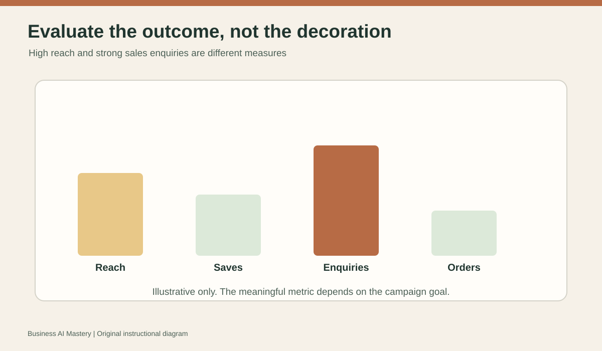

# Metricool for publishing, reporting and editorial learning

> Reviewed 20 November 2026. Check the current help pages for supported networks, plan limits and metric definitions. The reporting method below applies even when interface features differ.



## The job behind the platform

Scheduling saves administrative effort, but analytics should answer whether the content did its job. A product comparison Reel may aim to reduce sizing questions. An event announcement may aim to produce registrations. A community question may aim to identify what people still misunderstand. These are not interchangeable objectives.

## Build a useful weekly dashboard

Choose the exact reporting period and keep every platform's own metric definitions. Capture posts published, views or impressions where available, watch time where available, relevant comments, website visits and verified enquiries. Label missing metrics. Do not mix an Instagram reach count with a YouTube view count as if they described the same event.

```text
Review this fictional weekly publishing report. The goal was to get
qualified enquiries for our workshop. Identify which posts generated
actual enquiries, not just views. Separate observed results from
possible reasons. Propose one content change to test next week and
show what would count as success. Do not invent missing reach data,
conversion attribution or customer statements.
```

## Why common content reports fail

A report may call every increase 'strong engagement' without identifying the business outcome. Or it may compare a promoted post with an organic post without mentioning paid distribution. Another error is treating a few days of observations as proof of a permanent pattern. Record the campaign date, creative variation, budget, platform and relevant external events before interpreting changes.

## Human editorial finish

Replace *Our audience loved the content* with an evidence-based observation such as *Four people asked for the size guide after viewing the comparison post*, if those four messages are recorded. Use the findings to improve the next piece, not merely to generate another chart.

**Vendor reference:** [Metricool](https://metricool.com/). Consult its current help centre for account-specific procedures.

[Home](../README.md) · [Performance rubrics](../06-reference/evaluation-scorecards.md)
