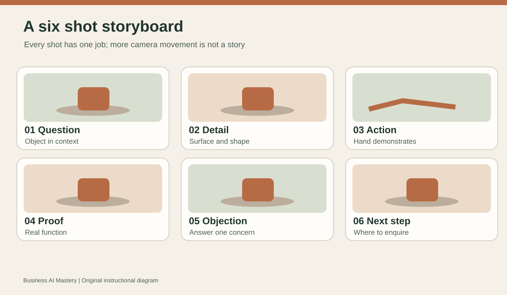

# Adobe Premiere Pro

**What you will be able to do:** Build a repeatable marketing video editing project.

> **Updated:** 20 November 2026. Interface, account access and available models can change.



*Original instructional artwork. Diagram labels are conceptual, not screenshots of a vendor interface.*

## Core guidance from the expanded handbook

*Professional editorial timeline and transcript based work*

### Where this tool earns its place

Premiere is useful for longer commercial edits, documentary material and caption production. Its speech to text tools help editors find lines and produce captions, but automatic transcription still needs human correction.

### Before the first prompt

Create a project, establish scratch disk locations, import the camera originals and organise footage. Transcribe spoken audio in the supported language, review the transcript against the recording, and mark the best lines before making picture cuts.

### A complete business exercise

Assemble a customer education video from interview footage, practical demonstration and charts. Use a verified script and locate the matching real statements in the transcript. Build a clean timeline, add restrained lower thirds, correct subtitles and export a reference review file. Only after approval should you make social variations.

### Copy ready prompt for this tool

> Review this interview transcript as an editor. Identify the best passages for a two minute explanation of choosing a home appliance. Give timestamps, topic, factual claims that need manufacturer confirmation and proposed picture coverage from the attached shot list. Do not invent quotations. Preserve the interviewee’s intended meaning when selecting short excerpts.

### When the result is weak

When automated captions mistranscribe names, fix the text and timing manually. If the cut is visually busy, remove effects until the audience can follow the explanation. For noisy audio, prioritise intelligibility over artificial smoothness.

### Human editorial finish

Keep the speaker’s individual way of explaining things. A real voice rarely follows a perfect equal length sentence pattern, and that difference can make the information easier to trust.

### Approval boundary and common errors

Verify source licences, interview consent, transcript accuracy and output levels.

**Official reference:** [Adobe Premiere Pro product guidance](https://helpx.adobe.com/premiere/desktop/add-text-images/insert-captions/auto-transcribe-video-using-speech-to-text.html)

## First session: from a blank workspace to a reviewable result

1. Create a project structure with folders for original footage, selects, narration, music and exports.
2. Put the approved script and transcript beside the edit so claims remain visible.
3. Create a rough cut on story and action before trying automatic edits.
4. Use supported caption and editing assistance for mechanical tasks, then inspect changes.
5. Review audio transitions, colour continuity and typography.
6. Export a version for each channel and save project files for later corrections.

## Prompt ladder: simple, evidence based and advanced

The prompts below are teaching examples. Replace fictional context with approved records. A tool that does not support freeform prompting may require you to perform the equivalent steps through its own interface.

### First pass

```text
Convert the approved 40 second script into a timeline outline with timestamps, footage needs and claims requiring verification.
```

### Revision notes

```text
For this rough cut review, identify shots that repeat the same information and suggest a smaller edit. Preserve the original interview meaning.
```

### Export audit

```text
Write a practical delivery checklist for vertical and landscape versions covering audio peaks, safe areas, subtitle accuracy, media rights and source version.
```

## What an acceptable result looks like

A testimonial should remain in the speaker’s original meaning. Editing out an important limitation to create a stronger endorsement is not a neutral creative choice.

## If the first version disappoints

If a generated edit changes the meaning of an interview, return to the original footage and rebuild the cut. If timing feels frantic, give the important demonstration more screen time.

## Human editorial finish

A real voice and clear sequence matter more than constant camera tricks. Let the product and customer question determine where the edit breathes.

## Practice assignment

Using a fictional or appropriately protected version of the case, complete **build a repeatable marketing video editing project**. Save an evidence inventory, the first draft, a precise correction request and the reviewed deliverable. Write a short comparison showing what the revision genuinely improved.

## Approval and success test

Can a reviewer trace every spoken claim to the original record and every visual asset to a known source?

## Related reading

[Prompt anatomy](../01-foundations/prompting-fundamentals.md) · [Context engineering](../01-foundations/context-engineering.md) · [Humanisation](../01-foundations/humanization.md) · [Reference index](../06-reference/sources-and-updates.md)

## Editorial lab: edit the story, not just the timeline

Premiere Pro suits projects with multiple cameras, long interviews, captions and a repeatable delivery workflow. Start with a paper edit. Identify the exact claim each interview line makes, the footage that supports it, and any missing evidence. Transcript-based editing can accelerate locating spoken material, but automatic captions remain draft material until checked.

**Interview exercise:** A founder explains how customers can return an item. Select the best explanation only after checking it against the current written policy. Do not splice unrelated parts together in a way that changes what the speaker meant. Add a graphic showing the exact verified timeframe if policy allows, rather than inventing a convenient number.

```text
Using the transcript and the approved returns policy, create a
90-second paper edit. Include source time codes, intended cut,
illustrating shot, on-screen text and any statements that conflict with
the policy. Preserve the speaker's meaning. Do not fabricate a sentence
by combining separate fragments, and do not put words in the speaker's
mouth. End with a verified way for customers to find the full policy.
```

**Caption quality:** check the first and last frame of every caption, split lines according to speech, spell local names correctly and use readable contrast. Adobe documents controls for caption line length, duration and gaps, but a technical preset does not replace listening to the recording.

**Sound finishing:** remove distracting background hum where possible; preserve speech clarity and keep music subordinate. When a clip contains a genuine crowd or business atmosphere, do not erase all environmental sound merely to make it feel artificial and perfect.

**Official reference:** [Create captions in Premiere](https://helpx.adobe.com/premiere/desktop/add-text-images/insert-captions/create-captions.html).
