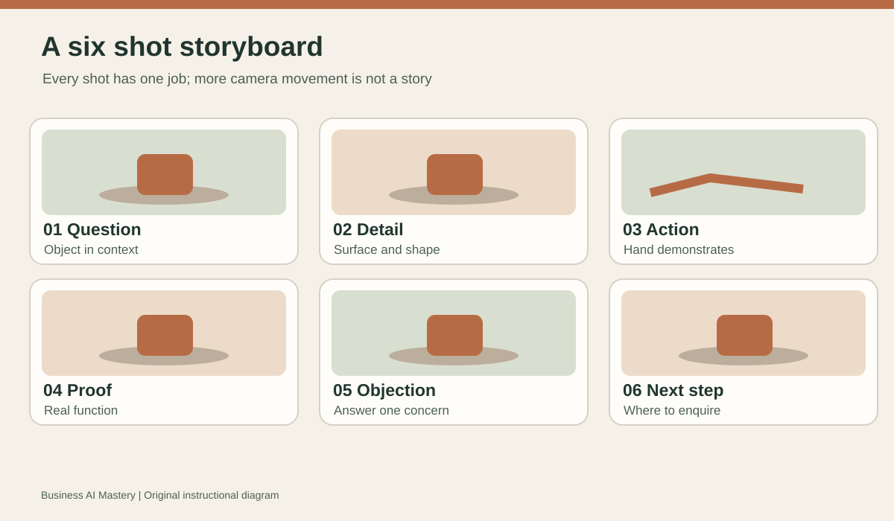

# Runway Gen 4.5 and Aleph

**What you will be able to do:** Turn an approved image into a short moving opener.

> **Updated:** 20 November 2026. Interface, account access and available models can change.



*Original instructional artwork. Diagram labels are conceptual, not screenshots of a vendor interface.*

## Core guidance from the expanded handbook

*Video generation and prompt based video editing*

### Where this tool earns its place

Gen 4.5 supports text and image led video generation. Aleph 2.0 powers targeted edits to existing footage through Edit Studio. The distinction matters: generating a new movement and changing a shot you already have are different jobs.

### Before the first prompt

For new video, write one shot with camera movement, subject action and physical setting. Use a strong approved starting frame where possible. For Aleph editing, upload footage and say which component is to change and what must remain untouched. Work in short tests before spending a full project budget.

### A complete business exercise

Make a five second opener of a neutral coffee cup as light shifts across it. Review for handle drift and shadow consistency. For a filmed shop clip, use Aleph only to clean a distracting background or adjust a targeted visual detail. Cut the approved shot into an ordinary editing timeline with real product footage and captions.

### Copy ready prompt for this tool

> Generate a five second clip from the supplied concept frame. Static camera at counter height. A hand enters from the left and places a ceramic cup in the middle of a wooden table. Soft window light from the right remains constant. The cup shape stays unchanged. Realistic contact shadow, natural hand speed. No camera orbit, morphing surface, floating objects, logo or text.

### When the result is weak

If the cup warps, simplify to one action and hold the shot shorter. If there is a sudden camera sweep, explicitly say the camera remains locked. With edits, use preservation constraints and inspect the modified area frame by frame.

### Human editorial finish

Most memorable business video comes from the thing actually happening. Add a real voice or real interaction rather than a parade of glamorous but disconnected clips.

### Approval boundary and common errors

Generated clips can show impossible action. Avoid portraying simulated testimony or events as documentary records.

**Official reference:** [Runway Gen 4.5 and Aleph 2.0 product guidance](https://help.runwayml.com/hc/en-us/articles/52150503729171-Aleph-2-0-Prompting-Guide)

## First session: from a blank workspace to a reviewable result

1. Write the action as a single observable event, not a theme or broad mood.
2. For generation, prepare the start frame and specify subject movement, camera behaviour and duration.
3. For edits to existing footage, describe one change and what must remain untouched.
4. Run a short test before producing variations.
5. Inspect the first, middle and final frames for continuity and physical consistency.
6. Place approved footage into an ordinary editing timeline with truthful captions and sound.

## Prompt ladder: simple, evidence based and advanced

The prompts below are teaching examples. Replace fictional context with approved records. A tool that does not support freeform prompting may require you to perform the equivalent steps through its own interface.

### First pass

```text
Storyboard three five second product openers with no dialogue. Each shot must use a single movement that reveals a useful product feature.
```

### Video prompt

```text
Five seconds. Fixed camera at counter height. A person’s hand enters left and sets down a plain ceramic cup. Natural window light from the right; unchanged cup geometry; visible contact shadow; no orbit, morph or text.
```

### Edit prompt

```text
Using this recorded shot, remove the distracting object in the back corner only. Keep the speaker, product, camera movement and original action intact. Compare before and after frames.
```

## What an acceptable result looks like

The first frame shows an empty counter; the hand places the cup; the last frame holds on the product long enough to read its silhouette. A sudden camera orbit adds spectacle but little explanation.

## If the first version disappoints

If the cup changes shape, shorten the action or use the filmed original. If the camera moves when it should not, repeat “locked camera” and remove cinematic movement instructions.

## Human editorial finish

Use the movement a real employee would make. Let natural timing and location sound keep the moment believable.

## Practice assignment

Using a fictional or appropriately protected version of the case, complete **turn an approved image into a short moving opener**. Save an evidence inventory, the first draft, a precise correction request and the reviewed deliverable. Write a short comparison showing what the revision genuinely improved.

## Approval and success test

Does a person watching without the prompt understand the action and identify any visual inconsistency?

## Related reading

[Prompt anatomy](../01-foundations/prompting-fundamentals.md) · [Context engineering](../01-foundations/context-engineering.md) · [Humanisation](../01-foundations/humanization.md) · [Reference index](../06-reference/sources-and-updates.md)

## Shot lab: separate generation, alteration and editing

A new generated scene and an alteration to filmed material are different operations. Runway's Gen 4.5 is documented for video generation; Aleph 2.0 offers controlled editing of existing footage through the relevant experience. First decide whether you need evidence of a real business event. If yes, film it. If you need a conceptual transition, a generated insert may be appropriate.

**Create a four-shot board before any generation:** the actual worker preparing a product, a close view of the hand action, an atmospheric insert and an honest closing frame with business details added in editing. Generate only the insert if the other three shots can be filmed. This preserves credibility and avoids paying to reconstruct things that already exist.

```text
Using the approved first frame: five seconds, one continuous shot.
Locked camera at table height. The linen curtain moves slightly in a
natural breeze. Sunlight shifts across a wooden counter; an empty
ceramic bowl remains motionless throughout. No camera movement, no
person enters, no object transforms, and the bowl's shape and texture
stay consistent. This shot will be an atmospheric transition inside a
video made primarily from real footage.
```

**Diagnostic review.** Scrub frame by frame at the start and end. Look for disappearing objects, changes in scale, impossible shadows and repeated motion. A problematic five-second clip cannot be rescued by adding speed ramps or a filter. Regenerate with a simpler action or replace with recorded footage.

**Real-life edit example.** If a sign in the background of an approved filmed scene is distracting, ask an editing tool to change that region alone and preserve the speaker, original movement, product and timing. Compare before and after. Do not edit documentary footage in a way that changes the meaning of what happened.

**Official reference:** [Gen 4.5 guide](https://help.runwayml.com/hc/en-us/articles/46974685288467-Creating-with-Gen-4-5) and [Aleph 2.0 prompting](https://help.runwayml.com/hc/en-us/articles/52150503729171-Aleph-2-0-Prompting-Guide).
