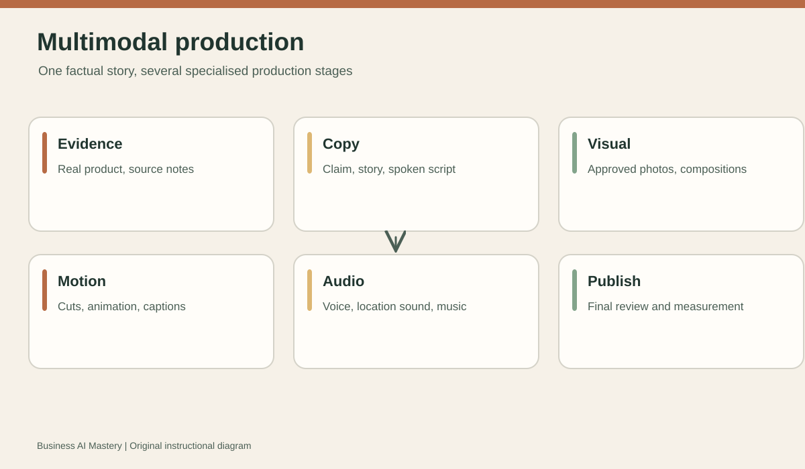

# Google Veo and Gemini Omni

**What you will be able to do:** Plan a short scene where video and sound agree.

> **Updated:** 20 November 2026. Interface, account access and available models can change.



*Original instructional artwork. Diagram labels are conceptual, not screenshots of a vendor interface.*

## Core guidance from the expanded handbook

*Multimodal video and sound creation*

### Where this tool earns its place

Gemini Omni 1.2 Flash was introduced in November 2026 with up to 15 second video creation and reference driven workflows. Veo 3.1 remains available in certain Google Flow experiences, with model changes announced for December 2026. The editor should choose the supported model within Flow or Gemini rather than assume all controls are identical.

### Before the first prompt

Build a short shot plan before prompting. Identify the subject reference, movement reference, intended sound, camera and duration. In Flow or the available video interface, choose the appropriate model and upload permitted references. Keep spoken words separate from the scene description.

### A complete business exercise

For a training clip, create an illustrative five to ten second scene showing a general process that cannot be filmed. Request one action, one camera position and restrained ambience. Do not generate a scene claiming to document a real customer, staff member or incident. Assemble it with verified narration and on screen explanations in an editor.

### Copy ready prompt for this tool

> Make a ten second illustrative workshop scene. A generic, unbranded ceramic cup is placed on a wooden shelf by an adult hand. Fixed medium camera at eye level, warm afternoon light, no movement of the camera. Quiet room ambience only, no dialogue. The cup retains its shape and colour across the full clip. This is a conceptual visual, not documentation of a real business process. No signage or subtitles inside the generated shot.

### When the result is weak

If voice or sound changes unexpectedly, make a separate audio specification. If the subject drifts, use one clean reference and reduce simultaneous actions. When model output is short, design the story as several deliberate shots rather than asking one generation to do everything.

### Human editorial finish

Let the viewer understand cause and effect. A genuinely useful training clip shows one clear operation and connects it to spoken instruction, not dramatic visuals for their own sake.

### Approval boundary and common errors

Availability, duration and audio controls depend on model and product. Follow current Google Flow help and disclosure policies.

**Official reference:** [Google Gemini Omni 1.2 Flash and Veo 3.1 product guidance](https://blog.google/innovation-and-ai/technology/developers-tools/introducing-gemini-omni-1-2-flash/)

## First session: from a blank workspace to a reviewable result

1. Check which Google video model is available in the actual Flow, Gemini or API experience.
2. Decide whether the scene requires generated video with sound or a separately recorded voice.
3. Write a short storyboard with exact visual action, environment sound and speech.
4. Supply a reference frame only for elements it should control.
5. Review the visual continuity and every spoken word.
6. Finish the production in a timeline editor, correct captions and add any required synthetic media label.

## Prompt ladder: simple, evidence based and advanced

The prompts below are teaching examples. Replace fictional context with approved records. A tool that does not support freeform prompting may require you to perform the equivalent steps through its own interface.

### First pass

```text
Create a shot plan for a 10 second explanatory scene showing a ceramic maker putting a cup on a shelf. Write the visual and audio requirements separately.
```

### Video instruction

```text
Warm indoor daylight, medium fixed shot, one person places a plain cup on a wooden shelf. Natural shelf contact sound; soft room tone; no background dialogue, text or dramatic camera movement.
```

### Review

```text
Inspect the generated scene for cup shape consistency, contact with the shelf, audio timing and any invented dialogue. Provide only changes supported by the storyboard.
```

## What an acceptable result looks like

An environment sound should match the action, not be louder or more dramatic than it would be in the room. A voiced advertisement can be added later if precise pronunciation and claims matter.

## If the first version disappoints

When sound and motion disagree, simplify the action and create separate audio. If speech is unintelligible, use a separately approved recording rather than accepting guessed words.

## Human editorial finish

A natural room tone and a carefully spoken sentence often connect better than theatrical music and overproduced effects.

## Practice assignment

Using a fictional or appropriately protected version of the case, complete **plan a short scene where video and sound agree**. Save an evidence inventory, the first draft, a precise correction request and the reviewed deliverable. Write a short comparison showing what the revision genuinely improved.

## Approval and success test

Are video and audio accurate to the depicted action, and is disclosure addressed before publication?

> **Model detail:** Gemini Omni and Veo are different model paths with different controls, limits and availability. Follow the selected product documentation.

## Related reading

[Prompt anatomy](../01-foundations/prompting-fundamentals.md) · [Context engineering](../01-foundations/context-engineering.md) · [Humanisation](../01-foundations/humanization.md) · [Reference index](../06-reference/sources-and-updates.md)

## Film lab: generated audiovisual scenes and honest speaking avatars

Veo 3.1 can be used in supported Google tools for generated video with sound, while Gemini Omni in certain Google experiences supports other video creation and editing workflows. These are not interchangeable buttons available to every account. Confirm the product, region, plan and permissions first. A strong video prompt aligns spoken words, visible action, duration and sound design.

```text
A fictional coffee shop training scene, six seconds. Medium close-up of
hands placing a clean ceramic cup under an espresso machine. Ambient
room sound: quiet coffee shop with a gentle machine hum. One visible
action only: the worker aligns the cup and presses a button. No
customer faces, no brand logo, no dialogue, no additional hands and no
jump cut. Camera stays fixed. The sequence is an illustrative training
concept, not evidence of a real staff member or shop procedure.
```

**For spoken videos**, write the exact transcript separately from the visual direction. Use simple sentences and allow enough seconds for natural speech. Verify pronunciation and synchronisation. For a genuine employee announcement, a real recording is normally the clearest and most trustworthy choice. If using a personal avatar, establish explicit consent and do not mislead viewers about who spoke or where the recording occurred.

**Shot continuity.** Preserve the main subject, clothing, lighting and physical layout across successive scenes. Use a reference image only if you have appropriate rights to it. Keep generated sounds separate from factual assertions: a machine hiss does not prove that the real machine works.

**Official references:** [Veo 3.1](https://blog.google/innovation-and-ai/technology/developers-tools/veo-3-1-gemini-api/) and [Google Vids with Gemini Omni](https://blog.google/products-and-platforms/products/workspace/gemini-omni-personal-avatars/).
