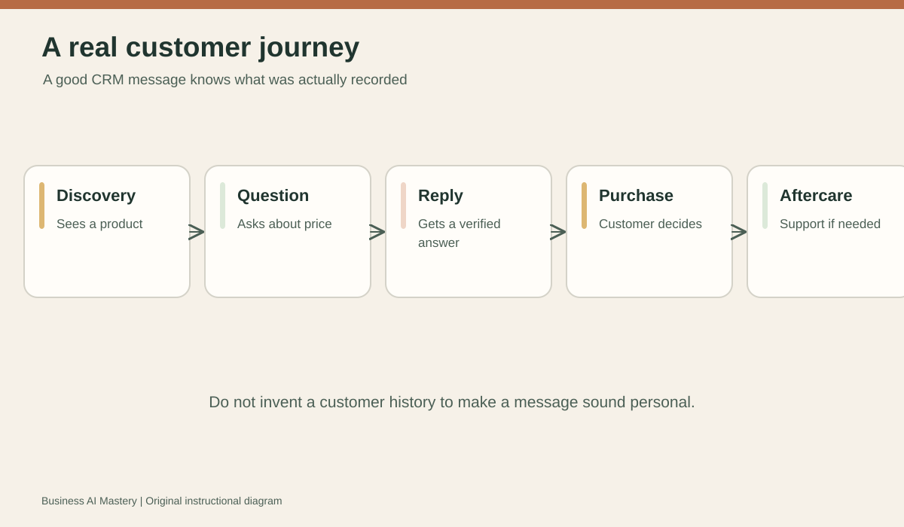

# A customer service and sales follow up system

> **Updated:** 20 November 2026. Interface, account access and available models can change.



*Original instructional artwork. Diagram labels are conceptual, not screenshots of a vendor interface.*

## Define the real journey

A customer asks about an item, receives a response, decides whether to purchase and may need support. The CRM should record each step without invented preferences. Review permission and opt out status before sending further messages.

### Sample record

```text
Contact ID: SAMPLE-007 (fictional)
Enquiry date: 18 November 2026
Question: Does the basket come in a smaller width?
Verified source: Catalogue v4 lists 30 cm and 40 cm widths.
Consent status: Permission to reply to this enquiry only.
```

### Prompt to draft the reply

```text
Answer the recorded question in fewer than 85 words. Use the approved catalogue only. Explain the two listed widths without guessing stock, delivery or the customer’s preferred size. Finish with one useful clarifying question. Do not send the message.
```

A good draft would offer measurements and ask whether the customer wants the smaller size. A weak draft would claim the customer is a valued repeat buyer or announce an invented discount.

### Escalation

Unclear warranty, payment dispute, damaged goods and sensitive information require policy review or a human decision. An automated answer should say it cannot confirm a detail rather than invent one.

**Exit test:** Staff can point to the question and the approved source behind each sentence of the proposed response.

## What to retain for the next cycle

Preserve the source interaction, consent status, proposed message, approval and actual send record separately. Correct the CRM stage only after the source event is verified.

[Return to the index](../README.md) · [Case studies](../05-real-world-examples/complete-campaign.md)

## The difference between a contact list and a relationship

A CRM is useful because it records actual interactions and next steps. Before classifying customers, choose a purpose and a lawful basis for using the data. Avoid collecting personal details merely because an automated tool makes them easy to store. A public training exercise should use fictional names and no contact information.

**Pipeline example:** an enquiry moves from `new` to `qualified` only when agreed criteria are met; it moves to `proposal` when a specific proposal was actually sent. A model's guess that someone is *very interested* is not a completed interaction. Preserve source dates and let missing records remain missing.

```text
Inspect the fictional opportunities table. Identify records with no
logged next step, inconsistent stage values and overdue follow-ups.
Draft a recommended queue with reason and source fields. Do not invent
customer intent, demographic attributes, consent or conversations.
Prepare messages only for records the owner explicitly approves.
```

**Editorial review:** a useful follow-up refers to the actual question. *You asked whether the larger cabinet fits a 90 cm wall. Here are its verified dimensions* helps more than *We are excited to unlock the next stage of your journey*. Check that the reply is authorised, accurate and appropriate for the channel before sending.
