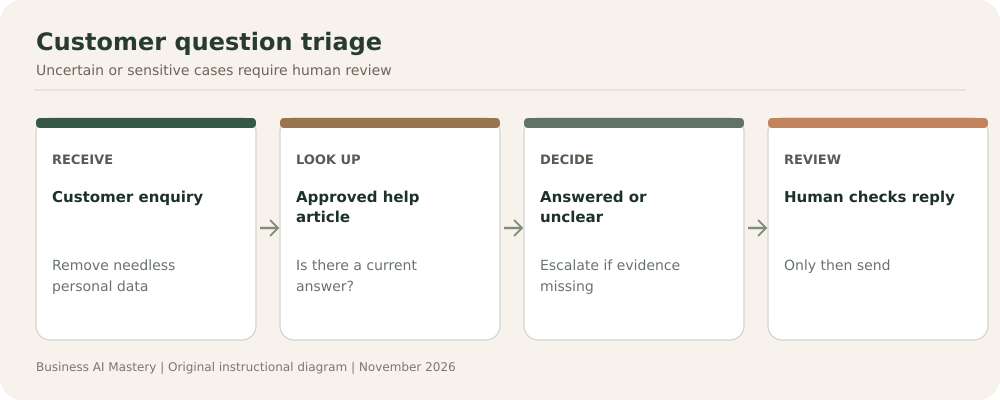
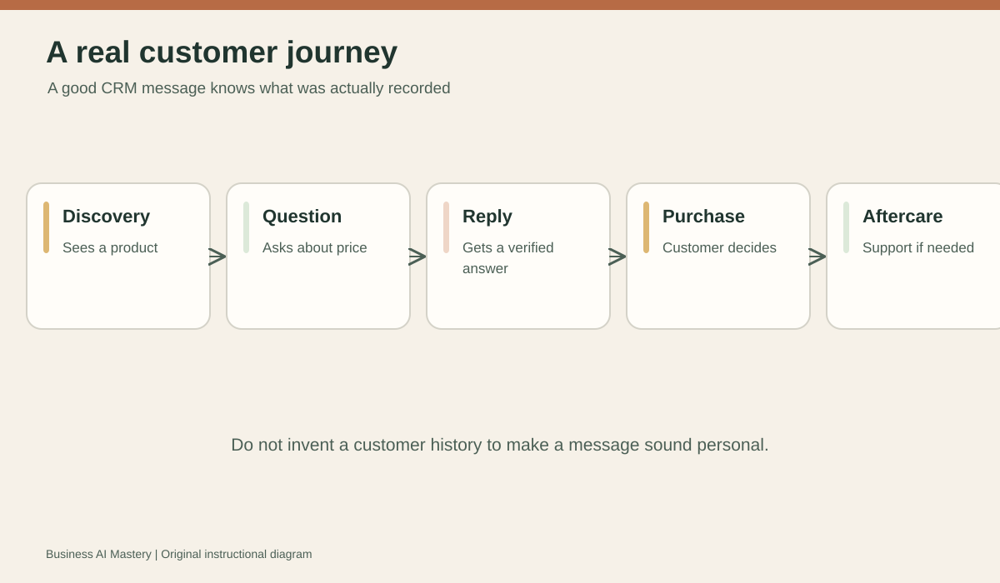

# Customer support with grounded replies and safe escalation






Automation can reduce repetitive writing, but service quality depends on whether the response is accurate for the customer's specific issue. Build an answer library with approved policies, owner, effective date and escalation criteria. Train staff to ask for the minimum information necessary and use secure channels for identifiers.

## Build a case taxonomy

Useful categories may include product information, opening hours, delivery status, damaged product, refund request, payment issue and complaint. For every category write the source of truth, first reply, permissible action, forbidden promise, escalation and resolution evidence.

## Sample conversation, fictional

Customer: *I ordered a lamp, but the box arrived crushed. Can you refund me today?*

Poor drafted response: *Absolutely. We guarantee a full instant refund, and we are thrilled to help.*

Safer draft: *I'm sorry the parcel arrived damaged. Please use our secure order form so the team can locate the purchase. We will review it against the current returns policy before confirming the next step.* This is appropriate only if that secure process and policy actually exist.

```text
Draft a reply using only the attached current returns policy. The
customer says the parcel arrived damaged and asks for an immediate
refund. Acknowledge the report, request only the next information the
policy requires, explain the review step and avoid a guarantee the
policy does not allow. Mark the draft unsent and include an internal
note showing which policy section supports the response.
```

## Test an automated responder

Use at least ten examples of real question types with personal information removed. Include ambiguous, emotional and adversarial requests. Score correct policy use, escalation accuracy, clarity, privacy and invented commitments. Deploy initially in review mode. Have a responsible person approve live sending and retain a way to disable the flow immediately.

[Return to workflows](../README.md)
