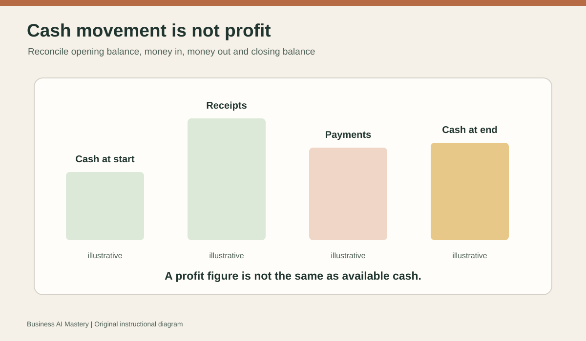

# Cash flow and overdue invoice review

> **Updated:** 20 November 2026. Interface, account access and available models can change.



*Original instructional artwork. Diagram labels are conceptual, not screenshots of a vendor interface.*

## Before requesting an explanation

Use reconciled accounting records, not screenshots of a bank balance alone. Confirm the reporting month, opening and closing cash, payment reversals, invoice status and currency. Cash movement, profit, tax liability and sales are different concepts.

### Worked arithmetic

This fictional business starts with UGX 5,000,000, receives UGX 3,400,000 from customers and pays UGX 4,100,000 to suppliers and other expenses. Ending cash is UGX 4,300,000. The movement is negative UGX 700,000. Nothing here establishes profit because purchases can involve inventory, timing differences and other accounting treatment.

```text
From the reconciled ledger, produce a cash movement table for the stated month. Show opening balance, each inflow and outflow category and ending balance. Flag anything uncategorised. Do not present this as profit, and do not make tax recommendations.
```

### Overdue receivables

Group open invoices by their verified due dates, exclude void or already paid items and inspect credit notes. Draft reminders only after confirming a payment has not arrived. A person should approve all messages and any adjustment to balances.

### Decision memo

Record short term cash requirements, major unconfirmed receipts, spending commitments and questions for an accountant. Do not build a precise cash forecast from unreliable transaction records.

**Exit test:** Opening cash plus net movements matches closing cash, with identified reconciliation differences.

## What to retain for the next cycle

Retain the reconciled statement, ageing report, assumptions table and approved action note. Keep private invoice details out of public examples and seek qualified review for statutory treatment.

[Return to the index](../README.md) · [Case studies](../05-real-world-examples/complete-campaign.md)

## Example monthly cash meeting

The fictional owner has a bank reconciliation, an accounts-receivable ageing report and a list of bills due. Start by checking that the documents use the same cut-off date. A receivable is a customer debt; it is not cash already in the bank. A payable is a commitment; its timing and amount should be verified before projecting a shortfall.

```text
Using the reconciled bank balance, approved outstanding invoice list
and bills due for the same reporting cut-off, prepare a 30-day cash
calendar. Show opening cash, dated expected collections, confirmed
payments and closing cash under each stated assumption. Create a
second scenario where overdue invoices arrive one week later.
Do not count an unconfirmed collection as guaranteed cash, invent
tax obligations or silently convert currencies.
```

**Reconciliation example, fictional:** opening cash UGX 9,000,000, confirmed receipts UGX 4,000,000 and confirmed payments UGX 5,500,000 would yield closing cash of UGX 7,500,000 before other transactions. This is a cash arithmetic illustration only. It says nothing about the company's net income. Use an accountant to review tax or statutory treatment.

**Human report:** *If two large customers pay after their due dates, the current supplier schedule may need review* is a sensible conditional observation if supported. It is more honest than claiming a precise liquidity crisis from incomplete records.
