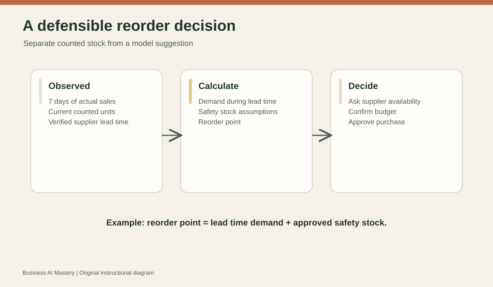

# Inventory, purchasing and supplier decisions



An owner can use a reasoning model to inspect stock movement, but the purchasing decision is grounded in actual supplier information and physical stock counts. Begin with a consistent item code and a snapshot date. A sales report from October cannot directly establish today's remaining stock without receiving, transfers, loss, returns and current counts.

## Required data and definitions

Prepare a table containing `SKU`, `product`, `opening stock`, `receipts`, `units sold`, `returns`, `adjustments`, `closing count`, `lead time`, `unit cost` and `supplier`. Ensure that sales and purchases use the same units. One case of bottles is not one bottle. Keep out-of-stock days separately because low sales may reflect unavailability rather than weak demand.

**Fictional exercise:** one item opened with 40 units, received 20, sold 34 and had 2 damaged units removed. Expected closing count is 24, subject to any additional adjustments. If the physical count is 21, that discrepancy must be investigated before recommending a replenishment quantity.

```text
Audit the attached fictional stock sheet. Reconcile expected closing
quantities to physical counts by SKU. Separate missing and overage
units, and note where stockouts might make sales-based demand estimates
misleading. Show reorder calculations only if supplier lead time,
minimum order quantity, available cash and expected demand are given.
Draft questions for the inventory manager; do not place orders or
invent supplier promises.
```

## Supplier comparison

Compare quoted purchase cost, tax, freight, payment terms, delivery reliability, minimum quantities, return policy and lead time. Do not rank a supplier using headline unit cost alone. For critical stock, consider risk of supplier failure and whether a second source is approved. Sensitive vendor pricing should remain in the authorised business system rather than a public demonstration.

## Approval and quality checks

A good AI-assisted procurement note contains the calculation, underlying records, identified unknowns and one proposed next action. It never silently places an order. A person should check the physical count, verify pricing and ensure the purchase fits the budget.

[Return to workflows](../README.md)
