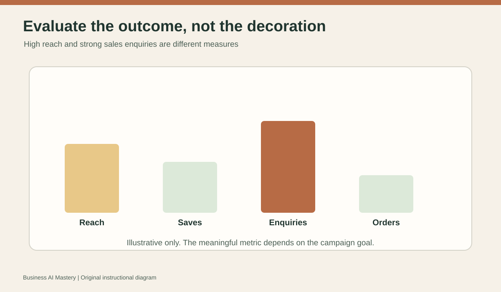

# One measured marketing campaign

> **Updated:** 20 November 2026. Interface, account access and available models can change.



*Original instructional artwork. Diagram labels are conceptual, not screenshots of a vendor interface.*

## The brief comes first

An imaginary craft studio wants more enquiries about its weekend workshops. Its approved facts are the workshop dates, location, capacity, fee and booking contact. Do not invent attendance, reviews or benefits.

### Make three distinct angles

One explains what people will make. Another answers a practical question about what to bring. A third shows the workspace using genuine authorised images. These are different jobs, not three rewrites of one slogan.

```text
Using the attached approved workshop brief, propose three campaign angles. For each name the customer question, central message, proof asset, one headline, target channel and what is still unknown. Do not draft final advertising until the facts are approved.
```

### Produce deliberately

A poster needs a specific title and readable booking route. A reel should show an actual step of the workshop. A carousel can explain materials and timing. A WhatsApp note should be direct and suitable for people who have agreed to receive updates.

### Measure

Define an enquiry, record where it came from and whether it became a booking. Do not claim an image “increased sales” because it gained views. Compare results only when the audience and distribution are reasonably comparable.

**Exit test:** Every asset points to the same approved dates, fees and contact details.

## Evidence driven campaign improvement

### Recipe A: turning scattered information into a source based article

Begin with a question that has a real audience. Suppose a community training group wants to explain how to evaluate a used smartphone. Write down the reader’s likely concerns: condition, battery, storage, price, proof of ownership and whether the device works with their needs. This is an audience map, not yet an article. Ask a research assistant to identify the authoritative sources for any technical claim, including manufacturer information, consumer guidance and relevant official requirements. Save every link and date.

Create an evidence table containing claim, supporting document, relevant passage and uncertainty. Remove claims that cannot be checked or narrow their wording. Decide the article’s actual argument: a buyer should perform a small set of practical checks rather than relying only on outward appearance. Structure the article around those checks. Use a writing model to draft one section at a time, telling it which evidence supports each section. Finally ask a different editing pass to spot repeated phrases, missing reader questions and statements that sound more certain than the evidence permits.

A working instruction might say: “Write a 900 word guide for people comparing used phones. Use only the attached verified notes. Start with the reader’s decision. Explain the observable checks in plain English, and distinguish what a buyer can see from what requires a specialist. Include an example with hypothetical devices clearly labelled. Preserve citation numbers. No invented guarantee, discount or success story.” The quality control is to compare the article line by line with the evidence sheet, not merely to ask the same model whether it is accurate.

### Recipe B: making a poster that does not resemble a generated template

Gather an approved object photograph, exact words, brand colours and intended dimensions. Open an editable design tool and create a page with generous margins. Put the object at roughly half the page width to begin. Write the message in no more than one strong headline, a small factual support line and a clear action. Do not introduce several competing badges or icons. Preview at normal phone width; increase contrast before adding decorations.


If the background feels empty, do not automatically fill it. White space can show care and confidence. If the product lacks presence, change the crop or camera angle. If the headline feels weak, improve its specificity. If the result still looks like a generic advertisement, ask what is visually distinctive about the actual business: a material, a place, a hand movement, a storefront, a recognisable process. Use that instead of the default glowing patterns.

Review the design in black and white. Its hierarchy should still be clear. Then check colour accessibility and spelling. When the graphic is for a real sale, confirm price and terms with the owner on the day of approval.

### Recipe C: consistent image sets without cloning the same composition

A five image campaign needs a shared language but not five copies. Establish an anchor photograph. Write a compact visual bible specifying the object, real world scale, colour temperature, surfaces, camera character and forbidden changes. For each frame, assign a different editorial purpose. The first establishes the product. The second explains texture. The third shows use. The fourth shows detail. The fifth gives a contextual overview.

Generate each frame with the anchor or approved product assets when supported. Name the role of the image in the prompt and preserve the invariants. For example: “Frame three of five. Keep the same cup, handle and glaze. A real hand lifts it over a pale wooden table. Soft daylight comes from the same left window. Show enough of the hand to communicate scale. No text.” If a generated image alters the product, replace it with a real photograph or a composite that uses the authentic asset.

Create a contact sheet and compare all frames together. Check that the product identity remains intact while cropping, distance and purpose vary. Correct the set with a common colour treatment in an editor, not by hoping each generation independently arrives at the same colour balance.

### Recipe D: producing a voiced video from verified material

Build an audio script before asking a tool to animate anything. Read it aloud and time the actual reading. Divide it into beats: question, explanation, demonstration and action. Prepare a storyboard with a matching real or illustrative shot for each beat. Gather any approved photographs, footage and music rights. Choose a voice whose tone fits the content and test pronunciation of every name before generating the full narration.


For a fictional instructional video, generate the visual clip that cannot be filmed, but do not invent footage of real customers or an actual location. For a genuine product, film the actual product. Lay down the voice in the editing timeline, trim the shot sequence to match the meaning, then place music below the narration only when it helps. Generate captions from the final audio and correct them manually. Check that the la
## What to retain for the next cycle

Archive the fact sheet, approved photographs, creative brief, rights record, edited masters, platform-specific exports and real performance report. A later price change must trigger a cross-channel review.

[Return to the index](../README.md) · [Case studies](../05-real-world-examples/complete-campaign.md)

## Creative decisions before channel decisions

The campaign's central idea should survive without any tool name. For a fictional homeware store, a good angle might be *See the actual size before you buy.* From this angle, the product photograph shows scale, the short film demonstrates shape, the caption explains the measurement and the landing page contains verified dimensions. Each format adds something. Copying one caption everywhere does not.

### A miniature campaign brief

| Element | Fictional brief |
| --- | --- |
| Audience | Buyers comparing storage solutions |
| Question | Will it fit my shelf? |
| Proof | Actual ruler photograph and measured dimensions |
| Format | Product page, poster, short video, Q&A |
| Restriction | No invented capacity, discount or stock |
| Success measure | Product enquiries that include the intended size |

**Production gates:** approve the product record, shoot real evidence, draft content, check each format, approve claims and rights, preview on the target platform and publish. Collect actual customer questions after publishing. If people still ask for dimensions, improve the visual rather than producing more slogans.

```text
Create four distinctly useful pieces from this verified source sheet:
a concise product-page explanation, a 4:5 poster, a 20-second filmed
shot list and a three-question FAQ. Label which supplied field supports
each claim. The film must use an actual item. Leave the price blank
until confirmed. Do not create invented reviews or dramatic scarcity.
```
