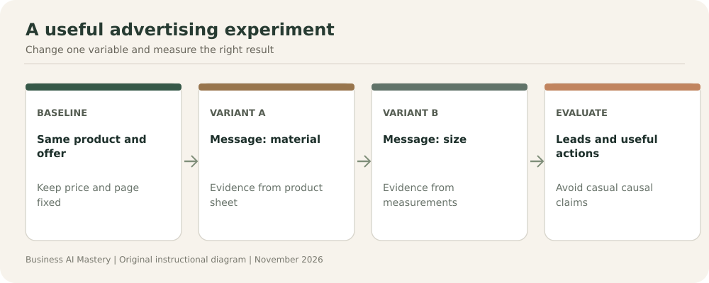

# Paid advertising and practical experiments




Paid advertising combines copy, creative, targeting, a verified offer, a landing page and measurement. A generated graphic cannot compensate for a poor destination page or inaccurate conversion tracking. Before spending money, record the business goal, eligible audience, budget ceiling, campaign dates, legal constraints and review owner.

## A controlled creative test

Suppose a fictional stationery shop wants to test two clear messages for a notebook: one emphasises paper quality, the other size and portability. Use the same verified product photograph, price, destination and relevant audience while changing only the message. A test in which the landing page, audience, image and price all change cannot isolate what caused the result.

```text
Plan an A/B creative test for one verified notebook listing.
Variant A explains the paper weight; Variant B explains the pocket
size. Produce one headline and one short body copy for each. Preserve
the exact product features and price. Define the target action as a
verified product-page visit, the observation window and what evidence
would justify a larger test. Do not guarantee performance or invent
user reviews.
```

## Understand the metrics

Reach, impressions, clicks, page visits, leads, purchases and revenue describe different events. Cost per click is not cost per acquisition. A high click rate can accompany poor sales if the advertisement overpromises. Compare results over equivalent time windows, record attribution limitations, and consider random variation before declaring one version better.

## Approval and review

Confirm that the offer exists, the product is genuinely available, the landing page loads, consent and tracking rules are followed, and the creative is legible. Save an unaltered record of the approved claim. Stop or adjust a campaign when the underlying price or availability changes.

[Return to workflows](../README.md)
