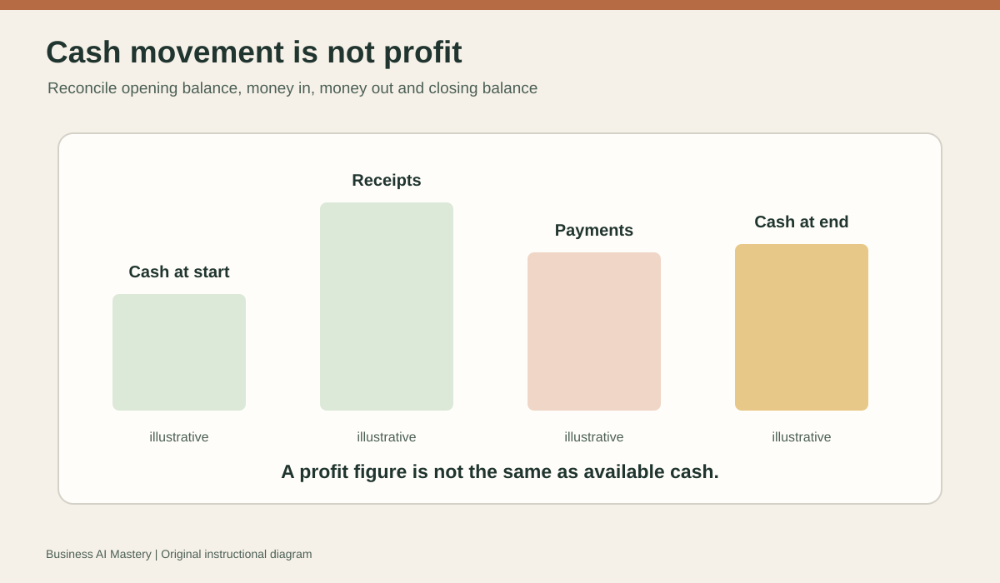

# Pricing, scenarios and forecasting without false precision



A forecast is an explicit set of assumptions, not a fact about the future. Generative models can help structure scenarios, but the owner must provide realistic costs, capacity and commercial constraints. A polished chart that hides its assumptions is more dangerous than an honest table showing uncertainty.

## Start with unit economics

For a product, define the sale price, variable cost per unit, payment fees, packaging, delivery contribution and return rate. For a service, include actual delivery time and labour costs where available. Distinguish contribution margin from gross margin, net profit and cash flow. The correct measure depends on the decision being made.

**Fictional worked arithmetic:** a product sells for UGX 40,000. Verified variable cost is UGX 25,000 per unit, plus UGX 2,000 packaging. Under these assumptions, contribution before other costs is UGX 13,000. This does not yet establish overall business profit, tax liability or customer acquisition cost.

## Build scenarios

Prepare a base case and two alternatives by changing one or two meaningful assumptions such as quantity sold, delivery cost or supplier price. Show the result as a range, not an unsupported point estimate. If the model generates historical growth rates, require the source dataset and calculation.

```text
Using the fictional price and cost sheet, calculate unit contribution,
then model low, base and high sales volumes. Show exact formulas,
assumptions and a sensitivity table for a 5% increase in variable cost.
Do not invent fixed overhead, tax rates, market demand or a precise
forecast. Mark every unresolved input and indicate what source would
be needed to improve the model.
```

## Decision rule

Before changing a price, check customer obligations, legal restrictions, inventory, competitor comparability and who may approve the change. Use a small measurable pilot where appropriate and review both conversion and customer satisfaction.

[Return to workflows](../README.md)
